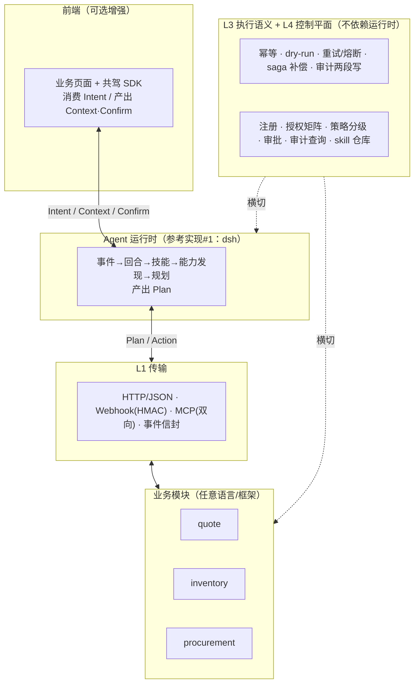

# Tenon（榫卯）

> 榫卯：不用胶水，靠结构本身严丝合缝。

**让 AI 直接操作业务系统的可插拔协议。** 业务模块按协议接入后，agent 自己发现它能做什么、自己决定怎么做——你不需要为每条业务流程写 `on 事件 → 调接口` 的胶水代码。

[](spec/0.1/README.md)
[](LICENSE)

---

## 它解决什么问题

大多数"AI + 业务系统"的做法退化成两种：要么 agent 只会聊天，要么工程师把业务流写成规则——**那还是程序驱动，只是调用方换成了 LLM**。

Tenon 划了一条可机械检验的界线：

> **接入方为了跑通业务流程，必须写「某事件/某错误 → 调某 action」的映射代码 —— 此时系统已退化为程序驱动，Tenon 在该接入点失效。**

支撑"AI 驱动"的三个机制，缺一即退化：

| 机制 | 作用 |
|---|---|
| **能力发现** | 模块插进来，agent 通过 `/.well-known/tenon` 获得新能力，不改代码 |
| **技能即知识** | 业务流程写成可审阅、可版本化的 skill 文件，教 agent 新流程只改 skill |
| **治理闸门** | 正因为不确定性是固有的，才用策略/审批/审计控风险，而不是硬编码 |

订阅事件只决定「是否思考」，绝不决定「做什么」。

## 这套界线怎么被验证

不是靠自觉，靠 **D1 差异测试**：

```
冻结同一输入（事件 + 数据快照 + 固定 skill 版本）
  跑 A：三模块全在        → Plan A 的 action 序列
  跑 B：摘掉 procurement   → Plan B 的 action 序列
断言：A ≠ B，且 B 仍达成可接受结果（改预留 / 转人工），不抛错
```

硬编码映射的实现，摘掉模块后行为**要么不变**（说明它根本没在用那个模块）、**要么崩溃**（说明映射写死了）。只有真在按能力清单推理，行为才会自适应地改变。

辅助手段是 `tools/lint` 的静态扫描（事件订阅回调里的 action 字面量、错误码→action 映射、skill 正文里的动作标识符）。

## 架构



**协议住在规范里，dsh 只是第一个宿主。** 协议层不 import 任何 dsh 类型；非 TypeScript 系统通过 HTTP 侧车接入，一样合规。

## 语言选型：按层选，不按偏好选

| 层 | 语言 | 为什么 |
|---|---|---|
| 协议线格式 | JSON Schema | 语言无关是**设计要求**，不是实现偏好 |
| dsh 宿主 | TypeScript | 硬约束：dsh 是 cordis 插件树，原生插件入口就是 JS |
| 一致性套件 + lint | **Go** | 交付形态是单文件二进制——第三方下载即自证合规，不必先装 Node/Python |
| HTTP 侧车 / demo 模块 | Go | 与套件共用一套工具链；跨进程强制走真实报文，堵住"绕过协议直接 import"的偷懒 |
| 协议类型定义 | TypeScript | 由 schema 派生，供 dsh 侧编译期使用 |

**为什么不用 Rust / C++**：本项目是 I/O 与编排密集型，零 GC 与零开销带来的收益接近于零，而 JSON Schema draft 2020-12 的生态成熟度与开发速度是实质收益。真出现热点（HMAC 验签、批量 schema 校验）再局部换语言，那是实现细节，不是选型。

**为什么 Python 不是首发**：`jsonschema` 4.x 原生支持 2020-12，生态与可读性都最好，但交付一个需要解释器的 CLI 会显著抬高接入门槛。Python 的正确位置是 M2 的 **SDK 接入示例**，不是工具链。

> 一处诚实的不确定：各语言对 draft 2020-12 的支持矩阵我没有逐条核实（本机连不上 raw.githubusercontent）。所以 Go 侧的 JSON Schema 库选型是 M0 的阻塞项，验收方式是**正反对拍**：同一份 `action.schema.json`，一条合法实例必须过、一条已知应失败的实例必须挂。

## 九类契约

| 契约 | 方向 | 关键内容 |
|---|---|---|
| [Module Manifest](spec/0.1/schemas/module-manifest.schema.json) | 模块→系统 | 摘要级自描述，不含 inputSchema（按需拉取，控上下文） |
| [Action](spec/0.1/schemas/action.schema.json) | agent→模块 | `kind`(read/write)、risk、幂等键、补偿、dry-run、配额单位 |
| [Domain Event](spec/0.1/schemas/domain-event.schema.json) | 模块→agent | 至少一次投递、可重放、causation/correlation 链 |
| [Plan](spec/0.1/schemas/plan.schema.json) | agent→系统 | DAG + `expectedDiff` + `dryRun.status` 四态，人能读懂、可回放 |
| [Intent / Context / Confirm](spec/0.1/schemas/frames.schema.json) | 双向 | 人机共驾三帧，**不含 DOM 选择器** |
| [Grant](spec/0.1/schemas/grant.schema.json) | 控制平面 | agent 能力白名单 + 配额；effective = agent ∩ 操作人 |
| [Policy](spec/0.1/schemas/policy.schema.json) | 控制平面 | `auto\|approve\|deny`；合并 `deny > approve > auto`；无命中即 deny |
| [Audit](spec/0.1/schemas/audit-event.schema.json) | 系统→存储 | 两段写（`dispatched` 先落盘才允许执行）+ `prevHash` 哈希链 |
| [Error](spec/0.1/schemas/error.schema.json) | 模块→agent | 四类：retryable / business_rejection / policy_denied / contract_violation |

## 健壮性：fail-closed

组件缺失时行为**预先定义**，且全部朝安全方向倒：

| 缺失 | 行为 |
|---|---|
| 无前端 SDK | 丢 Intent 帧，业务结果不变 |
| 无 dry-run 或 dry-run 报 unsafe | 强制审批 |
| 策略/授权服务不可用 | **deny**（不是 auto） |
| 审计 `dispatched` 写失败 | **拒绝执行** |
| 模块超时/熔断 | 从能力清单摘掉 |

## 仓库结构

```
spec/0.1/         规范：schema 是唯一真源，md 只写语义（JSON Schema）
conformance/      可执行规范：C1–C10 + D1 差异测试（Go）
tools/lint/       C10 反模式扫描器（Go）
packages/         @tenon/core 类型 + 4 个 dsh 插件 + HTTP 侧车（TypeScript）
demo/mini-erp/    quote（TS 插件）+ inventory / procurement（Go 侧车）
docs/             设计文档与架构图
```

## 当前状态

**M0 内核已跑通**：规范 10 份 schema + Go 工具链（`cmd/tenon`：一致性套件 / lint / schema 校验）+ 两个真实模块（`cmd/inventory`、`cmd/procurement`）。约 5000 行 Go，四个包全绿。

一条命令跑一致性测试（模块需先起在 8081/8082）：

```bash
go run ./cmd/tenon conformance run \
  --target http://127.0.0.1:8081 --module inventory \
  --fixtures conformance/fixtures/mini-erp.json --source-dir . --report out/report.json
```

对真实模块实测（`exit=0`，pass 6 / fail 0 / skip 3）：

| 用例 | 结果 | 断言的是什么 |
|---|---|---|
| C1 | pass | manifest 合法、摘要不含 `inputSchema`、每个 write 都有幂等声明 |
| C2 | pass | 同 `Idempotency-Key` 两次 → 响应一致、副作用一次 |
| C3 | pass | 注入未知字段 → 200 而非 400（前向兼容） |
| C8 | pass | 不支持 dry-run 的 action → 404/501 优雅降级 |
| C9 | pass | 库存不足 → 422 `business_rejection`，`retryable=false` |
| C10 | pass | 全仓反模式扫描 0 命中 |
| C4 / C5 / D1 | **skip** | 需要宿主侧端点或 LLM 规划器；**SKIP 不等于 PASS**，报告会明说不能视为整体合规 |

其它检查：

```bash
pnpm check        # 规范 schema 校验 + TS 类型检查
go test ./... -count=1
```

**还没做的**：dsh 宿主（`dsh-plugin-module-host` / governance / intent-ui / skill-biz）、`quote` 进程内模块、D1 需要的 LLM 规划器。没有 LLM 凭据之前，D1 保持 SKIP——用规则式规划器让它「通过」就是把核心命题做成假命题。

里程碑：

| 阶段 | 内容 | 出口判据 |
|---|---|---|
| M0 | schema + conformance C1–C5/C8/C9/C10 + D1 + lint + mini-erp 三模块 + module-host 插件 | D1 与 C10 全绿；注入 `dispatched` 写失败必须拒绝执行 |
| M1 | grant 矩阵 + policy 引擎 + 审批 + 审计查询/回放 + 对账 | 高风险路径必须人工；对账能发现篡改 |
| M2 | HTTP 侧车 SDK + MCP 双向 + 非 TS 示例 | 非 TS 模块跑通全套用例 |
| M3 | skill 仓库 + 轨迹蒸馏 + 发布审计/回滚 | 新流程只改 skill 即可上线 |

## 容器

三层，**只有第一层现在能跑**（细节与判据见 [docker/README.md](docker/README.md)）：

```bash
docker compose up -d docs      # 文档站 → http://localhost:8088（规范 + 架构图 + 设计文档）
docker compose run --rm spec   # 规范校验（与 CI 的 spec job 同源）
docker compose run --rm go     # Go 工具链 gofmt/vet/build（与 CI 的 go job 同源）
```

M0 的目标拓扑（`host` + `inventory` + `procurement` + `conformance` + `lint`，两段网络）在 [compose.m0.yaml](compose.m0.yaml)：
`docker compose -f compose.m0.yaml config` 现在就能过；`build` 会在 `go build ./cmd/...` 与
`pnpm run build` 处失败——**这是「代码还没写」的契约信号，不是缺陷**。

对外接口（端口分配、模块侧 6 端点、宿主侧 4 端点 + WS、请求头与 HMAC、健康探针、调用矩阵、已知缺口）：
[**docs/interfaces.md**](docs/interfaces.md)。

## 与相邻协议的关系

| | Tenon | MCP | A2A |
|---|---|---|---|
| 层次 | 业务治理与执行语义 | 工具暴露与传输 | agent 间委派 |
| 关系 | — | 互补：模块可同时以 MCP server 暴露 | v2 适配：Agent Card → Module Manifest |

## 深入

- 设计文档：[docs/superpowers/specs/2026-10-27-tenon-ai-driven-system-design.md](docs/superpowers/specs/2026-10-27-tenon-ai-driven-system-design.md)
- 规范索引：[spec/0.1/README.md](spec/0.1/README.md)
- 架构图（浏览器打开）：[docs/design-screens/](docs/design-screens/architecture-approaches.html)
- 参与贡献：[CONTRIBUTING.md](CONTRIBUTING.md)

## 许可

[Apache-2.0](LICENSE)
