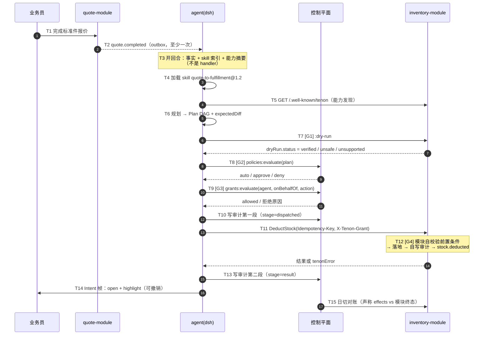

# demo/mini-erp

Tenon 纵切面演示：标准件报价完成 → 核对库存 → 扣减（或缺口转采购）。三个模块加一个共驾页面（§6.1）。

> **本目录在 M0 阶段只放文档与将要实现的三模块占位说明，不含业务代码。**
> 下面出现的 action / event 名都是规范里的名字，不是已实现的端点；实现落在 M0 计划里。

## 为什么必须是三个模块

quote 是触发器，inventory 是主路径 + 补偿，procurement 是**分支路径**。只有存在两条可能路径，才能用差异测试（D1）证明 agent 在**推理**而不是在跑流水线（§6.1、D12）。

## 模块与能力清单

| 模块 | actions | events | 用途 |
|---|---|---|---|
| quote | `CreateStandardPartQuote`、`GetQuote` | `quote.completed` | 触发器 |
| inventory | `GetStock`、`DeductStock`、`ReleaseStock` | `stock.deducted`、`stock.insufficient` | 主路径 + 补偿 |
| procurement | `CreatePurchaseRequest` | `purchase.requested` | 分支路径：库存不足时由 agent 自行选择 |

按 §4.2 的硬约束，`DeductStock` / `ReleaseStock` / `CreatePurchaseRequest` 作为 write 必须声明 `idempotency`（`keyFields` 需为 `inputSchema.required` 的子集），`DeductStock` 的补偿是 `ReleaseStock`。

## 四个闸门

| 闸门 | 落在哪步 | 含义 |
|---|---|---|
| G1 dry-run | T7 | 预演必须先跑：`unsafe` / `unsupported` → 强制审批（§8 降级矩阵） |
| G2 策略 | T8 | `policies:evaluate`；无命中即 deny（fail-closed，§4.7） |
| G3 授权 | T9 | `grants:evaluate`；`effective = agent ∩ 操作人`（D5） |
| G4 模块前置条件 | T12 | 模块自校验——「库存够不够」永远由模块判定，agent 不可绕过（§3.2 #2） |

## 时序（15 步 · 4 个闸门）

## 分支：库存不足

`DeductStock` 返回 `business_rejection / STOCK_INSUFFICIENT` 后，agent **不报错**，而是（§6.3）：

1. 重新读能力清单，发现 `procurement.CreatePurchaseRequest`；
2. 产出替代 Plan（部分履约 + 采购申请），`supersedes` 旧 Plan，标 `estimatedRisk`；
3. 若新 Plan 命中高风险策略 → `approve` 转人工；否则执行；
4. Intent 帧告诉业务员「已扣 3 件，缺口 9 件已发起采购申请 PR-…」，并且可撤销。

**规范不规定 `stock.insufficient` 对应哪个 action。** 演示中「改走采购」是由 skill 引导 agent 自行决定的，不由代码映射——这是 D1 差异测试能通过的前提（§6.1）。任何形式的「错误码 → action」映射表都会立刻让这个 demo 失去意义，并直接命中 §2.2 的反模式判据（C10 的规则 2 也会扫出来）。

同样地，`quote.completed` 只用来决定「是否开启一个回合」，不用来决定「做什么」（§2.2：订阅决定「是否思考」，不决定「做什么」）。

## D1 差异测试如何使用本 demo

D1 是 M0 的主判据，也是「AI 驱动」唯一不依赖实现方自觉的机械证明（§10.2、D13）。

1. **冻结输入**：同一 `quote.completed` 事件 + 同一库存快照（例如可用 3、需求 12）+ 固定 skill 版本 `quote-to-fulfillment@1.2.0`。
2. **跑 A**：三模块全在 → 记录 Plan A 的 action 序列。期望形态（M0 计划）：先 `inventory.GetStock`，再 `inventory.DeductStock`，缺口部分走 `procurement.CreatePurchaseRequest`。
3. **跑 B**：摘掉 `procurement` 模块再跑同一输入 → 记录 Plan B 的 action 序列。

断言：**Plan A 的 action 序列 ≠ Plan B 的 action 序列**（比结构，不比参数字符串），且 Plan B **必须不抛错**并达成可接受结果（例如改走预留 / 转人工）。

摘掉 procurement 后，Plan B 里不允许再出现 `procurement.CreatePurchaseRequest`；如果它还出现，说明能力清单没被真正读取；如果实现直接崩溃，说明「事件 → action」被写死了。两种情况都是失败。

## 交付边界

- 本目录（当前，M0 骨架阶段）：只有这份 README。三模块、页面与 skill 都还没有实现。
- M0 计划：quote / inventory / procurement 三模块服务、共驾页面（`@tenon/dsh-plugin-intent-ui` 的 demo 面板）、`quote-to-fulfillment@1.2` skill，以及「一条命令起 demo」+「D1 与 C10 全绿」的出口判据（§12）。
- 前置依赖：`spec/0.1/schemas/*.json`（线格式唯一真源，§2.1）与本目录之外的三模块实现；本文件不替代 schema。
