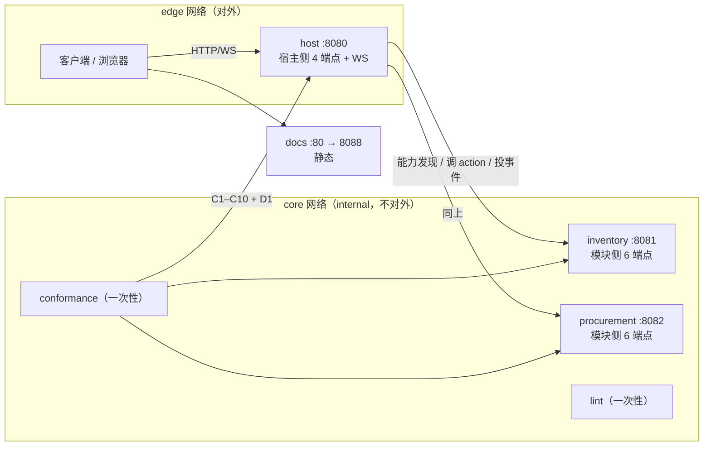

# 对外接口

> 这份文档回答一个问题：**容器边界上到底暴露了什么？** 每个端点的语义以 `spec/0.1/` 为准，这里只固定「谁在哪个端口实现它、怎么调、失败怎么办」。

## 0. 一句话

**容器边界 = 协议边界。** 一个容器要么是**模块**（实现模块侧 6 个端点），要么是**宿主**（实现宿主侧 4 个端点）。引用方只认这两套接口，不认任何容器内部实现。

---

## 1. 服务拓扑与端口

| 容器 | 角色 | 容器内端口 | 对外发布 | 实现的接口 | 状态 |
|---|---|---|---|---|---|
| `host` | 宿主：agent 运行时（dsh）+ 控制平面 + 共驾 WS | 8080 | **8080** | 宿主侧 4 + WS + 运维 | M0 契约 |
| `inventory` | 模块（Go 侧车） | 8081 | 不发布 | 模块侧 6 + 运维 | M0 契约 |
| `procurement` | 模块（Go 侧车） | 8082 | 不发布 | 模块侧 6 + 运维 | M0 契约 |
| `quote` | 模块（**TS 进程内插件**） | **无端口** | — | 进程内方法调用，不走 HTTP | M0 契约 |
| `conformance` | 客户端（一次性） | — | — | 以 HTTP 调 host 与各模块 | M0 契约 |
| `lint` | 客户端（一次性） | — | — | 只读文件，不联网 | M0 契约 |
| `docs` | 静态文档站 | 80 | 8088 | 静态 HTTP | ✅ 现在可跑 |

**`quote` 没有端口，这是有意的。** 它跑在 `host` 进程内（cordis 插件），用来证明「进程内路径」可用；`inventory`/`procurement` 走 HTTP 侧车，用来证明「跨进程真实报文」可用。两条路径各测一次，少任何一条 M0 出口判据都不完整（见 `demo/mini-erp/README.md`）。



---

## 2. 三类接口，别混

| 类别 | 例子 | 是否进协议 | 是否进一致性套件 |
|---|---|---|---|
| **协议接口** | `/.well-known/tenon`、`/tenon/actions/{id}`、`/tenon/grants:evaluate` … | ✅ 是 | ✅ 是 |
| **运维接口** | `/healthz`、`/readyz` | ❌ 否（容器约定） | ❌ 否 |
| **静态接口** | `docs` 容器的只读页面 | ❌ 否 | ❌ 否 |

本仓库早先的一处不一致已消除：`tools/lint` 与 `conformance/` 都只做协议与工具职责，运维接口不进它们的断言。

---

## 3. 模块侧接口（每个模块容器实现这 6 个）

| # | 方法 | 路径 | 语义 | 幂等 | 调用方 |
|---|---|---|---|---|---|
| 1 | `GET` | `/.well-known/tenon` | 能力发现：摘要级 manifest（**不含 inputSchema**） | 天然幂等 | 宿主 |
| 2 | `GET` | `/tenon/actions/{id}` | 拉完整 Action（含 `inputSchema`/`risk`/`idempotency`） | 天然幂等 | 宿主（命中候选后才拉） |
| 3 | `POST` | `/tenon/actions/{id}` | 执行 | **必须**由 `Idempotency-Key` 保证 | 宿主 |
| 4 | `POST` | `/tenon/actions/{id}:dry-run` | 预演，无副作用 | 天然幂等 | 宿主（G1 闸门） |
| 5 | `POST` | `/tenon/events` | **宿主 → 模块**：投递事件（Webhook） | 按 `eventId` 去重 | 宿主 |
| 6 | `GET` | `/tenon/events?since=<cursor>` | **模块 ← 宿主**：补课/重放 | 天然幂等 | 宿主 |

### 3.1 通用请求头

| 头 | 方向 | 必需 | 说明 |
|---|---|---|---|
| `Content-Type: application/json` | 双向 | ✅ | 错误的 content-type 按 `contract_violation` 处理 |
| `Tenon-Version: 0.1` | 双向 | ✅ | 双方各带自己支持的版本；不匹配且无法降级即 `contract_violation` |
| `Tenon-Min-Version` | 双向 | 可选 | 低于此版本宁可失败，也不要静默降级 |
| `Idempotency-Key` | 请求 | 写操作 ✅ | 同一键重复提交必须返回**首次结果**，绝不产生重复副作用 |
| `X-Tenon-Grant` | 请求 | 写操作 ✅ | 授权凭证；模块**必须再校验一次**（纵深防御，设计文档 §8 第 6 闸） |
| `X-Tenon-Signature` | 请求 | 事件投递 ✅ | `t=<unix>,v1=<hex>`，见 §3.4 |

### 3.2 执行与幂等

```
POST /tenon/actions/inventory.DeductStock
Idempotency-Key: tenon:pln_01JB.../s2
X-Tenon-Grant: gr-01J...
Tenon-Version: 0.1
Content-Type: application/json

{ "sku": "STD-1001", "qty": 12, "referenceNo": "Q-2026-0417" }
```

成功（200）：

```json
{ "onHand": 108 }
```

失败（业务拒绝，422）：

```json
{ "tenonError": { "class": "business_rejection", "code": "STOCK_INSUFFICIENT",
  "message": "可用 3，需求 12", "details": { "available": 3 }, "retryable": false } }
```

- 状态码与 `class` 的映射见 [`spec/0.1/errors.md`](../spec/0.1/errors.md) §5：`retryable`→503/429、`business_rejection`→422、`policy_denied`→403、`contract_violation`→400。
- **两者不一致时以响应体为准**：体是协议语义，码只是给网关/监控聚合用。
- 无响应（连接失败/超时/重置）本身就是 `retryable`，此时不要求模块给错误体。

### 3.3 dry-run 的三态

```
POST /tenon/actions/inventory.DeductStock:dry-run
→ 200 { "dryRun": { "status": "verified",
                    "diff": [ { "entity": "inventory:SKU/STD-1001", "field": "onHand", "from": 120, "to": 108 } ] } }
```

`status` 四态：`verified` / `unsafe` / `unsupported` / `pending`。
- 模块未实现该端点 → 宿主按 `unsupported` 处理（**不是错误**），并**强制审批**（fail-closed，设计文档 §8 降级矩阵）。
- `unsafe` 同样强制审批。

### 3.4 事件投递的签名

```
POST /tenon/events
X-Tenon-Signature: t=1730000000,v1=5f2c...e1
Tenon-Version: 0.1

{ "eventId": "evt_01JB...", "type": "quote.completed", "subject": {...}, ... }
```

- `v1 = HMAC-SHA256(secret, "<t>." + rawBody)`，十六进制小写。
- 校验方必须用**原始字节**计算，不能先反序列化再序列化。
- **时钟容差 ±300s**，超出即拒（防重放）。
- 消费侧按 `eventId` 去重：至少一次投递意味着可能重复。

### 3.5 补课/重放

```
GET /tenon/events?since=<cursor>&limit=100
→ 200 { "events": [...], "nextCursor": "cur_..." }
```

`since` 与 `nextCursor` 是不透明字符串，由模块定义。**不承诺全局有序**，只承诺「不漏」；乱序由消费侧的 `occurredAt` 与幂等吸收。

### 3.6 密钥取材口径（隐性约定，必须跨实现统一）

规范只规定了 HMAC 算法，**没规定密钥文件怎么取材**。两侧口径不一致时签名必然对不上，而且报错长得像"伪造报文"，极难排查。M0 锁定为：

> **密钥 = 密钥文件内容去掉首尾空白后的原始字节，不做 hex/base64 解码。**

也就是说 `openssl rand -hex 32` 产出的 64 字符文本，整体作为 key 使用（不是把它解成 32 字节）。这是**跨实现的隐性约定**，M0 两侧都按此实现；将来若要改成解码 hex，必须同时升级 `Tenon-Version` 并在 versioning.md 里写明迁移。

### 3.7 版本头的处理分档（M0 取值，已知与 versioning.md 有张力）

`versioning.md` §4.3 写「缺版本视为 0.1」，而本节表格要求 `Tenon-Version` 必需。M0 的实际取值是按**是否有副作用**分档：

| 路径 | 缺 `Tenon-Version` 时 |
|---|---|
| 执行写操作（`POST /tenon/actions/{id}`） | **400 `contract_violation`**（版本未协商就落库，会产生「状态机不同却已写入」） |
| 只读 / dry-run / 事件 | 按 0.1 宽松处理 |

头**存在且不兼容**时一律 400。这条张力应在 v0.2 规范里二选一收口，不要长期两说。

---

## 4. 宿主侧接口（`host` 容器实现这 4 个 + WS）

| # | 方法 | 路径 | 语义 | 调用方 |
|---|---|---|---|---|
| 1 | `POST` | `/tenon/grants:evaluate` | 授权评估（G3 闸门） | 宿主内部 / 诊断 |
| 2 | `POST` | `/tenon/policies:evaluate` | 策略评估（G2 闸门） | 宿主内部 / 诊断 |
| 3 | `GET` | `/tenon/audit?planId=&since=` | 审计查询（支撑 C4） | 宿主内部 / 外部审计方 |
| 4 | `WS` | `/tenon/intents` | 人机共驾三帧 | 前端共驾 SDK |
| 4b | `GET`/`POST` | `/tenon/intents/poll`、`/tenon/intents/ack` | 上面 WS 的 REST 降级 | 无 WS 的客户端 |

### 4.1 授权评估

```
POST /tenon/grants:evaluate
{ "agent": "ag_fulfillment", "onBehalfOf": "user:alice",
  "action": "inventory.DeductStock", "args": { "sku": "STD-1001", "qty": 12 } }

→ 200 { "allowed": true, "matchedGrantId": "gr-01J...", "quota": { "remaining": 88, "unit": "quantity" } }
→ 200 { "allowed": false, "reason": "QUOTA_EXCEEDED" }
```

- **不返回 403**：这是「评估」不是「执行」，拒绝也是 200 + `allowed:false`。真正的 403 由模块在收到 `X-Tenon-Grant` 后决定。
- 生效权限 = agent 被授予 **∩** `onBehalfOf` 用户的权限（决策 D5）。
- `reason` 取值：`NOT_IN_GRANT` / `EXPIRED` / `QUOTA_EXCEEDED` / `SUBJECT_NOT_PERMITTED`。

### 4.2 策略评估

```
POST /tenon/policies:evaluate
{ "plan": { ... } }

→ 200 { "outcome": "deny",  "decidedBy": [],                   "reasons": ["NO_POLICY_MATCH_DEFAULT_DENY"] }
→ 200 { "outcome": "approve", "decidedBy": ["pol-stock-deduct"], "approvers": ["role:warehouse_manager"] }
```

- `outcome` 三值：`auto` / `approve` / `deny`。
- 合并顺序 **deny > approve > auto**；同 outcome 取 `priority` 最高者。
- **无命中 = deny**（fail-closed）。
- 策略本身不可被 agent 读取或改写，只能请求评估。

### 4.3 审计查询

```
GET /tenon/audit?planId=pln_01JB...&since=<cursor>&limit=100
→ 200 { "records": [ ... ], "nextCursor": "cur_..." }
```

返回的是**两段写**的记录：同一 `auditId` 会有 `stage=dispatched` 与 `stage=result` 两条，`prevHash` 串成链（链首为 `null`）。C4 断言两段齐备且链连续。

### 4.4 共驾三帧（WS）

连接 `ws://host:8080/tenon/intents?session=<id>`，双向 JSON 帧：

```json
{ "type": "tenon.intent", "intentId": "int_01J...", "actions": [
  { "kind": "open", "target": { "module": "quote", "type": "Quote", "id": "Q-2026-0417" } },
  { "kind": "highlight", "target": { "module": "inventory", "type": "SKU", "id": "STD-1001" },
    "badge": "-12 已扣减", "undoable": true } ] }
```

```json
{ "type": "tenon.context", "view": { "module": "quote", "type": "Quote", "id": "Q-2026-0417" },
  "edits": [ { "field": "qty", "from": 10, "to": 12 } ], "at": "2026-10-27T09:15:00Z" }
```

```json
{ "type": "tenon.confirm", "confirmId": "cfm_01J...", "planId": "pln_01JB...",
  "decision": "approve", "patch": null, "by": "user:alice", "at": "2026-10-27T09:16:00Z" }
```

- **帧内没有 DOM 选择器、没有坐标**。只表达「界面应进入什么状态」。
- 前端不接入时，`intent` 帧直接丢弃，业务结果不变（设计文档 §3.2 决定 1）。

---

## 5. 调用矩阵

| 调用方 | 被调方 | 通道 | 凭据 |
|---|---|---|---|
| 宿主 | 模块 | `GET /.well-known/tenon`、`GET /tenon/actions/{id}` | 内网直连 |
| 宿主 | 模块 | `POST /tenon/actions/{id}`（+dry-run） | `Idempotency-Key` + `X-Tenon-Grant` |
| 宿主 | 模块 | `POST /tenon/events` | `X-Tenon-Signature`（HMAC） |
| 宿主 | 模块 | `GET /tenon/events?since=` | 内网直连 |
| 宿主 | 自身控制平面 | `grants:evaluate`、`policies:evaluate`、`audit` | 进程内或环回 |
| 前端 | 宿主 | `WS /tenon/intents` | 会话凭据（M1 定） |
| conformance | 宿主 + 模块 | 上述全部（只读 + 幂等写） | 测试用的专用 grant |
| lint | 文件系统 | 无网络 | — |

**注意：模块不主动调宿主。** 模块只做两件事——响应宿主的请求、在响应里给出结果；它的独立审计写**本地**（见 §9 缺口 1）。

---

## 6. 环境变量与机密

| 变量 | 用于 | 含义 |
|---|---|---|
| `PORT` | 全部服务 | 监听端口（模块默认 8081/8082，宿主 8080） |
| `TENON_VERSION` | 全部 | 实现的协议版本，必须等于 manifest 里的 `tenon` |
| `TENON_MODULE_ID` | 模块 | manifest 的 `module.id`，必须唯一 |
| `TENON_HOST_URL` | 模块 | 宿主基地址（M0 仅用于诊断；模块不主动调宿主） |
| `TENON_HMAC_SECRET_FILE` | 宿主 + 模块 | HMAC 密钥文件路径（**不要用环境变量直接传密钥**，避免进 `docker inspect`） |
| `TENON_POLICY_FILE` | 宿主 | 策略规则文件（M1 起由控制平面管理） |
| `TENON_AUDIT_PATH` | 宿主 | 审计 append-only 日志路径，需持久化卷 |
| `TENON_TARGET` | conformance | 被测实现的基地址 |

机密通过 compose `secrets:` 以文件挂载，开发期：

```bash
mkdir -p docker/secrets && openssl rand -hex 32 > docker/secrets/hmac.txt
```

`docker/secrets/` 已在 `.gitignore` 中。

---

## 7. 运维接口（非协议）

| 端点 | 语义 | 依赖检查 |
|---|---|---|
| `GET /healthz` | 进程存活 | **不检查依赖**。依赖挂了也返回 200，否则编排会误杀 |
| `GET /readyz` | 可以开始接协议请求 | 检查 manifest 可加载、HMAC 密钥可读、审计可写；任一不满足 → **503** |

这两个**不进协议、不进一致性套件**，可以自由改名——但 compose 的 `healthcheck` 要同步改。之所以单列，是因为上一版仓库里 `readyz` 的语义被含糊带过，容器化后必须钉死。

---

## 8. 暴露面与部署

- `edge` 网络：**只有 `host` 发布端口**（8080）。模块一律不发布——最小暴露面。
- `core` 网络：`internal: true`，容器出不去外网，模块只能被宿主访问。
- 生产：在 `host` 前加反向代理做 TLS 与鉴权；`host` 自身不要在公网裸奔（它持有控制平面）。
- 镜像 tag：`tenon/host:m0`、`tenon/tool:m0`、`tenon/inventory:m0` —— tag 对应里程碑，接口版本另由 `Tenon-Version` 头协商，两者不要混用。

---

## 9. 已知缺口（写在这里而不是藏起来）

1. **模块侧审计没有对账端点。** 设计文档要求「审计双写，日切对账」，但 `spec/0.1` 只定义了宿主侧的审计查询。用模块侧独立记录做对账时，宿主要么直连模块拉日志（无协议端点），要么模块反向投递（模块目前不主动调宿主）。**M1 必须补一个**（推荐：模块侧 `GET /tenon/audit?since=`，与宿主的同名同构）。在这之前，C4 只能断言宿主侧链完整，对账无法机械验证。
2. **`readyz` 的依赖清单未进协议。** 现在只是运维约定，跨实现不保证一致。
3. **`quote` 无端口带来的可观测性缺口。** 进程内模块没有独立健康检查，它的故障表现为宿主不健康。这是选择进程内路径的代价，M1 应在宿主侧为每个 in-process 模块提供 `/tenon/modules/{id}/health`。
4. **前端会话凭据未定。** `WS /tenon/intents` 现在是裸连接，M1 需要定会话票据与 `onBehalfOf` 的绑定方式。
5. **`X-Tenon-Grant` 目前在模块侧只被"承认"、不被校验。** M0 没有 grant 签发与存储，模块无法判断凭证真伪。实现选择是**不做假校验**（伪造一个"已校验"比不校验更危险），凭证校验留到 M1 的治理平面。**这意味着 M0 的双层授权只有一层。**
6. **模块 → 宿主的事件方向没有推送通道。** `POST /tenon/events` 是**宿主 → 模块**。模块产生的事件（如 `quote.completed`）要靠宿主**轮询** `GET /tenon/events?since=cursor` 拉取——协议已有该端点，语义上成立（至少一次 + 游标补课），但设计文档的时序图把它画成了 push。要么承认「事件靠轮询」，要么在 M1 加一条带 HMAC 的模块→宿主投递通道；现在两种都没写死。
7. **未知 action 返回 404 而错误体是 `contract_violation`**，与 `errors.md` §5 把 `contract_violation` 映射到 400 有出入。依 `errors.md`「以响应体为准」处理：404 是资源不存在的传输语义，体里的分类才是协议语义。这条也应在 v0.2 收口。

---

## 10. 怎么验

```bash
# 1. 当前状态就能跑的两个容器
docker compose up -d docs        # → http://localhost:8088
docker compose run --rm spec     # 规范校验
docker compose run --rm go       # Go 工具链

# 2. M0 拓扑：语法可验，构建必失败（代码还没写）——这是预期信号
docker compose -f compose.m0.yaml config
docker compose -f compose.m0.yaml build   # 预期在 go build ./cmd/... 处失败
```

M0 落地后，验收顺序是：`host` 与两个模块 `/readyz` 全 200 → `conformance` 跑 C1–C5/C8/C9/C10 与 D1 全绿 → `lint` 对仓库零命中。

### 已经验过 / 还没验过

| 项 | 状态 |
|---|---|
| `compose.yaml` 与 `compose.m0.yaml` 语法 | ✅ 两份 `config` 均 exit 0 |
| `docs` 容器 | ✅ `Up (healthy)`；`/healthz` 200 `ok`；首页与 `screens/`、`spec/schemas/` 均 200 |
| `spec` / `go` 检查容器 | ✅ 两者 exit 0（规范 11 项 0 失败；gofmt/vet/build 全通过） |
| `go-service.Dockerfile` 契约点 | ✅ 在 `go build ./cmd/inventory` 处失败（无 Go 文件） |
| `node-service.Dockerfile` 契约点 | ✅ 在 `pnpm run build` 处失败（`ERR_PNPM_RECURSIVE_RUN_NO_SCRIPT`） |
| `host` 完整镜像与端到端启动 | ❌ 未验（依赖 M0 代码） |
| 模块 ↔ 宿主 HMAC 实际握手 | ❌ 未验（同上） |
| `readyz` 的依赖探测行为 | ❌ 未验（同上） |

**上表下半部分不许当成已实现来宣称。**
