# 对外接口

> 这份文档回答一个问题：**容器边界上到底暴露了什么？** 每个端点的语义以 `spec/0.1/` 为准（外加 [`spec/0.1/CHANGELOG.md`](../spec/0.1/CHANGELOG.md) 里 `0.2.0` 提案记录的三处扩展），这里只固定「谁在哪个端口实现它、怎么调、失败怎么办」。

## 0. 一句话

**容器边界 = 协议边界。** 一个容器要么是**模块**（实现模块侧 6 个端点），要么是**宿主**（实现宿主侧端点，清单见 §4），要么是**纯客户端**（`agent` / `conformance` / `lint`，不实现任何协议端点）。引用方只认这两套接口，不认任何容器内部实现。

---

## 1. 服务拓扑与端口

| 容器 | 角色 | 容器内端口 | 对外发布 | 实现的接口 | 状态 |
|---|---|---|---|---|---|
| `host` | 宿主：控制平面（策略 / 授权 / 审计链 / 注册表）+ 共驾帧 REST 中转 | 8080 | **8080** | 宿主侧 8 个（§4）+ 运维（§7） | ✅ 已实现（`cmd/host`） |
| `agent` | agent 运行时（**纯客户端**） | 无 | — | 不实现任何端点 | ✅ 已实现（`cmd/agent`） |
| `quote` | 模块（Go 侧车，数据流第一跳） | 8083 | 不发布 | 模块侧 6 + 运维 | ✅ 已实现（`cmd/quote`） |
| `inventory` | 模块（Go 侧车） | 8081 | 不发布 | 模块侧 6 + 运维 | ✅ 已实现（`cmd/inventory`） |
| `procurement` | 模块（Go 侧车） | 8082 | 不发布 | 模块侧 6 + 运维 | ✅ 已实现（`cmd/procurement`） |
| `conformance` | 客户端（一次性） | — | — | 以 HTTP 调宿主与模块 | ✅ 可跑（C4/C5 需 `--host`） |
| `lint` | 客户端（一次性） | — | — | 只读文件，不联网 | ✅ 可跑 |
| `docs` | 静态文档站 | 80 | 8088 | 静态 HTTP | ✅ 可跑 |

**`quote` 是 Go 侧车，不是进程内插件。** 设计文档最初把它规划为 TypeScript 的 cordis 插件，用来验证「进程内路径」；本轮宿主选了 Go（决策 A），仓库里没有 TS 宿主，所以进程内路径整体 **deferred**（设计增量 §7 的 D18 修订）。同一件事不要在两处说成不同样子：现在三条模块路径都是跨进程 HTTP，没有一条进程内路径被覆盖。

```mermaid
flowchart LR
    subgraph edge["edge 网络（对外）"]
        C["客户端 / 浏览器 / 业务系统"]
        H["host :8080<br/>宿主侧 8 端点"]
        A["agent（无端口）<br/>纯客户端"]
    end
    subgraph core["core 网络（internal，不对外）"]
        Q["quote :8083<br/>模块侧 6 端点"]
        I["inventory :8081<br/>模块侧 6 端点"]
        P["procurement :8082<br/>模块侧 6 端点"]
        CF["conformance（一次性）"]
        LN["lint（一次性）"]
    end
    D["docs :80 → 8088<br/>静态"]

    C -->|"HTTP"| H
    C --> D
    A -->|"注册表 / 闸门 / 审计 / 帧"| H
    A -->|"能力发现 / 执行 / 轮询发件箱"| Q
    A -->|"同上"| I
    A -->|"同上"| P
    CF -->|"C1–C10（C4/C5 需 --host）"| H
    CF --> I
    LN -->|"只读源码"| LN
```



**注意方向：宿主不调模块。** 能力发现与执行都由 `agent` 发起；宿主只回答闸门、审计与注册表三类问题。这条与 M0 的调用矩阵不同（旧版写的是「宿主 → 模块」），以本节为准。

---

## 2. 四类接口，别混

| 类别 | 例子 | 是否进协议 | 是否进一致性套件 |
|---|---|---|---|
| **协议接口** | `/.well-known/tenon`、`/tenon/actions/{id}`、`/tenon/grants:evaluate` … | ✅ 是 | ✅ 是 |
| **测试面** | `/tenon/admin/modules`、`/tenon/admin/reset` | ❌ 否（仅测试态挂载） | ❌ 否 |
| **运维接口** | `/healthz`、`/readyz` | ❌ 否（容器约定） | ❌ 否 |
| **静态接口** | `docs` 容器的只读页面 | ❌ 否 | ❌ 否 |

本仓库早先的一处不一致已消除：`tools/lint` 与 `conformance/` 都只做协议与工具职责，运维接口不进它们的断言。

---

## 3. 模块侧接口（每个模块容器实现这 6 个）

| # | 方法 | 路径 | 语义 | 幂等 | 调用方 |
|---|---|---|---|---|---|
| 1 | `GET` | `/.well-known/tenon` | 能力发现：摘要级 manifest（**不含 inputSchema**） | 天然幂等 | agent |
| 2 | `GET` | `/tenon/actions/{id}` | 拉完整 Action（含 `inputSchema`/`risk`/`idempotency`） | 天然幂等 | agent（需要细节时才拉） |
| 3 | `POST` | `/tenon/actions/{id}` | 执行 | **必须**由 `Idempotency-Key` 保证 | agent |
| 4 | `POST` | `/tenon/actions/{id}:dry-run` | 预演，无副作用 | 天然幂等 | agent（G1 闸门） |
| 5 | `POST` | `/tenon/events` | **宿主/外部 → 模块**：投递事件（Webhook） | 按 `eventId` 去重 | 本里程碑**无调用方**，见 §3.4 |
| 6 | `GET` | `/tenon/events?direction=in\|out&since=&limit=` | 补课 / 重放；`direction` 选事件表 | 天然幂等 | agent（只读 `out`） |

### 3.1 通用请求头

| 头 | 方向 | 必需 | 说明 |
|---|---|---|---|
| `Content-Type: application/json` | 双向 | ✅ | 头**存在**且非 JSON 按 `contract_violation` 处理；头缺失按 JSON 处理 |
| `Tenon-Version: 0.1` | 双向 | 写操作 ✅ | 写路径缺头即 400（见 §3.7）；只读/预演/事件缺头按 0.1 宽松处理 |
| `Tenon-Min-Version` | 双向 | 可选 | 低于此版本宁可失败，也不要静默降级 |
| `Idempotency-Key` | 请求 | 写操作 ✅ | 同一键重复提交必须返回**首次结果**，绝不产生重复副作用 |
| `X-Tenon-Grant` | 请求 | 写操作 ✅ | 授权凭证；规范要求模块**再校验一次**，M0.5 只承认不校验（§9 缺口 3） |
| `X-Tenon-Signature` | 请求 | 事件投递 ✅ | `t=<unix>,v1=<hex>`，见 §3.4 |

### 3.2 执行与幂等

```
POST /tenon/actions/inventory.DeductStock
Idempotency-Key: tenon:pln_01JB.../s2
X-Tenon-Grant: gr-01J...
Tenon-Version: 0.1
Content-Type: application/json

{ "sku": "STD-1001", "qty": 12, "referenceNo": "Q-2026-0417" }
```

成功（200）：

```json
{ "onHand": 108 }
```

失败（业务拒绝，422）：

```json
{ "tenonError": { "class": "business_rejection", "code": "STOCK_INSUFFICIENT",
  "message": "可用 3，需求 12", "details": { "available": 3 }, "retryable": false } }
```

- 状态码与 `class` 的映射见 [`spec/0.1/errors.md`](../spec/0.1/errors.md) §5：`retryable`→503/429、`business_rejection`→422、`policy_denied`→403、`contract_violation`→400。
- **两者不一致时以响应体为准**：体是协议语义，码只是给网关/监控聚合用。
- 无响应（连接失败/超时/重置）本身就是 `retryable`，此时不要求模块给错误体。

### 3.3 dry-run 的三种结局（含 404）

```
POST /tenon/actions/inventory.DeductStock:dry-run
→ 200 { "dryRun": { "status": "verified",
                    "diff": [ { "entity": "inventory:SKU/STD-1001", "field": "onHand", "from": 120, "to": 108 } ] } }
```

响应是**包裹**过的 `{"dryRun": {...}}`，不是裸的 `DryRunReport`。

`status` 四态：`verified` / `unsafe` / `unsupported` / `pending`。

「端点不存在」是一个**可判定的信号**，不是错误报文：

| 情况 | 模块应答 | 调用方必须做什么 |
|---|---|---|
| 动作不支持预演（未声明 `dryRun.supported`） | **404 空体**（无错误信封） | 按 `unsupported` 处理并**强制审批**（fail-closed，见 §10） |
| 动作 id 不存在 | 404 + `tenonError(UNKNOWN_ACTION)` | 同上，不得当作放行 |
| 预演成功但结论不是 `verified`（`unsafe`/`pending`） | 200 + 该结论 | 强制审批；**只有 `verified` 允许自动执行** |

一句话：**404 不等于免检。** 把 404 读成「没有预演就放行」，等于让供应商删掉端点即可绕过预演。

### 3.4 事件投递的签名

```
POST /tenon/events
X-Tenon-Signature: t=1730000000,v1=5f2c...e1
Tenon-Version: 0.1

{ "eventId": "evt_01JB...", "type": "quote.completed", "subject": {...}, ... }
```

- `v1 = HMAC-SHA256(secret, "<t>." + rawBody)`，十六进制小写。
- 校验方必须用**原始字节**计算，不能先反序列化再序列化。
- **时钟容差 ±300s**，超出即拒（防重放）。
- 消费侧按 `eventId` 去重：至少一次投递意味着可能重复。

**M0.5 的这个方向没有调用方。** 宿主不主动调模块（§1 的注意），agent 只读发件箱；模块的投递入口与验签逻辑仍在（有单测），留给 M1 的 push 通道。别把「端点存在」当成「链路已通」。

### 3.5 补课 / 重放：两个方向、两套游标

```
GET /tenon/events?direction=out&since=<cursor>&limit=100
→ 200 { "events": [...], "nextCursor": "cur_out_..." }
```

| `direction` | 读哪张表 | 语义 |
|---|---|---|
| `in`（**缺省**） | 收件箱 | 宿主/外部投递进来的事件，0.1 语义，向后兼容 |
| `out` | 发件箱 | 模块自己产生的事件（如 `quote.completed`），供 agent 轮询 |
| 其它取值 | — | 400 `INVALID_DIRECTION` |

- **两张表各有独立序号与游标，互不干扰**；`nextCursor` 只对该方向有效。
- 游标是不透明字符串，带方向标签：`cur_in_<b64>` / `cur_out_<b64>`。**把某一方向的游标用在另一个方向 → 400 `INVALID_CURSOR`**，而不是被当成同一张表的序号静默跳过一段事件。0.1 的无标签游标（`cur_`）仍只在 `in` 方向被接受。
- `limit` 缺省 100、上限 500；超限截断而不是报错。
- 事件表只在内存里：进程重启或测试态 reset 后序号从 1 重新开始；此时若调用方持有更大的游标，模块按「从头读」处理（重放而不是饿死消费方），重复由 `eventId` 去重吸收。
- **不承诺全局有序**，只承诺「不漏」；乱序由消费侧的 `occurredAt` 与幂等吸收。

### 3.6 密钥取材口径（隐性约定，必须跨实现统一）

规范只规定了 HMAC 算法，**没规定密钥文件怎么取材**。两侧口径不一致时签名必然对不上，而且报错长得像「伪造报文」，极难排查。M0 锁定为：

> **密钥 = 密钥文件内容去掉首尾空白后的原始字节，不做 hex/base64 解码。**

也就是说 `openssl rand -hex 32` 产出的 64 字符文本，整体作为 key 使用（不是把它解成 32 字节）。这是**跨实现的隐性约定**；将来若要改成解码 hex，必须同时升级 `Tenon-Version` 并在 `versioning.md` 里写明迁移。

### 3.7 版本头的处理分档

`versioning.md` §4.3 写「缺版本视为 0.1」，而 §3.1 的表格要求写操作必须带 `Tenon-Version`。M0.5 的实际取值是按**是否有副作用**分档：

| 路径 | 缺 `Tenon-Version` 时 |
|---|---|
| 执行写操作（`POST /tenon/actions/{id}`） | **400 `VERSION_HEADER_MISSING`**（版本未协商就落库，会产生「状态机不同却已写入」） |
| 只读 / dry-run / 事件补课 | 按 0.1 宽松处理 |
| 宿主侧全部端点 | 宽松处理（缺失视为 0.1） |

头**存在且不兼容**时一律 400。这条张力应在 v0.2 规范里二选一收口，不要长期两说。

### 3.8 模块侧审计

每个模块把**自己的**动作执行写进本地 JSONL（`TENON_MODULE_AUDIT_PATH`，缺省 `./audit-<moduleID>.jsonl`）：这是「审计双写」的一半。另一半在宿主侧（§4.3）。两侧目前**无法机械对账**——模块侧没有查询/对账端点（§9 缺口 1）。

---

## 4. 宿主侧接口（`host` 容器实现这 14 个）

| # | 方法 | 路径 | 语义 | 调用方 |
|---|---|---|---|---|
| 1 | `POST` | `/tenon/policies:evaluate` | 策略评估（G2 闸门），逐 step 求值后取最严 | agent / 诊断 |
| 2 | `POST` | `/tenon/grants:evaluate` | 授权评估（G3 闸门） | agent / 诊断 |
| 3 | `POST` | `/tenon/audit` | **写审计**（两段写的写入口），200 表示已落盘 | agent |
| 4 | `GET` | `/tenon/audit?planId=&since=&limit=` | 审计查询（支撑 C4） | agent / 运维 / 外部审计方 |
| 5 | `GET` | `/tenon/modules` | 注册表读取（**管理面视图**，§4.4） | agent |
| 6 | `POST` | `/tenon/intents` | 共驾帧入队（出站：agent → 界面） | 共驾前端 / agent |
| 7 | `GET` | `/tenon/intents/poll?after=` | 回放未确认的帧 | 无 WS 的客户端 |
| 8 | `POST` | `/tenon/intents/ack` | 确认到某个序号，此后不再回放 | 无 WS 的客户端 |
| 9 | `POST` | `/tenon/session` | dev 口令换 Bearer token（§4.6） | 共驾前端 / agent 服务账号 |
| 10 | `POST` | `/tenon/requests` | **入站**帧入队（人 → agent），需 Bearer token（§4.6） | 共驾前端 |
| 11 | `GET` | `/tenon/requests/poll?after=` | 回放入站帧（宿主签发的 `requestId`/`syntheticEventId` 随帧返回） | agent |
| 12 | `POST` | `/tenon/requests/ack` | 确认入站游标，此后不再回放 | agent |
| 13 | `POST` | `/tenon/pending` | 待批公告板上推（幂等 upsert，§4.7） | agent |
| 14 | `GET` | `/tenon/pending` | 待批公告板读取（只读 read-model） | 共驾前端 |

另有测试面 `POST /tenon/admin/modules`（仅 `TENON_TEST_MODE=1`，见 §7）。

另有同源静态页，**不在协议面**（不参与 `Tenon-Version` 协商、不进 §5 调用矩阵、不要求 token）：`GET /`（页面本体）与 `GET /ui/…`（页面引用的资源）。未配置 `TENON_UI_DIR`、或该目录不可用 → **503** 并写明原因（「页面没配」是可诊断的部署问题，伪装成 404 会让运维去查路由，查错方向）；已配置的目录里确实没有该文件 → 404；非 `GET`/`HEAD` → 405。P1 只做路由与目录，页面内容属 P3。

**WS 升级留 M1。** `spec/0.1` 把 `/tenon/intents` 写成 WS 端点，但 Go 标准库没有 WebSocket 服务端，为 M0.5 引一个第三方依赖不值得。本实现的 `GET /tenon/intents` **一律 405**，功能由上面三个 REST 端点等价提供（能发帧、能回放、能确认，只是没有实时推送）。M1 加 WS 时与 REST 并存，**帧格式不变**。

宿主侧的共同约定：

- 所有响应带 `Tenon-Version` / `Tenon-Min-Version`；`POST` 头部缺失按 0.1 处理，头存在且不是 0.1 → 400。
- 未知路径 → 404 + `tenonError(UNKNOWN_ENDPOINT)`；路径存在但方法不对 → 405 + `Allow`。
- 请求体上限 1 MiB，必须是单个 JSON 对象；空体按 `{}` 处理。

### 4.1 授权评估

```
POST /tenon/grants:evaluate
{ "agent": "ag_tenon", "onBehalfOf": "user:alice",
  "action": "inventory.DeductStock", "args": { "sku": "STD-1001", "qty": 12 } }

→ 200 { "allowed": true, "matchedGrantId": "gr-01J...", "quota": { "remaining": 88, "unit": "quantity" } }
→ 200 { "allowed": false, "reason": "QUOTA_EXCEEDED" }
```

- **不返回 403**：这是「评估」不是「执行」，拒绝也是 200 + `allowed:false`。真正的 403 由模块在收到 `X-Tenon-Grant` 后决定（M0.5 尚不校验，§9 缺口 3）。
- 生效权限 = agent 被授予 **∩** `onBehalfOf` 用户的权限（决策 D5）。
- `reason` 取值：`NOT_IN_GRANT` / `EXPIRED` / `QUOTA_EXCEEDED` / `SUBJECT_NOT_PERMITTED`。
- 缺 `agent`/`onBehalfOf`/`action` → 400 `SCHEMA_MISMATCH`（这是接入方 bug，不伪装成业务拒绝）。
- 授权数据读不懂（窗口/计量单位不受支持）→ **503 `GRANT_EVALUATION_FAILED`**：拒绝原因的词表装不下引擎级错误，所以走 5xx；调用方按 fail-closed 不做任何写。
- 本次调用的业务量取自 `args.qty`，拿不到时按 1 计（宁可多占配额，也不给「无法计量」留免费口子）。

### 4.2 策略评估

```
POST /tenon/policies:evaluate
{ "plan": { "planId": "pln_...", "steps": [ ... ] },
  "triggerEventId": "evt_01J..." }

→ 200 { "outcome": "deny",  "decidedBy": [],                   "reasons": ["NO_POLICY_MATCH_DEFAULT_DENY"] }
→ 200 { "outcome": "approve", "decidedBy": ["pol-stock-deduct"], "approvers": ["role:warehouse_manager"] }
→ 200 { "outcome": "deny",  "decidedBy": [],                   "reasons": ["MISSING_TRIGGER"] }
```

- **`triggerEventId`（可选）**：本次计划的触发事件 id，宿主拿它查 `origin` 登记表判定来源（§4.6）——命中登记表 → `origin="request"`（对话发起），缺失或未命中 → `origin="event"`（事件驱动）。请求体里若出现 `origin` 字段**一律忽略**：来源只能由宿主判定，agent 不得自报（spec §3.11）。
- **`triggerEventId` 缺失且 `TENON_REQUIRE_TRIGGER=1`** → `200` + `outcome=deny` + `reasons:["MISSING_TRIGGER"]`，**不是 4xx**。理由：这是业务判定（缺来源凭证 ⇒ 拒），必须与「请求体格式不对」的 4xx 可区分；调用方按 deny 处理、不重试。该开关缺省关闭（P1 过渡态，见 spec §3.11「分阶段启用」）。
- `outcome` 三值：`auto` / `approve` / `deny`。
- **求值粒度是整份 plan**：宿主逐 step 求值后按 **deny > approve > auto** 合并；与最终处置同级的 step 的 `decidedBy`/`approvers`/`reasons` 取并集去重。
- **无命中 = deny**（fail-closed）；**空 plan 或零步 plan 同样 deny** + `NO_POLICY_MATCH_DEFAULT_DENY`——零步计划没有可执行语义，放它过闸门等于给「什么都不做」发通行证。
- 求值出错（规则配置坏、`action` 不是 `<module>.<Action>` 词法）→ 200 + `deny` + `POLICY_EVALUATION_FAILED`（与「策略拒绝」「无命中」区分开，排障时不会把配置错误看成业务判定）。
- 策略本身不可被 agent 读取或改写，只能请求评估。

### 4.3 审计：写与查

**写**（两段写的唯一写入口）：

```
POST /tenon/audit
{ "auditId": "aud_01J...", "stage": "dispatched", "at": "2026-10-27T09:15:00Z", "actor": {...}, ... }
→ 200 { "ok": true }
```

- **200 表示这条记录已经落盘（fsync 之后才应答）。** 非 2xx 时调用方**必须拒绝执行下游调用**：一次没有 `dispatched` 的写是不允许发生的。
- 必填：`auditId`；`stage` 只能是 `dispatched` 或 `result`（其它值 → 400 `INVALID_AUDIT_STAGE`）。
- `hash` / `prevHash` 由宿主计算并**无条件覆盖**调用方给的值：链的唯一权威是宿主的审计存储。
- 宿主**不做 schema 完整性校验**（见 §9 缺口 6）：字段缺失会照原样落盘，`hash` 覆盖的是「你给的内容」。
- 落盘失败 → 503 `AUDIT_WRITE_FAILED`（不是「这次没记上」，而是「审计链已不可用」）。

**查**：

```
GET /tenon/audit?planId=pln_01JB...&since=<int>&limit=100
→ 200 { "records": [ ... ], "nextCursor": "12" }
```

- 返回的是**两段写**的记录：同一 `auditId` 会有 `stage=dispatched` 与 `stage=result` 两条，`prevHash` 串成链（链首为 `null`）。C4 断言两段齐备且链连续。
- `since` 是**写入顺序的 0 基序号**，不是过滤后的序号（只有它在 append-only 日志上稳定）；`nextCursor` 给出下一页应当传入的 `since`。
- `limit` 缺省 100、上限 500；`since` 不是非负整数 → 400 `INVALID_CURSOR`。

### 4.4 注册表：`GET /tenon/modules` 返回的是管理面视图

```
GET /tenon/modules
→ 200 { "modules": [ { "id": "inventory", "baseURL": "http://inventory:8081", "enabled": true },
                     { "id": "procurement", "baseURL": "http://procurement:8082", "enabled": false } ] }
```

**契约含义（必须照着用）：**

1. **响应含 `enabled:false` 的条目。** 这是管理面视图，不是「可用模块清单」。
2. **调用方必须自己按 `enabled` 过滤**，再做能力发现。宿主不替调用方裁剪视野——否则「这个模块被摘除了」在审计与排障里不可见，差异测试也就无法解释自己为什么换了路径。
3. 条目按 `id` 字典序返回；空注册表返回 `[]` 而不是 `null`。
4. 注册表在 M0.5 是**纯内存态**：进程重启即回到启动配置（`TENON_MODULES` + 测试面的增删）。

把「管理面视图」当成「可用清单」的后果是可测的：差异测试的 B 轮会看见被摘除的模块，于是行为不变，而「行为不变」正是硬编码映射的特征。

### 4.5 共驾三帧（REST 降级通道）

```json
{ "type": "tenon.intent", "intentId": "int_01J...", "actions": [
  { "kind": "open", "target": { "module": "quote", "type": "Quote", "id": "Q-2026-0417" } },
  { "kind": "highlight", "target": { "module": "inventory", "type": "SKU", "id": "STD-1001" },
    "badge": "-12 已扣减", "undoable": true } ] }
```

```json
{ "type": "tenon.context", "view": { "module": "quote", "type": "Quote", "id": "Q-2026-0417" },
  "edits": [ { "field": "qty", "from": 10, "to": 12 } ], "at": "2026-10-27T09:15:00Z" }
```

```json
{ "type": "tenon.confirm", "confirmId": "cfm_01J...", "planId": "pln_01JB...",
  "decision": "approve", "patch": null, "by": "user:alice", "at": "2026-10-27T09:16:00Z",
  "roles": ["role:warehouse_manager"] }
```

> **`roles` 由宿主写入，客户端自报无效**：agent 侧判定"这个人能不能批"时用的是这个字段，所以它必须是**宿主验证过的 token 角色**。入队前宿主会先删掉帧里原有的 `roles`、再写入提交者 token 的 `claims.roles`（`internal/controlplane/inbound.go` 的 `normalizeInboundFrame`）。缺 token 仍 401；token 无角色则写入空数组——**不补默认角色**，agent 侧对空集 fail-closed（403）。
>
> **请求回合的业务链锚点**：`tenon.request` 帧里没有 `correlationId` 字段，agent 用宿主签发的 `requestId` 派生 `cor:request/<requestId>`（满足 `common.schema.json` 的 `^cor:\S+$`）。事件回合仍沿用事件自带的 `correlationId`。

REST 三端点的报文：

| 端点 | 请求 | 响应 |
|---|---|---|
| `POST /tenon/intents` | 上面三种帧之一 | `{ "ok": true, "seq": 7 }` |
| `GET /tenon/intents/poll?after=<seq>` | — | `{ "frames": [ { "seq": 7, "frame": {...} } ], "nextCursor": 7, "dropped": 0 }` |
| `POST /tenon/intents/ack` | `{ "upto": 7 }`（省略 = 确认全部） | `{ "ok": true, "acked": 7 }` |

- **帧内没有 DOM 选择器、没有坐标**。只表达「界面应进入什么状态」；帧的完整校验属 `spec/0.1/schemas/frames.schema.json`，宿主只判定 `type` 是三者之一。
- 队列是**有界内存队列（1024 帧）**，溢出丢最旧的并在 `dropped` 里累计；没有确认的帧会一直被回放。
- 前端不接入时，`intent` 帧直接丢弃，业务结果不变（设计文档 §3.2 决定 1）。

### 4.6 入站面：人 → agent（身份 / 队列 / 来源凭证）

入站与出站是**两条独立队列**（`/tenon/requests` vs `/tenon/intents`）：出站的 `ack` 是累积游标，两个消费者共用一条队列会互相吞帧。

| 端点 | 请求 | 响应 |
|---|---|---|
| `POST /tenon/requests` | `{ "type": "tenon.request", "text": "扣 12 件" }`（也收 `tenon.confirm`） | `{ "ok": true, "seq": 1, "durable": true }` |
| `GET /tenon/requests/poll?after=<seq>` | — | `{ "frames": [ { "seq": 1, "frame": { ... } } ], "nextCursor": 1, "dropped": 0 }` |
| `POST /tenon/requests/ack` | `{ "upto": 1 }`（省略 = 确认全部） | `{ "ok": true, "acked": 1 }` |

**身份：入站三个端点全部要求 `Authorization: Bearer <token>`**（`poll` 与 `ack` 也是）。token 由 `POST /tenon/session` 用 dev 账号口令换取：

```
POST /tenon/session
{ "user": "alice", "password": "alice-dev" }

→ 200 { "token": "<payload>.<sig>", "user": "user:alice",
        "roles": ["role:warehouse_clerk"], "exp": 1761609600 }
→ 401 { "tenonError": { "class": "policy_denied", "code": "AUTH_INVALID", "message": "账号或口令不正确" } }
```

- 401 不区分「用户不存在」与「口令错」：dev 环境也不送可枚举的信息。缺少 `Authorization` 头同样是 401，`code` 为 `AUTH_REQUIRED`。
- token 是无状态 HMAC-SHA256（`base64url(payload).base64url(sig)`），有效期 8 小时；`sub` 形如 `user:<name>`。
- dev 账号表见 `config/users.dev.json`：`alice`（`role:warehouse_clerk`）/ `bob`（`role:warehouse_manager` + `role:procurement_manager`）/ `agent`（`role:agent`）。**agent 作为入站消费方用 `agent` 服务账号登录**（P2 的 `TENON_AGENT_USER`/`TENON_AGENT_PASSWORD`）。
- 这是 **dev 认证，不是生产认证**：没有用户库、没有轮转、没有吊销，生产真认证在 M1 的反向代理与治理平面（§8）。

**鉴权先于其它一切校验**：`POST` 端点在 `Content-Type` 预检之前验 token，`poll` 在解析 `after` 之前验 token。未认证的调用只拿到 `401`，拿不到「你的 Content-Type 不对」或「游标不合法」这类端点细节；401 之后请求不再被处理（不入队、不推进游标、不回放任何帧）。

- 为什么 `poll` 也要 token：入站队列里装的是**用户说过的话**，未鉴权的读等于把别人的话摊开。
- 为什么 `ack` 也要 token：未鉴权的 ack 能把还没被处理的请求直接吞掉（游标一推进，`poll` 再也回放不出来）——这是拒绝服务，不只是越权。

**`durable` 的含义**：`POST /tenon/requests` 回 `{ok, seq, durable}`。`durable:false` 表示这帧**只进了内存、没落盘**（重启会丢），同时宿主日志打一条告警。**这种情况下仍回 200，不回 500**：500 会诱导客户端重试，而 `requestId`/`syntheticEventId` 由宿主签发，重试等于重发用户那句话、造出第二条请求——比「热情地告知没落盘」更坏。消费方可以对 `durable:false` 打点告警，但**不要重试**。

**来源凭证（与 §4.2 的 `origin` 对接）**：收到 `tenon.request` 时宿主**签发** `requestId` 与合成 `syntheticEventId`（`evt_` 前缀）、用 token 的 `sub` 覆写 `by`、盖上 `at`，并把 `syntheticEventId → {requestId, by, at}` 登记进 `requests-index.jsonl`（**独立落盘，不依赖队列实现**）。agent **必须沿用**帧里这两个 id，不得自行生成——自行生成等于让 agent 决定自己要不要被审。客户端自报的 `by`/`requestId` 一律被覆盖。

- 帧类型只收 `tenon.request` 与 `tenon.confirm`（`tenon.context` 不入站）：其它 `type` → 400 `UNKNOWN_FRAME_TYPE`；登记 origin 失败 → 400 `ORIGIN_REGISTER_FAILED`（凭证没留下就不入队）。
- 队列是**落盘 JSONL**（`requests.jsonl` + `.meta` 序号水位）：重启续号、崩溃留下的半行被跳过、ack 后重写存活部分。容量 1024 帧，溢出丢最旧并**留日志**（入站丢的是「用户说过的话」，与出站丢界面提示不是一个量级）。
- **重置入站队列要同时删三个文件**：`requests.jsonl`、`requests.jsonl.meta`、`requests-index.jsonl`。前两者是序号水位（只删主文件会让序号从 meta 续上、不回 1）；第三个是**治理状态而非缓存**——判定规则是「未登记即视为 `event`」，单删索引会把在途 request 静默降级成事件驱动，绕开「对话发起必须审批」。所以清索引必须与清空 pending 一起做。

### 4.7 待批公告板（`/tenon/pending`）

```
POST /tenon/pending                # agent 每 tick 重推，同 planId 覆盖（幂等 upsert）
{ "planId": "pln_01JB...", "requestId": "req_...",
  "summary": "扣减 STD-1001 库存 12 件（单据 REF-…）",
  "items": [ { "label": "扣减 STD-1001 库存 12 件（单据 REF-…）",
               "detail": "inventory.DeductStock（{\"sku\":\"STD-1001\",\"qty\":12}）" } ],
  "requiredRoles": ["role:warehouse_manager"], "expiresAt": "2026-10-27T10:00:00Z" }

→ 200 { "ok": true }

GET /tenon/pending
→ 200 { "items": [ { ...同上, "by": "user:alice", "mine": true } ] }
```

- 两个方法**都要求 Bearer token**；`POST` 的 `by` 一律用 token 的 `sub` 覆写（条目里自报的身份只是展示文案，不构成来源凭证）。`planId` 缺失 → 400 `SCHEMA_MISMATCH`。
- `GET` 返回**全部未过期条目**（不按角色裁剪）：过期条目在读取时剔除，按 `expiresAt` 升序返回。`mine` 只表示「当前 token 的角色与 `requiredRoles` 有交集」，供页面高亮；`requiredRoles` 为空即无人匹配。**`mine` 不是授权判定**——真正的审批权限校验在 agent 恢复时做（权威侧）。
- `items[]` 逐 step 一条：`label` 是给人看的**白话**（由模块 manifest 的 `summaryTemplate` 渲染，失败退「标题 + 参数」），`detail` 是**技术原文**（action id + args），只供页面折叠区展示。宿主**不解释、不校验**这两个键（`items` 的容器是 `[]map[string]any`），也别把它当契约字段的替代——真要加字段，先改 schema 再说。
- 公告板是**只读 read-model，刻意不落盘**：权威状态在 agent 盘上的 pending 文件，公告板可丢、可重建（agent 每 tick 重推即自愈）。host 不判断、不执行、不授权；持久化会造出第二份「权威状态」，与 agent 盘上的文件互相漂移。

---

## 5. 调用矩阵

| 调用方 | 被调方 | 通道 | 凭据 |
|---|---|---|---|
| agent | 宿主 | `GET /tenon/modules` | 内网直连 |
| agent | 宿主 | `POST /tenon/policies:evaluate`、`POST /tenon/grants:evaluate` | 内网直连 |
| agent | 宿主 | `POST /tenon/audit`（两段）、`GET /tenon/audit` | 内网直连 |
| agent | 宿主 | `POST /tenon/intents`（+ `poll`/`ack`） | 会话凭据（M1 定） |
| 共驾前端 / agent | 宿主 | `POST /tenon/session` → `POST /tenon/requests`、`GET /tenon/requests/poll`、`POST /tenon/requests/ack`、`POST`/`GET /tenon/pending` | **Bearer token**（§4.6、§4.7） |
| agent | 模块 | `GET /.well-known/tenon`、`GET /tenon/actions/{id}` | 内网直连 |
| agent | 模块 | `POST /tenon/actions/{id}`（+ `:dry-run`） | `Idempotency-Key` + `X-Tenon-Grant` |
| agent | 模块 | `GET /tenon/events?direction=out` | 内网直连 |
| agent | 本地文件 | `TENON_RESULT_FILE`（每回合一行，供差异测试读） | — |
| 业务系统 / 人 | 模块 | `POST /tenon/actions/quote.CreateStandardPartQuote` | 各模块自定（demo 无鉴权） |
| 外部 / 宿主（M1） | 模块 | `POST /tenon/events` | `X-Tenon-Signature`（HMAC） |
| conformance | 宿主 + 模块 | 上述只读 + 幂等写 | 测试专用策略/授权 |
| lint | 文件系统 | 无网络 | — |

**注意：模块不主动调宿主。** 模块只做两件事——响应宿主的请求、在响应里给出结果；它的独立审计写**本地**（§3.8）。模块自产事件走**发件箱**由 agent 轮询，不是推给宿主。

---

## 6. 环境变量与机密

| 变量 | 用于 | 含义 |
|---|---|---|
| `PORT` | 宿主 + 模块 | 监听端口或完整地址（宿主 8080；模块 8081/8082/8083） |
| `TENON_MODULE_ID` | 模块 | manifest 的 `module.id` 与审计的 `module` 字段 |
| `TENON_HMAC_SECRET_FILE` | 模块 | HMAC 密钥文件路径（事件验签）；读不到即拒绝投递、`/readyz` 非 200 |
| `TENON_MODULE_AUDIT_PATH` | 模块 | 模块侧审计 JSONL 路径（缺省 `./audit-<moduleID>.jsonl`） |
| `TENON_POLICY_FILE` | 宿主 | 策略规则数组文件；**未设置时规则表为空 → 所有动作 fail-closed 成 deny** |
| `TENON_GRANT_FILE` | 宿主 | `{"grants": [...], "subjects": {...}}`；未设置时没有任何调用被授权 |
| `TENON_AUDIT_PATH` | 宿主 | 审计 JSONL 路径（缺省 `./audit-host.jsonl`），需持久化卷 |
| `TENON_MODULES` | 宿主 | 启动时登记的模块，`id=url,id=url` |
| `TENON_TEST_MODE` | 宿主 | 只认 `"1"`：挂载 `POST /tenon/admin/modules`；其它写法（`true`/`yes`）一律不算 |
| `TENON_USERS_FILE` | 宿主 | dev 账号表 `[{user,password,roles}]`；**未设置 = 登录端点永远 401**（不是「跳过鉴权」） |
| `TENON_SESSION_SECRET` | 宿主 | token 的 HMAC 密钥；未设置时用 dev 缺省值并打告警。空密钥签出的 token 谁都能伪造，所以装配期拒绝空值（**装配失败，不是「禁用登录」**） |
| `TENON_INBOUND_DIR` | 宿主 | 入站队列与 origin 登记表目录（缺省 `out/inbound`）；重置要三文件一起删（§4.6） |
| `TENON_SKILLS_DIR` | 宿主 | 业务级规则根目录（缺省 `skills`，**相对 cwd**，须在仓库根启动）；`skills/*/approval.json` 与平台级规则同 schema、同池合并、取更严 |
| `TENON_STRICT_RULES` | 宿主 | 只认 `"1"`：任一份 `approval.json` 未生效即**启动失败**；缺省是「告警 + 该份不生效」 |
| `TENON_UI_DIR` | 宿主 | 同源静态页目录；空或不可用 → `GET /` 回 503（§4） |
| `TENON_REQUIRE_TRIGGER` | 宿主 | 只认 `"1"`：`policies:evaluate` 缺 `triggerEventId` 即 deny（§4.2）。缺省关闭（P1 过渡态） |
| `TENON_HOST_URL` | agent | 宿主基地址（缺省 `http://127.0.0.1:8080`） |
| `TENON_AGENT_ID` | agent | 审计 `actor.id`（缺省 `ag_tenon`，须符合 `Actor.id` 词法）。**必须与 `TENON_GRANT_FILE` 里的 `grant.agent` 对齐**：dev 授权表写的是 `ag_fulfillment`，用缺省 id 时 G3 会 fail-closed 全拒 |
| `TENON_ON_BEHALF_OF` | agent | **必填**，形如 `user:alice`；缺了 agent **启动即失败**（已在 10:59 实测：exit 1 + 明确报错） |
| `TENON_SKILL_DIR` | agent | skill 目录（缺省 `skills`；0 个 skill 只告警，不 fail-closed） |
| `TENON_SPEC_DIR` | agent | schema 目录（缺省 `spec/0.1/schemas`）；读不到即拒绝启动 |
| `TENON_POLL_INTERVAL` | agent | 轮询间隔（缺省 `1s`，必须为正） |
| `TENON_ONCE` | agent | 真值时只跑一轮就退出（差异测试取「一轮」语义） |
| `TENON_CURSOR_FILE` | agent | 事件游标持久化文件；不配则只在内存里（重启从头读，会产出新 planId） |
| `TENON_RESULT_FILE` | agent | 每回合追加一行 JSON：`{at, correlationId, outcome, planId, actions, detail}`。`actions` 是**规划出来的**动作序列（不是执行过的），差异测试从这里取 A/B 两轮的对照。**运维产物，不是协议端点**；写失败只记日志、不改结局 |
| `TENON_LLM_BASE_URL` | agent | OpenAI 兼容端点（缺省 `https://api.deepseek.com`） |
| `TENON_LLM_API_KEY` / `TENON_LLM_API_KEY_FILE` | agent | 二选一，**文件优先**；都没有则 agent 拒绝启动 |
| `TENON_LLM_MODEL` | agent | 缺省 `deepseek-flash`（`temperature=0`，D1 可重复性依赖它） |
| `TENON_LLM_TIMEOUT` | agent | 缺省 `60s` |

两处**不再被任何代码读取**的旧变量，别再往部署里写：`TENON_VERSION`（协议版本是编译期常量 `0.1`）与 `TENON_TARGET`（`conformance` 只认 `--target` 参数）。

机密通过 compose `secrets:` 以文件挂载，开发期：

```bash
mkdir -p docker/secrets
openssl rand -hex 32 > docker/secrets/hmac.txt    # 模块事件验签
printf '%s' '<LLM API key>' > docker/secrets/llm.key
```

`docker/secrets/` 已在 `.gitignore` 中。密钥走文件不走环境变量，避免进 `docker inspect`。

---

## 7. 运维接口（非协议）+ 测试面

| 端点 | 挂载条件 | 语义 | 依赖检查 |
|---|---|---|---|
| `GET /healthz` | 始终 | 进程存活 | **不检查依赖**。依赖挂了也返回 200，否则编排会误杀 |
| `GET /readyz` | 始终 | 可以开始接协议请求 | 模块：`hmac_secret` + `audit_file`；宿主：`audit_file` + `policy_engine`。任一不满足 → **503** |
| `POST /tenon/admin/modules` | 宿主 `TENON_TEST_MODE=1` | 登记/摘除模块：`{id, baseURL?, enabled?}`，返回最新注册表 | 关闭时回 **404**（不是 403——403 等于承认这里本来有个测试面） |
| `POST /tenon/admin/reset` | 模块 `TENON_TEST_MODE=1`（`Module.TestMode`） | 抹掉幂等表、收件箱、发件箱与两套游标，再调业务 `Reset()`；返回 `{"reset":true}` | 关闭时该路径**不在路由表里**，请求得到与「不存在」同形的 404 |

`admin/modules` 的开关语义（容易踩）：

- `enabled` 省略 = **不改开关**（所以请求体里用 `*bool`，省略与 `false` 必须能区分）。
- 先 `Upsert`（新条目一律 `enabled:true`）再 `SetEnabled(false)`，因此「登记同时禁用」可以一次请求表达完。
- 只给 `enabled` 而模块未登记 → 404 `MODULE_NOT_FOUND`（开关只能作用于已登记的模块，注册只能走 `Upsert`）。

**接线方式：** 模块的 `POST /tenon/admin/reset` 由 `Module.TestMode` 字段控制，三个模块进程都用 `TENON_TEST_MODE=1` 打开它（`cmd/quote`、`cmd/inventory`、`cmd/procurement` 各自读一次，精确匹配 `"1"`）。两侧都实测过：设 `1` → 200 `{"reset":true}`，设 `0`（或不设）→ 与「路径不存在」同形的 404。**这个端点会抹掉幂等记账与两张事件表**，所以 `compose.m0.yaml` 只在测试拓扑里声明它。

这两类端点都**不进协议、不进一致性套件**，可以自由改名——但 compose 的 `healthcheck` 要同步改。

---

## 8. 暴露面与部署

- `edge` 网络：只有 `host` 发布端口（8080）。模块一律不发布——最小暴露面；`agent` 在 `edge` 上但**不发布端口**，它借 `edge` 出网去调 LLM（`core` 是 `internal: true`，出不去）。
- `core` 网络：`internal: true`，容器出不去外网，模块只能被宿主与 agent 访问。
- 生产：在 `host` 前加反向代理做 TLS 与鉴权；`host` 自身不要在公网裸奔（它持有控制平面），并**删掉 `TENON_TEST_MODE`**。
- 镜像 tag：`tenon/host:m0`、`tenon/agent:m0`、`tenon/quote:m0`、`tenon/inventory:m0`、`tenon/procurement:m0`、`tenon/tool:m0` —— tag 对应里程碑，接口版本另由 `Tenon-Version` 头协商，两者不要混用。

---

## 9. 已知缺口（写在这里而不是藏起来）

1. **模块侧审计没有对账端点。** 设计文档要求「审计双写，日切对账」，但 `spec/0.1` 只定义了宿主侧的审计查询。用模块侧独立记录做对账时，宿主要么直连模块拉日志（无协议端点），要么模块反向投递（模块不主动调宿主）。**M1 必须补一个**（推荐：模块侧 `GET /tenon/audit?since=`，与宿主的同名同构）。在这之前，C4 只能断言宿主侧链完整，对账无法机械验证。
2. **`readyz` 的依赖清单未进协议。** 现在只是运维约定（两侧检查项不同，见 §7），跨实现不保证一致。
3. **`X-Tenon-Grant` 在模块侧只被「承认」、不被校验。** M0.5 没有 grant 签发与存储，模块无法判断凭证真伪。实现选择是**不做假校验**（伪造一个「已校验」比不校验更危险），凭证校验留到 M1 的治理平面。**这意味着现在的双层授权只有一层。**
4. **模块 → 宿主没有 push 通道。** 模块自产事件靠 agent **轮询发件箱**（§3.5）拉取，至少一次 + 游标补课；`POST /tenon/events` 的反方向（宿主/外部 → 模块）端点存在但在 M0.5 **没有调用方**。设计文档的时序图把它画成 push，以 §1、§5 为准。
5. **`tokenUsage` 只能写 `{in:0,out:0}`。** `internal/llm` 不解析 `usage` 字段，agent 的审计记录里这两项是常量零。它不是「用量为零」，而是「没有采集」——按数值做成本统计会得出错误结论。
6. **审计记录不保证 schema 完整。** 宿主 `POST /tenon/audit` 只校验 `auditId` 与 `stage`，`trigger` / `effects` / `decision` 等字段缺失也照原样落盘并计入哈希链。agent 侧已补齐必填字段（`trigger`/`inputHash`/`idempotencyKey`/`tokenUsage`），但**宿主不强制**：任何第三方写入者都可以落一条缺字段的记录，C4 的「链连续」不等于「记录合法」。
7. **没有 Go AST 检查「agent 不得硬编码 action」。** C10 的 lint 只覆盖 TS/JS（`.ts/.tsx/.js/.jsx/.mjs/.cjs`）与 skill 正文的 `模块.动作` 形式；Go 写的 agent 靠「只使用 manifest 动态发现的 action id」这条纪律，外加差异测试兜底。这是设计文档 §8 已列的风险，不是遗漏。
8. **模块侧的测试态开关没有启动期警告。** 宿主开 `TENON_TEST_MODE=1` 会打一行警告，模块不会；忘记删这个变量的环境里 `POST /tenon/admin/reset` 会安静地可用，而它抹掉的正是幂等记账与两张事件表（生产误开 = 丢账）。另外模块侧只认精确的 `"1"`：写成 `true` 静默不生效，排查时容易误判成「端点坏了」。
9. **差异测试未在真 LLM 上验证。** `tenon d1 run` 与 `internal/d1` 已实现（A 轮全模块在场 → B 轮摘掉 procurement，比对两轮规划出的动作序列），前置接线也都到位（宿主与模块的测试面、agent 的 `TENON_RESULT_FILE` 都能用），但本轮**没有用真凭据跑过 A/B 两轮**。所以 D1 的结论是**未判定**，不是「通过」也不是「失败」——`conformance` 里的 D1 仍是 SKIP。
10. **`agent` 的观测产物只有结果文件。** 每回合一行（`outcome`/`planId`/规划出的动作序列），不含 token 用量、也不含被丢弃的 Intent 帧；没有轮转与上限，长期跑要外部做日志轮转。
11. **共驾只有 REST 降级通道。** `GET /tenon/intents` 一律 405，没有实时推送；队列有界（1024 帧），溢出丢最旧的。前端会话凭据也未定（M0.5 是裸连接）。
12. **宿主不做能力发现。** 它拿不到动作定义，因此既不能判断 `kind`，也不能给读动作开「只读即放行」的特例：读动作必须在策略文件里逐个登记（`config/policies.dev.json` 给 `inventory.GetStock`、`quote.GetQuote` 各写了一条 `auto` 规则）。漏登记一个动作的后果是该动作所在的整份 plan 被判 deny——闸门上的响失败，不是静默放行。M1 接入 manifest 后可以放宽。
13. **进程内路径未覆盖。** `quote` 是 Go 侧车（§1），D18 的「进程内 + 跨进程两条路径各测一次」本轮只完成了跨进程那条。

---

## 10. G1 闸门的 fail-closed 语义

G1 是「预演闸门」：每个 **write** 动作在执行前先 `:dry-run`，只有 `verified` 才允许自动执行。它的降级矩阵必须钉死，否则整条闸门会被一个 404 绕过。

| 预演结果 | agent 行为 | 是否产生副作用 |
|---|---|---|
| 200 + `verified` | 放行，继续 | 是 |
| 200 + `unsafe` / `pending` / `unsupported` | **转人工**（`needs_human`） | 否 |
| **404（端点不存在）** | **转人工**（等价 `unsupported`） | 否 |
| 404 + `UNKNOWN_ACTION` | **转人工**（动作不存在，计划的前提就不成立） | 否 |
| 5xx / 超时 / 响应不是 `{"dryRun":{...}}` | **失败**（`failed`，fail-closed） | 否 |

三条必须一起成立，缺一条就有洞：

1. **「没有预演」与「预演通过」必须可区分。** 模块侧用「404 空体」表达前者、用「200 + `verified`」表达后者；形状上不能含糊（§3.3）。
2. **调用方对 404 的动作是「强制审批」，不是「继续」。** 早期实现曾把 404 读成「忽略并继续」，那等于「模块不实现预演就免检」。
3. **这个旁路不该由供应商自助开启。** 模块是接入方自己写的：只要「删掉端点」能换来免检，任何一个嫌麻烦的接入方都会删掉它——闸门于是变成「谁不实现谁省事」。所以 404 的方向只能是**更严**，不能是更松。这条由 §3.3、本节与 `spec/0.1/CHANGELOG.md` 的 0.2.0 提案共同钉住，改动它需要同时改三处并升版本。

对应的实测行为：`internal/agent` 的闸门 4 在 404 时返回 `needs_human` 并写明「模块未实现预演（404）：按降级矩阵强制转人工」，该分支有单测锁定；`inventory` / `quote` 对不支持预演的动作回 404 空体，C8 在真实模块上验证了这条降级。

---

## 11. 怎么验

```bash
# 1. 现在就能跑的两个容器
docker compose up -d docs        # → http://localhost:8088
docker compose run --rm spec     # 规范校验
docker compose run --rm go       # Go 工具链

# 2. 拓扑语法（每次改 compose 都要跑）
docker compose -f compose.m0.yaml config --quiet

# 3. 一致性：模块模式（不给 --host 时 C4/C5 记 SKIP）
go run ./cmd/tenon conformance run --target http://127.0.0.1:8081 --module inventory \
  --fixtures conformance/fixtures/mini-erp.json --source-dir . --report out/report.json

# 4. 一致性：宿主模式（C4/C5 可判定；宿主与模块都要先起）
go run ./cmd/tenon conformance run --target http://127.0.0.1:8081 --host http://127.0.0.1:8080 \
  --module inventory --fixtures conformance/fixtures/mini-erp.json --source-dir . \
  --report out/report-inventory.json

# 5. 差异测试（D1）：需要真 LLM 的 agent + 测试态宿主 + 测试态模块
go run ./cmd/tenon d1 run --host http://127.0.0.1:8080 \
  --quote http://127.0.0.1:8083 --inventory http://127.0.0.1:8081 \
  --procurement http://127.0.0.1:8082 \
  --agent-result out/agent-result.jsonl --report out/d1.json
```

验收顺序：`host` 与各模块 `/readyz` 全 200 → `conformance` 跑 C1–C5/C8/C9/C10（宿主模式）→ `lint` 对仓库零命中 → D1 需真 LLM 凭据再跑一次 `d1 run`（接线已就位，见 §7）。

### 已经验过 / 还没验过

| 项 | 状态 |
|---|---|
| `compose.yaml` 与 `compose.m0.yaml` 语法 | ✅ 两份 `config --quiet` 均 exit 0 |
| `docs` 容器 | ✅ `Up (healthy)`；`/healthz` 200 `ok`；首页与 `screens/`、`spec/schemas/` 均 200 |
| `spec` / `go` 检查容器 | ✅ 两者 exit 0 |
| 真宿主 + 真模块的 C4/C5（宿主模式） | ✅ 已跑（2026-10-27 10:59，`cmd/host` + `cmd/inventory`）：C4/C5 PASS，pass 8 / fail 0 / skip 1（D1），exit 0 |
| 模块侧 dry-run 404 降级 | ✅ C8 在真实 `inventory` 上判 PASS |
| 模块侧 `direction=out` 发件箱 | ✅ `cmd/quote` 单测覆盖（`quote.completed` 入箱 + 游标）；端到端「事件 → agent 开回合」未验 |
| agent 缺 `TENON_ON_BEHALF_OF` 启动即失败 | ✅ 实测 exit 1 + 明确报错 |
| 模块 `TENON_TEST_MODE=1` 挂载 `admin/reset` | ✅ 实测：设 `1` → 200 `{"reset":true}`；设 `0` → 404 |
| `tenon d1 run` 已实现（A/B 两轮 + 报告） | ✅ 子命令与 `internal/d1` 在仓库里（`--agent-result`/`--report` 参数齐全）；**未在真 LLM 上跑过** |
| `host` 完整镜像启动 | ❌ 未验（运行时基础镜像与命名卷可写性都未在容器内验过） |
| 模块 ↔ 宿主 HMAC 实际握手 | ❌ 未验：M0.5 没有调用方走这个方向（§3.4） |
| `compose.m0.yaml` 端到端 `up` | ❌ 未验 |
| D1 差异测试结论（pass/fail） | ❌ 未判定：没有用真凭据跑过 A/B 两轮（§9 缺口 9） |
| `-race` 并发验证 | ❌ 本机不跑（`CGO_ENABLED=0` 且无 gcc/clang），见设计增量 §10 |

**上表的❌不许当成已实现来宣称。**
