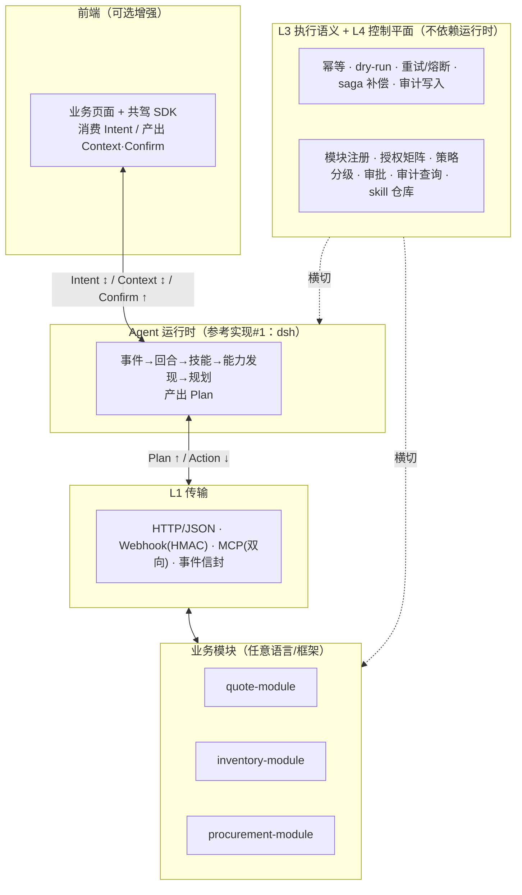
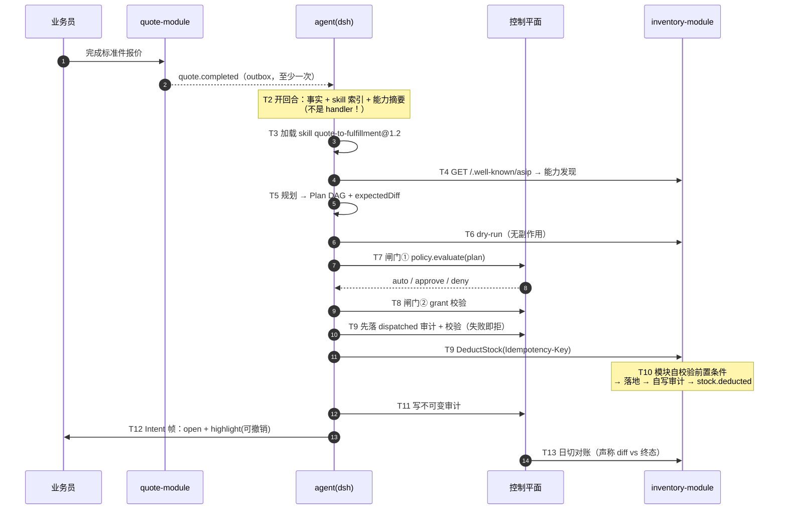
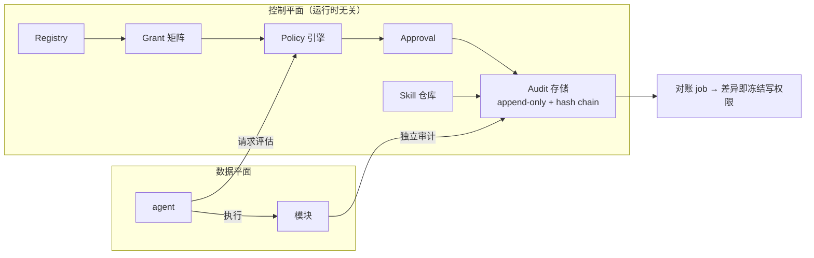

# ASIP：AI 驱动的可插拔业务系统协议（设计文档）

- 状态：**待评审**（v0.1 设计稿）
- 日期：2026-10-27
- 定位：基于 dsh（万物即插件）的开源项目，主产物是**可被机械验证的协议规范 + 参考实现**
- 协议名：**ASIP**（Agent–System Interaction Protocol）
- 许可：Apache-2.0；包命名空间：`@asip/*`

---

## 0. 结论摘要

**技术可行性：可行。** dsh 生态已提供本项目所需的大部分基础原语，自研量集中在三处：

| 自研 | 对应 dsh 现有原语（不自研） |
|---|---|
| 协议契约（8 类 schema + 语义） | `dsh-skill`（技能）、`dsh-jobs-local`（任务队列） |
| 治理控制平面（注册/授权/策略/审批/审计） | `dsh-authorization`、`dsh-permission-presets`、`dsh-user-approval`、`dsh-session-persistence-jsonl`、`dsh-otel` |
| 一致性测试套件（可执行规范） | `dsh-mcp-client`（MCP 挂载）、`dsh-api-gateway`、`dsh-client-ui-*`（前端插件） |

**最大风险不是技术，而是产品性退化**：整套系统可能被接入方用 `on 事件 → 调 action` 的胶水代码写成规则引擎，从而丧失"AI 驱动"的全部价值。本设计把这一点作为**规范级反模式判据**，并用 CI 机械检查守住。

**规模估算**：M0–M2（可用纵切面 + 治理 + 跨语言兼容）约 **5.5 人周**（M0 2 + M1 1.5 + M2 2），含 20% 缓冲约 6.5 人周。

---

## 1. 目标与非目标

### 1.1 目标

1. **AI 驱动而非程序驱动**：模块插入后 agent 自动"学会"使用它，无需为每个业务流程写事件处理器。
2. **模块可插拔**：任意语言、任意框架的业务系统，按协议实现即可接入；符合 dsh"万物即插件"。
3. **协议可机械验证**：规范每一条都有可执行的一致性测试，第三方实现跑测即可自证合规。
4. **写操作可控**：风险分级、审批、幂等、补偿、审计、对账构成闭环，企业敢用。
5. **前端可选共驾**：agent 能让人看到它在做什么、让人一键批准/撤销，但前端不接入也不影响正确性。

### 1.2 非目标（明确不做，v1 范围外）

| 不做 | 原因 |
|---|---|
| UI/DOM 自动化（点页面） | 脆弱、慢、贵、难审计；与 Tool-first 冲突。遗留系统请写适配器 |
| 自研 LLM / 向量库 / 消息中间件 | 协议层不绑定任何基础设施 |
| 自研前端框架或低代码平台 | 前端只认三帧，任何框架都能接 |
| A2A、语音助手（小艺式）原生实现 | v2 适配层，v1 只留扩展点 |
| 通用工作流引擎 / BPMN | 会让"AI 驱动"退回"流程编排" |
| agent 内部规划算法 | 属实现细节，协议只规定输入输出与闸门 |

---

## 2. 协议边界（本设计最重要的约束）

### 2.1 协议内 vs 协议外

**协议内（必须写死，可被机械测试）**
- JSON 线格式与 JSON Schema
- 状态机（Plan / Approval / Execution 的状态迁移）
- 执行语义：幂等、dry-run、重试、超时、saga 补偿
- 审计必须产生、字段最小集、哈希链
- 版本协商与错误分类

**协议外（永远不规定）**
数据库、消息中间件、鉴权实现、前端框架、部署形态、LLM 供应商、agent 内部规划算法、UI 布局。

> **判据**：任何一条规范如果无法写出一致性测试用例，就不该进协议。

### 2.2 反模式判据（规范级）

> **接入方为了跑通业务流程，必须写 `on 某事件 → 调某 action` 的粘合代码 —— 此时系统已退化为程序驱动，ASIP 在本接入点失效。**

三个支撑"AI 驱动"的机制，缺一即退化：

1. **能力发现**（`/.well-known/asip`）：模块插进来，agent 通过发现获得新能力，不改代码。
2. **技能即知识**（skill 文件）：业务流程写成可审阅、可版本化的知识，教 agent 新流程只改 skill。
3. **治理闸门**（policy/approval/audit）：正因为不确定性是固有的，才用闸门而非硬编码控制风险。

**允许的绑定**：agent 可以订阅领域事件（`quote.*`）来决定"是否开启一个回合"。
**禁止的绑定**：事件类型到 action 的映射。**订阅决定"是否思考"，不决定"做什么"。**

这条区别会用 CI 检查守住：demo 模块中若出现对某个具体 action 的硬编码调用，构建失败。

---

## 3. 架构总览

### 3.1 分层



| 层 | 承诺 | 不承诺 |
|---|---|---|
| 前端 | 消费 Intent、产出 Context/Confirm | 页面长什么样 |
| Agent 运行时 | 事件→回合→技能→规划→过闸门 | 怎么"想" |
| 业务模块 | 暴露 actions/events，**自己校验前置条件** | 内部实现 |
| L1 传输 | 语言无关、不绑 broker | 用哪个 broker |
| L3+L4 横切 | 幂等/补偿/审计语义 + 治理 | 用什么数据库 |

### 3.2 三个关键设计决定

1. **前端通道是可选增强**：无共驾 SDK 时 `Intent` 帧直接丢弃，业务结果不变。这才叫兼容性。
2. **前置条件由模块自校验，agent 不可绕过**：agent 只能*请求*；"库存够不够"永远由模块判定。这是抗幻觉第一道闸。
3. **审计双写**：agent 侧记一份、模块侧独立记一份，日切对账能发现"agent 声称做了、模块没做"。

---

## 4. ASIP 协议内核：8 类契约

### 4.1 Module Manifest（发现）

`GET /.well-known/asip` → 模块自描述。agent 先拿摘要，只为要用的 action 拉完整 schema（省上下文）。

```json
{
  "asip": "0.1",
  "module": { "id": "inventory", "version": "1.4.0", "title": "库存" },
  "actions": [
    { "id": "inventory.DeductStock", "version": "1.0.0", "title": "扣减库存",
      "risk": { "level": "medium", "reversible": true }, "dryRun": true }
  ],
  "events": [ { "type": "stock.deducted", "version": "1.0.0" } ],
  "transports": ["http", "mcp"],
  "capabilities": ["dry-run", "event-replay"]
}
```

### 4.2 Action

```json
{
  "id": "inventory.DeductStock",
  "version": "1.0.0",
  "title": "扣减库存",
  "inputSchema":  { "type": "object", "required": ["sku","qty"],
    "properties": { "sku": {"type":"string"}, "qty": {"type":"integer","minimum":1},
                    "referenceNo": {"type":"string"} } },
  "outputSchema": { "type": "object", "properties": { "onHand": {"type":"integer"} } },
  "risk": { "level": "medium", "reversible": true, "moneyAffecting": false },
  "idempotency": { "keyFields": ["sku","referenceNo"], "scope": "module",
                   "duplicateBehavior": "return_first_result" },
  "preconditions": ["stock.onHand >= qty"],
  "compensation": {
    "action": "inventory.ReleaseStock",
    "argMap": { "sku": "$in.sku", "qty": "$in.qty", "referenceNo": "$in.referenceNo" }
  },
  "timeoutMs": 5000,
  "dryRun": true
}
```

字段硬约束：
- `idempotency.keyFields` **必填**（写 action）；重复提交必须返回首次结果，**绝不重复副作用**
- `risk.reversible=false` 的 action **不允许出现在多步 Plan 的非末位**（无法回滚）
- `preconditions` 是**模块自校验**的说明性字段，不是给 agent 执行的；agent 不得据此短路
- `compensation` 缺失且 `reversible=false` → 强制审批

### 4.3 Domain Event

```json
{
  "eventId": "evt_01JB...", "type": "quote.completed", "version": "1.0.0",
  "subject": { "entity": "quote", "id": "Q-2026-0417" },
  "occurredAt": "2026-10-27T09:12:03.412Z",
  "causationId": "cmd_...", "correlationId": "quote:Q-2026-0417",
  "payload": { "customerId": "C-88", "lines": [{ "sku": "STD-1001", "qty": 12 }] }
}
```
语义：至少一次投递、可重放（`GET /asip/events?since=cursor`）、消费侧按幂等去重。

### 4.4 Plan

```json
{
  "planId": "pln_01JB...",
  "trigger": { "eventId": "evt_01JB..." },
  "steps": [
    { "stepId": "s1", "action": "inventory.GetStock", "args": { "sku": "STD-1001" },
      "readOnly": true },
    { "stepId": "s2", "action": "inventory.DeductStock",
      "args": { "sku": "STD-1001", "qty": 12, "referenceNo": "Q-2026-0417" },
      "dependsOn": ["s1"],
      "idempotencyKey": "asip:pln_01JB.../s2",
      "compensation": "inventory.ReleaseStock" }
  ],
  "expectedDiff": [
    { "entity": "inventory.SKU:STD-1001", "field": "onHand", "from": 120, "to": 108 }
  ],
  "dryRunVerified": true,
  "estimatedRisk": "low"
}
```
硬约束：Plan 必须**人能读懂**、可被策略评估、可回放重建；`expectedDiff` 是审计与对账的依据。

### 4.5 Intent / Context / Confirm（人机共驾三帧）

```json
// agent → 前端
{ "type": "asip.intent", "intentId": "int_1", "actions": [
  { "kind": "open", "target": { "entity": "quote", "id": "Q-2026-0417" } },
  { "kind": "highlight", "target": { "entity": "inventory.SKU", "id": "STD-1001" },
    "badge": "−12 已扣减", "undoable": true, "undoPlanId": "pln_01JB..." },
  { "kind": "proposeForm", "diff": { "qty": { "from": 10, "to": 12 } } }
] }

// 前端 → agent
{ "type": "asip.context", "view": { "entity": "quote", "id": "Q-2026-0417" },
  "edits": [ { "field": "qty", "from": 10, "to": 12 } ], "at": "..." }

// 前端 → agent
{ "type": "asip.confirm", "confirmId": "cfm_1", "planId": "pln_01JB...",
  "decision": "approve|reject|amend", "patch": { }, "by": "user:alice" }
```
硬约束：**帧内不含 DOM 选择器、不含坐标**。只表达"界面应进入什么状态"，由前端自行决定怎么渲染。

### 4.6 Grant（授权）

`agent 身份 × 模块 × action` 白名单 + 配额。**双层执行**：控制平面拒一次，模块侧再拒一次（纵深防御）。webhook 用 HMAC + 时间戳防重放。

### 4.7 Policy（风险分级）

```json
{ "id": "pol-stock-deduct", "match": { "action": "inventory.*" },
  "when": [ { "arg.qty": { ">": 10 } } ],
  "decision": "approve", "approvers": ["role:warehouse_manager"] }
```
求值结果 `auto | approve | deny`；**默认 deny**；策略不可被 agent 读取或改写，只能请求评估。

### 4.8 Audit Event（不可变）

```json
{ "auditId": "aud_...", "at": "...",
  "actor": { "type": "agent", "id": "ag_fulfillment", "onBehalfOf": "user:alice" },
  "trigger": { "eventId": "evt_01JB..." },
  "planId": "pln_01JB...", "stepId": "s2", "action": "inventory.DeductStock",
  "inputHash": "sha256:...", "idempotencyKey": "asip:pln_01JB.../s2",
  "decision": { "policy": "auto", "grantOk": true, "approvedBy": null },
  "result": { "status": "ok", "outputHash": "sha256:..." },
  "tokenUsage": { "in": 812, "out": 233 },
  "prevHash": "sha256:..." }
```
append-only + `prevHash` 哈希链；大对象只存 hash，原文入对象存储。

**两段写（WAL 语义）**：同一次调用产生两条审计记录，`stage` 字段区分——
1. `dispatched`：**执行前**写入（含 decision、inputHash、幂等键）。写失败则**拒绝执行**。
2. `result`：执行后补写（含 status、outputHash、实际 diff）。

因此审计不是"事后补记"，而是**执行的前置条件**；崩溃恢复时凭 `dispatched` 记录能识别"已发出但结果未知"的调用，配合幂等键向模块查询真实结果。

### 4.9 错误分类与信封

```json
{ "asipError": { "class": "business_rejection", "code": "STOCK_INSUFFICIENT",
  "message": "可用 3，需求 12", "details": { "available": 3 }, "retryable": false } }
```

| class | 例子 | agent 行为 | 可重试 |
|---|---|---|---|
| `retryable` | 网络/限流/超时 | 退避重试，幂等键不变 | 是 |
| `business_rejection` | 库存不足/单据已变 | **重新规划**（改预留/拆单/发起采购），拿不准就问人 | 否 |
| `policy_denied` | 超授权/超阈值 | 终止转人工，**不得换路绕过** | 否 |
| `contract_violation` | schema 不符/未知 action | 死信 + 告警（协议或接入方 bug） | 否 |

### 4.10 接入面

**HTTP 侧车（任意语言，6 端点）**

```
GET  /.well-known/asip            → manifest
GET  /asip/actions/{id}           → schema + risk
POST /asip/actions/{id}           → 执行（Idempotency-Key 头）
POST /asip/actions/{id}:dry-run   → 预演（可选，强烈建议）
POST /asip/events                 → agent 收事件（Webhook，HMAC 签名）
GET  /asip/events?since=cursor    → 补课/重放
```

**dsh 原生（TS，参考实现#1）**

```ts
export const inventory = defineModule({
  id: 'inventory',
  actions: [deductStock, releaseStock, getStock],   // 含 risk / 幂等 / 补偿声明
  events:  ['stock.deducted'],
})
ctx.plugin(asipModuleHost, inventory)   // 自动成 dsh tool + 事件订阅 + 审计，HMR 热插拔
```

**版本协商**：`ASIP-Version: 0.1` / `ASIP-Min-Version`；语义化版本；**只增不删字段，未知字段必须忽略**。

---

## 5. 纵切面：报价完成 → 扣库存

### 5.1 demo 业务系统（3 模块，`demo/mini-erp`）

| 模块 | actions | events | 用途 |
|---|---|---|---|
| quote | `CreateStandardPartQuote`、`GetQuote` | `quote.completed` | 触发器 |
| inventory | `GetStock`、`DeductStock`、`ReleaseStock` | `stock.deducted`、`stock.insufficient` | 主路径 + 补偿 |
| procurement | `CreatePurchaseRequest` | `purchase.requested` | **分支路径**：库存不足时 agent 自己选它 |

> 为什么必须 3 个模块：只有存在两条可能路径（扣库存 / 发起采购），才能证明 agent 在**推理**而不是跑流水线。2 模块的线性流程用 `if/else` 就能实现，证明不了"AI 驱动"。

### 5.2 时序（13 步，4 个闸门）



### 5.3 分支：库存不足（AI 驱动价值所在）

`DeductStock` 返回 `business_rejection / STOCK_INSUFFICIENT` → agent **不报错**，而是：
1. 重新读取 capability 清单，发现 `procurement.CreatePurchaseRequest`
2. 产出替代 Plan（部分履约 + 采购申请），标 `estimatedRisk`
3. 超阈值 → `approve` 转人工；否则执行
4. Intent 帧告诉业务员："已扣 3 件，缺口 9 件已发起采购申请 PR-..."，可撤销

这就是"AI 驱动"与"程序驱动"的可观测差异：同样是库存不足，程序驱动抛异常，agent 换方案。

### 5.4 技能（Skill）格式

复用 dsh skill（`SKILL.md` + frontmatter），增加业务元数据：

```yaml
---
name: quote-to-fulfillment
version: 1.2.0
asip:
  subscribes: ["quote.completed"]        # 决定「是否思考」，不决定「做什么」
  expectedModules: ["inventory", "procurement"]
  outcome: "标准件报价完成后核对库存并履约"
---
# 步骤（给 agent 读的知识，不是可执行流程）
1. 若报价单含物理件，必须核对库存……
```

**硬约束**：skill 只能声明"我关心哪些事实"，**不得声明"某个事件对应某个 action"**——后者即为反模式。

---

## 6. 治理控制平面

### 6.1 v1 范围（用户选定）

| 模块 | 内容 |
|---|---|
| **Agent 注册 + 能力授权矩阵** | agent 身份与凭证、可调用的 `模块×action` 白名单、配额 |
| **审计 + 可回放** | 结构化审计事件（who/why/plan/diff/idemKey/result）、从审计回放到 dsh 会话轨迹 |
| **技能 / 业务流程知识管理** | skill 仓库、版本化、审阅发布、从成功轨迹蒸馏新 skill |

**暂缓（v2）**：用量与成本看板（用户未选）。
**但**：审计事件已含 `tokenUsage` 与业务单据量字段，**看板届时只是查询层，不需要改 schema**。这是有意的预留。

### 6.2 平面与数据平面的关系



---

## 7. 健壮性：8 道闸 + fail-closed

| # | 机制 | 硬约束 |
|---|---|---|
| 1 | 幂等 | 写 action 必声明 keyFields；`Idempotency-Key` 重复必须返回首次结果，绝不重复副作用 |
| 2 | saga 补偿 | `reversible=false` 不许出现在多步 Plan 非末位 |
| 3 | 超时 + 熔断 | 每 action 声明 timeout；连错 N 次 → 熔断，能力清单标 unavailable |
| 4 | 对账 | 日切比对「声称 diff」vs「模块终态」；差异即**冻结该 agent 写权限**再告警 |
| 5 | 审计不可变 | append-only + `prevHash` 哈希链；大对象只存 hash；**两段写**：执行前 `dispatched`、执行后 `result` |
| 6 | 双层授权 | 控制平面 + 模块侧各拒一次；webhook HMAC + 时间戳 |
| 7 | 版本演进 | 只增不删、未知字段忽略、一致性测试进 CI 门禁 |
| 8 | 降级 | 见下表，**全部 fail-closed** |

### 降级矩阵（fail-closed）

| 缺失/失败 | 行为 |
|---|---|
| 无前端 SDK | 丢 Intent 帧，业务正确 |
| 无 dry-run | 标 `unverified` → **强制审批** |
| 策略服务不可用 | 默认 **deny**（不是 auto） |
| 无 LLM | 事件积压可重放，不丢 |
| 模块超时/熔断 | 从能力清单摘掉 |
| 事件重复投递 | 幂等键吸收 |
| 审计写失败 | **拒绝执行**（WAL：先落 `dispatched` 再动） |

---

## 8. 兼容性

| 对象 | 怎么接 | 降级 |
|---|---|---|
| 任意语言后端 | HTTP/JSON + JSON Schema，6 端点 | 无 SDK 手写端点 |
| 已有 MCP 服务 | 包装成模块：tool → action | 缺 risk 注解 → 默认高风险 + 审批 |
| 无 API 老系统 | 写适配器（**不做 UI 自动化**） | 写操作退回人工 |
| 任意前端 | WS 三帧；REST 轮询可降级 | 纯对话 + IM 通知 |
| 消息中间件 | 事件信封与 broker 解耦（Kafka/NATS/Redis 适配器） | HTTP webhook 轮询 |
| A2A | v2：Agent Card → module manifest 映射 | v1 不承诺 |
| 语音/意图助手（小艺式） | v2：语音 → 业务意图帧 | v1 不承诺 |
| dsh 版本 | peerDeps 范围 + dsh 已有豁免机制 | 协议层不 import dsh |

**MCP 关系澄清**：MCP 是**传输与工具暴露**协议，ASIP 是**业务治理与执行语义**协议。二者互补：
- ASIP 模块可以同时以 MCP server 形式暴露（`transports: ["http","mcp"]`）
- 任意 MCP server 可被包装成 ASIP 模块（拿不到 `risk`/`idempotency` 时按最保守假设处理）

---

## 9. 一致性测试套件（可执行规范）

```
asip conformance run --target http://localhost:8080 --report out.json
```

用例至少覆盖：

| # | 用例 | 断言 |
|---|---|---|
| C1 | manifest 合法性 | 符合 JSON Schema；action 有 risk 与 idempotency 声明 |
| C2 | 幂等 | 同 Idempotency-Key 提交两次 → 副作用一次，返回首次结果 |
| C3 | 未知字段 | 请求注入未知字段 → 必须忽略而非报错（前向兼容） |
| C4 | 审计必产生 | 任一写调用后审计可查，且 `prevHash` 链连续 |
| C5 | 策略失效必须拒 | 策略服务不可达时写操作被拒（fail-closed） |
| C6 | 事件重放 | `since=cursor` 能补齐丢失事件，消费侧不重复生效 |
| C7 | 补偿 | 多步 Plan 中途失败 → 已执行步骤被补偿，审计标 `partially_failed` |
| C8 | 可选能力容忍 | 模块未实现 dry-run 时用例仍 pass，但运行时必须强制审批（见 §7 降级矩阵） |
| C9 | 错误分类 | 四类错误码与 `retryable` 标志正确 |
| C10 | 反模式扫描 | 事件订阅回调内**不得出现具体 action 字面量**。AST 检查：订阅处理函数的函数体内出现 `actions.<id>` 或 `invoke("<module>.<action>")` 这一类字面量 → 失败（`@asip/lint`，可对任意接入方仓库运行） |

通过者获 badge：`asip-conformant-0.1`。

---

## 10. 仓库结构

```
dsh_for_sys/
├── spec/0.1/
│   ├── action.md event.md plan.md intent.md audit.md policy.md grant.md
│   ├── schemas/*.json          # 机器可读，规范书由此生成
│   └── CHANGELOG.md
├── conformance/                # 可执行规范
│   ├── cases/*.yaml
│   └── src/runner.ts
├── packages/
│   ├── asip-core/              # 类型 + schema 校验 + 幂等/哈希工具（不依赖 dsh）
│   ├── dsh-plugin-module-host/ # 参考实现#1：cordis 插件，把模块挂进 dsh
│   ├── dsh-plugin-governance/  # 控制平面（registry/grant/policy/audit）
│   ├── dsh-plugin-intent-ui/   # 共驾三帧服务 + 前端 UI 插件
│   ├── dsh-plugin-skill-biz/   # 业务流程 skill 仓库（复用 dsh-skill）
│   └── sidecar-http/           # 参考实现#2：任意语言接入的 HTTP 侧车
├── demo/mini-erp/              # quote + inventory + procurement + 前端页面
├── docs/                       # 架构图、接入指南、可行性报告
└── .superpowers/               # 设计期画板（gitignore）
```

---

## 11. 里程碑

| 阶段 | 内容 | 出口判据 | 估算 |
|---|---|---|---|
| **M0 骨架** | `spec/0.1` schema + conformance 前 5 用例 + mini-erp 三模块 + dsh 插件宿主 + 「报价→扣库存」跑通 | 一条命令起 demo；**无 handler 注册**；C1–C5 绿 | 2 人周 |
| **M1 治理** | grant 矩阵 + policy 分级 + 审批 UI + 审计查询/回放 + 对账 job | 高风险路径必须人工；对账能发现人为篡改 | 1.5 人周 |
| **M2 兼容** | HTTP sidecar SDK + MCP 双向 + Python 示例 + 一致性 badge | 非 TS 模块接入跑通全套用例 | 2 人周 |
| **M3 知识** | skill 仓库 + 轨迹蒸馏半自动 + A2A/语音适配草案 | 新业务流程只改 skill 即可上线 | 1.5 人周 |

**范围切分（给实施计划用）**：本设计覆盖 M0–M3 四个阶段，是**四个可独立交付的子系统**，不应塞进一个实施计划。
下一份计划只针对 **M0 骨架**：`spec/0.1` schema + conformance C1–C5 + `demo/mini-erp` 三模块 + `dsh-plugin-module-host` + 「报价→扣库存」端到端。
M1/M2/M3 各自另起计划，前置条件是上一阶段的出口判据达成。

---

## 12. 风险登记

| 风险 | 影响 | 缓解 |
|---|---|---|
| **R1 退化成规则引擎** | 高 | 反模式判据 + demo 零胶水 + CI 用例 C10 |
| **R2 协议过抽象变空泛标准** | 高 | 只服务一个纵切面；无测试用例的条款直接删除 |
| R3 真实系统无补偿接口 | 中 | `risk.reversible` + 不可逆强制审批 + dry-run 必读 |
| R4 审计不可信（agent 自证） | 中 | 模块侧独立记录 + 日切对账 + 哈希链 |
| R5 共驾帧落地成本高 | 中 | 先只做 demo 页 + SDK hook；未接入降级纯对话 |
| R6 绑定 dsh 版本 | 低 | 协议层不 import dsh，仅 adapter 包依赖 |

---

## 13. 决策记录（本次设计会话）

| # | 决策 | 选择 | 理由 |
|---|---|---|---|
| D1 | 项目主产物 | **双轨：规范 = 可执行测试** | 兼容性与健壮性都要可机械验证 |
| D2 | 首个纵切面 | **虚构 mini-erp**（不拿内部系统当试点） | 公开可复现、无内部依赖 |
| D3 | agent 作用于后端的通道 | **Tool/API-first**（不做 UI 自动化） | 抗幻觉、可审计、可回滚 |
| D4 | 自主性边界 | **分风险分级**：低风险自动、高风险审批 | 效率与可控的平衡点 |
| D5 | 前端协议语义 | **人机共驾三帧**（Intent/Context/Confirm） | 不做 DOM 自动化仍能让人看得见、拦得住 |
| D6 | v1 入口协议 | HTTP/Webhook + MCP 双向 + 业务事件 | A2A 与语音留 v2 |
| D7 | 实现栈 | **TS + cordis 插件**；跨语言走侧车 | 与 dsh 同构，零胶水 |
| D8 | 管理台 v1 | 注册/授权 + 审计/回放 + 技能管理 | 用量看板延后（字段已预留） |
| D9 | 架构选型 | **C：协议内核 + 多运行时** | 协议不被运行时绑死，dsh 只是第一个宿主 |
| D10 | demo 模块数 | **3 个**（+procurement） | 有分支才能证明在推理 |

---

## 14. 未决问题（实施前需定）

1. **事件订阅粒度**：全面订阅 vs 声明订阅（成本与漏判的权衡）——M0 用声明订阅，M1 补"漏判检测"。
2. **身份代理链**：`onBehalfOf` 的授权边界——agent 能否行使业务员全部权限？建议取交集 + 显式委托。
3. **skill 发布审批**：谁能发布 skill（改知识等于改行为），需要审批流还是双人复核。
4. **上下文成本**：模块多时 action schema 会撑爆上下文，需要裁剪策略（摘要 → 按需拉取，M0 先验证可行性）。
5. **一致性与"可选能力"**：C8 的容忍边界（哪些能力可缺、缺了是否降级审批）需逐条定。
6. **ASIP-over-MCP 的 tool 命名约定**：`模块.action` 还是纯 action id 加前缀。
7. **ASIP 名称冲突**：开源前做一次同名检索（ASIP 亦为其他领域缩写）。

---

## 附录 A：设计期可视化

可直接用浏览器打开的设计图（已入库，互为导航）：

- [`docs/design-screens/architecture-approaches.html`](../design-screens/architecture-approaches.html)（三方案对比与选型理由）
- [`docs/design-screens/design-1-layers.html`](../design-screens/design-1-layers.html)（分层 + 8 类契约 + 协议内外边界）
- [`docs/design-screens/design-2-slice.html`](../design-screens/design-2-slice.html)（13 步时序 + 错误分类 + 6 端点接入面）
- [`docs/design-screens/design-3-robustness.html`](../design-screens/design-3-robustness.html)（8 闸 + 降级矩阵 + 兼容性 + 风险登记）

> 设计期的本地画板会话目录 `.superpowers/` 不入库（已在 `.gitignore` 中），上述四份是固化后的独立版本。
