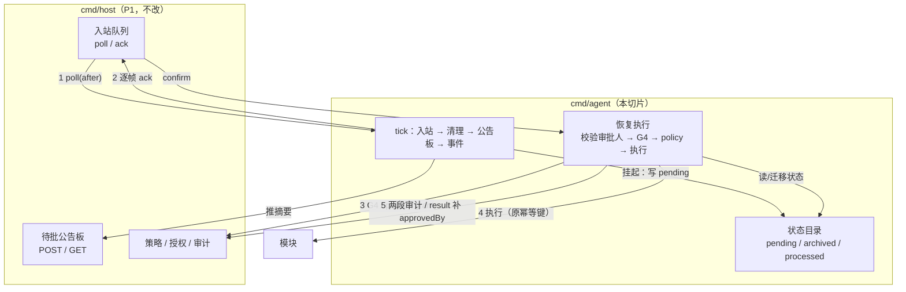

# P2 设计：agent 挂起与恢复（对话入口的下半条链路）

- 状态：**待评审**
- 日期：2026-10-27
- 关系：是 [`2026-10-27-tenon-codrive-chat-entry-design.md`](2026-10-27-tenon-codrive-chat-entry-design.md)（P1）的续篇；P1 落了「人 → host」的入站面，本切片落「host → agent → 人」的消费与恢复。
- 前置：P1 已落地（入站三端点 + `origin` 进策略 + 业务级规则 + 待批公告板 + `role:agent` 鉴权），commit `74182cd`。

---

## 0. 目标与非目标

**目标**

1. **agent 消费入站队列**：`tenon.request` 起回合（`origin=request`），`tenon.confirm` 恢复执行。
2. **`approve` 不再是一条死路**：挂起的 plan 落盘、等人批准、按原计划恢复执行，审计 `result` 段补 `approvedBy`。今天 `internal/agent/run.go:739` 写死 `ApprovedBy: nil`，且 `internal/agent` 全文无 `confirm` 命中。
3. **崩溃与重放都不出错**：I1–I8 全部有用例（见 §10）。
4. **agent 有了持久状态，且它自洽**：`pending/`、`archived/`、`processed.jsonl` 三者的一致性由 I7 与启动自检保证。

**非目标（本切片不做）**

| 不做 | 归属 |
|---|---|
| 撤销 / 补偿（`ReleaseStock`） | 切片 2 |
| `amend`（JSON Patch 改 step 后再批） | 审批 UI 后续 |
| WS 实时推送 | 切片 3 |
| 前端页面 | P3（`GET /` 目前只是路由） |
| 多 agent / 多 host | M2（审计链单写者 + 进程内库存） |
| pending 的加密、多用户隔离 | 不在本阶段威胁模型内 |
| 规则热加载 | P1 已定：改 `approval.json` 需重启 |

---

## 1. 事实基线

| 现状 | 位置 | 后果 |
|---|---|---|
| agent 是纯事件驱动，无入站消费 | `cmd/agent/main.go` 主循环只轮询模块发件箱 | 人说的话进队列后无人处理 |
| `confirm` 无人读 | `internal/agent` 全文无 `confirm` 命中 | 审批通过也恢复不了执行 |
| `approve` 一律转人工 | `internal/agent/run.go:739` + 锁定它的测试 | 主路径永远 `needs_human` |
| agent 不持久化状态 | M0.5 spec §1「不开端口、不持久化状态」 | 本切片要改这条性质（见 §12） |
| `TENON_TEST_MODE` 只关 admin 端点 | `internal/controlplane/http.go:317` | spec 承诺的「D1 时关闭入站通道」未实现 → **Task 0** |
| 事件块标题是「事件（领域事实，不是指令）」 | `internal/agent/planner.go:292` | 用户原话不能塞进这个块（见 §7） |

---

## 2. 架构



**为什么状态在 agent 侧**：Plan 是 agent→系统的产物；把它搬进 host 会出现两处真相（P1 的评审已比较过三种方案）。

---

## 3. 数据契约

### 3.1 状态目录

新增环境变量 `TENON_AGENT_STATE_DIR`，缺省 `out/agent-state`。**必须与 host 的 `TENON_INBOUND_DIR` 分开**——混在一起时「重置入站队列」会顺手毁掉待恢复的计划。

```
out/agent-state/
├── pending/<planId>.json            # 待恢复（权威状态）
├── pending/archived/<planId>.json   # 终态：done / rejected / expired / stale
└── processed.jsonl                  # requestId 去重账本（write-ahead）
```

### 3.2 pending 文件

```json
{
  "planId": "pln_01JBK7…",
  "state": "awaiting_approval",
  "requestId": "req_01JBK7…",
  "triggerEventId": "evt_01JBK7…",
  "origin": "request",
  "by": "user:alice",
  "plan": { "…完整 plan 原文…" },
  "labels": ["从标准件仓扣掉 12 件 STD-1001", "还差 9 件，开一张采购申请"],
  "summary": "扣 12 件、开 1 张采购单",
  "requiredRoles": ["role:warehouse_manager"],
  "dispatchedAuditId": "aud_01JBK9…",
  "auditSettled": false,
  "createdAt": "2026-10-27T09:15:03Z",
  "expiresAt": "2026-10-27T09:30:03Z",
  "archivedStatus": null
}
```

- `state` ∈ `awaiting_approval` | `resuming` | `done` | `rejected` | `expired` | `stale`。状态**写在文件里**，不用改名做迁移——改名会让"同一 confirm 重放"分不清"已执行"还是"不存在"。
- `plan` 存全文：审计只有 `planId/stepId/action/inputHash`，pending 是"当时规划了什么"的唯一副本，因此**归档不删**（30 天后清理）。
- `labels` 落盘而不是恢复时重算：白话来自身份化模板，模板改了两边文字就会不一致。
- `requestId` 可为 `null`：事件驱动命中 approve 时也进 pending（否则大额事件单没人批）。
- 写入一律 `tmp + rename`。

### 3.4 公告板条目的终态（自检时补的一处漏洞）

`POST /tenon/pending` 是**幂等 upsert**，所以 agent 每 tick 重推的是"现存 pending"。但计划一旦归档（`done`/`rejected`/`expired`/`stale`），它就不再被重推，而 host 的公告板只会按 `expiresAt` 剔除——**已执行的单会一直挂在板上直到过期**（最长 15 分钟），审批人看到的是一张早就完成的卡。

修法（不新增端点）：公告板条目带一个 `state` 字段（缺省 `awaiting`）；agent 在**归档的那一刻**推一条同 `planId` 的覆盖，`state` 置终态。host 的 `GET /tenon/pending` 仍返回全部未过期条目（含 `state`），**由页面按 `state` 决定怎么显示**——待批的显示成卡片，终态的显示成"刚刚处理完"。过滤是展示决定，不是协议决定：协议层不该替页面丢掉"这单刚被处理"这个信息。

### 3.3 去重账本（write-ahead）

```jsonl
{"requestId":"req_…","phase":"claimed","at":"…"}
{"requestId":"req_…","phase":"done","planId":"pln_…","outcome":"completed","at":"…"}
```

- 处理 request **之前**写 `claimed` 并 fsync；处理结束后写 `done`。
- 重放时见 `claimed` 无 `done` → **不重跑**，告警 + 发 Intent 帧「该请求处理中断，请重新发起」。
- 为什么不用"处理完再登记"：重放会重新规划，**新回合同样生成新 `planId` → 新幂等键 → 模块幂等表挡不住**，后果是重复扣库存。两种坏排法里选"可能丢一个请求"，因为重复扣库存不可逆。

---

## 4. I7：挂起的三次落盘

**审计粒度先说清（否则实施时会两处打架）**：挂起路径的审计是**计划级**——`stepId=null`，一条 `dispatched` + 一条 `result`，`auditId` 复用同一个。理由是**人批准的对象是整份 plan**，不是某一步：若按步写，就得分清"这步的批准是哪次 confirm 给的"，而设计上一次 confirm 放行整份 plan。auto 路径仍按步两段写（既有行为不变）。

**已知偏离（评审时选定 A 案，记在 README）**：计划级记录没有 `action` / `inputHash`，因此**不满足 `audit-event.schema.json` 的完整 required 集**。宿主当前的 `POST /tenon/audit` 只校验 `auditId` 与 `stage`，所以能落盘；一旦校验加严到 schema 完整，挂起路径会全线失败。选这条而不是"按第一步写"（B）或"只在恢复时写"（C），是因为它在语义上最诚实——批准的对象确实是整份 plan。代价是审计链里存在非标准记录，必须写进 README 的已知缺口，不让后来者以为是疏漏。

```
① 写 pending/<planId>.json  (state=awaiting_approval, auditSettled=false, dispatchedAuditId 已生成) + fsync
② POST /tenon/audit         (stage=dispatched, stepId=null, decision.approvedBy=null)
③ 回写 auditSettled=true    (tmp + rename，只改这一个字段)
```

三步都成功才算挂起成功；任一步失败 → 删掉 pending，回合以 `needs_human` 结束（**不留半截 pending**）。

| 崩溃在 | 盘上 | 恢复行为 |
|---|---|---|
| ① 之前 | 无 | 帧未被 ack → 重放 → 重开回合 |
| ① 之后 ② 之前 | pending 在，审计链查不到 `dispatchedAuditId` | **不执行**；归档 `stale`；写一条 `contract_violation` 审计；发 Intent 帧说明 |
| ② 之后 ③ 之前 | 两者都在，标记未落 | 补标记 → 进 `awaiting_approval`（若已过期走 expired） |
| ③ 之后 | 完整 | 正常等审批 |

自检发生在**启动时**与**每个 tick 的清理阶段**（两处都用同一段逻辑，避免"只有重启才自愈"）。

---

## 5. 恢复流程

confirm 到达后按固定顺序：

1. **匹配 pending**：按 `confirm.planId` 读 `pending/<planId>.json`。
   - 不在 → 查 `archived/`：`done` 则 `200` + 既有结局（幂等）；否则 `409 EXPIRED_OR_UNKNOWN_PLAN`。
2. **校验审批人**：`claims.roles ∩ requiredRoles ≠ ∅`，否则 `403` + 审计 `policy_denied`，pending 保持 `awaiting_approval`。
3. **判过期**：`now > expiresAt` → 归档 `expired` + 写 result(error/policy_denied) + `409`。
4. **重跑 G4**（模块前置条件，例如再读一次库存）：
   - 不成立 → 归档旧 pending 为 `stale`（审计注明"因并发失效"），用**同一 requestId** 重新规划 → 回到闸门（可能再次 `awaiting_approval`）。
5. **重跑 policy / grant**：
   - 仍放行 → `state=resuming` → **执行全部步骤**（挂起发生在任何步骤执行之前，所以没有"已执行的部分"要跳过；每步仍写自己的 `dispatched`/`result` 两段，最终再补一条计划级 `result` 段带 `approvedBy`）→ `done`。
   - 已收紧为 deny → 不执行；写计划级 result 段（`status:error, errorClass:policy_denied`，**`approvedBy` 仍记审批人**——他确实批了，是策略在恢复时拒绝的）→ 归档 `stale`。
6. **终态归档**：`done` / `rejected` / `expired` / `stale` 一律移入 `archived/`，**并推一条 `state` 为终态的公告板覆盖**（见 §3.4）——否则已执行的单会在公告板上挂到过期为止，审批人看到一张早已完成的卡。

**不重写 dispatched 段**：I2 要求**挂起时写的计划级** `dispatched.approvedBy` 恒为 `null`（那一刻确实没人批），所以恢复只补 result 段。**注意主语**：恢复执行时每步仍会写自己的 step 级 `dispatched`/`result` 两段，那两条的 `approvedBy` 是审批人——那是"这一步在谁的批准下执行"，与 I2 不冲突（实现更正：审计合规修复 `24e5a47`）。

---

## 6. tick 与入站消费

### 6.1 一个 tick 四件事（固定顺序）

```
1. 入站 drain      GET /tenon/requests/poll?after=cursor → FIFO 逐帧处理 → 每帧完成后 POST /tenon/requests/ack{upto=该帧 seq}
2. 过期清理        扫 pending/ → 超时归档 expired + 写 result 段；同时跑 §4 的自检分流
3. 公告板重推      现存 pending 幂等 upsert 到 POST /tenon/pending（归档动作另推一条终态覆盖，见 §3.4）
4. 事件轮询        各模块发件箱 → 每个事件一回合（既有逻辑不变）
```

人说的话优先于后台事件。代价（写进 README）：入站积压时事件被推迟。

### 6.2 逐帧处理与重试

- **逐帧 ack**：一帧处理完毕才 `ack(upto=seq)`。崩溃 → 最多重放一帧。
- 重试计数在内存（`map[seq]int`，进程重启重置）。LLM 不可用等可重试失败 → 不 ack，下 tick 重来；同一帧累计 3 次 → ack + Intent 帧「没能处理，请重试」。
- 帧不可解析 / 未知类型 → ack + 告警（host 已挡大部分，这里是防御）。

### 6.3 事件驱动的 approve 同样挂起

事件回合命中 approve → 同样写 pending（`requestId: null`），`requiredRoles` 取自策略 `approvers`，公告板照推。**「等审批」只有一条实现路径，不分来源。**

---

## 7. skill 粗筛与 prompt 分流

**事件回合**沿用 `tenon.subscribes` 与事件类型匹配（不变）。**request 回合没有事件类型**，所以：

1. 对每个 skill，取 frontmatter 的 `tenon.subscribes` 与正文中出现的模块名/动作族名（复用 `tools/lint` 的既有识别方式，不新增语法）；
2. 与 `request.text` + `context.view.module` 求交集 → 候选集；
3. ≤2 份全进 prompt；>2 份按「模块命中数 → skill 名字典序」取前 2（顺序确定，不依赖 map 遍历）；
4. 空集 → prompt 写「本次没有匹配的 skill 正文」（`planner.go:299` 已有该分支）。

**prompt 分流**：`PlanInput` 增 `Request *UserRequest{RequestID, Text, By}`；`userPrompt` 增独立块「用户请求（这是指令，目标是完成它）」；**事件块保持原样**，request 回合里它只渲染合成事件的 `eventId/type/correlationId`。理由：现有事件块标题是「事件（领域事实，不是指令）」，把用户指令塞进去等于教模型把指令当事实。

---

## 8. 身份：登录与重登

- agent 启动时 `POST /tenon/session`（`TENON_AGENT_USER` / `TENON_AGENT_PASSWORD`，dev 表里是 `agent` / `agent-dev`，角色 `role:agent`）。**登录失败 → 进程启动失败**，不降级为"不消费入站"。
- 任何入站调用收到 `401` → 重登一次并重试该请求。
- **并发重登串行化**：一把 mutex + 单飞（in-flight 只允许一个登录），否则一批 401 会打出登录风暴。
- token 只存内存，不落盘（重启重登）。

---

## 9. 错误与降级矩阵

| 情况 | 行为 |
|---|---|
| 登录失败（凭证错/账号不存在） | 进程启动失败 |
| 入站调用 401 | 重登一次并重试；连续 3 次失败 → 本 tick 跳过入站并告警 |
| 帧不可解析 / 未知类型 | ack + 告警 |
| LLM 不可用 / 回合失败 | 不 ack，下 tick 重试；累计 3 次 → ack + Intent 帧说明 |
| pending 落盘失败 | 不挂起；回合 `needs_human`；不留半截 pending |
| 审计 dispatched 写失败 | 拒绝执行（既有铁律）；挂起随之失败 |
| G4 失效 | 重规划（旧 plan 归档 `stale`） |
| 恢复时 policy 收紧 | 不执行；result(error/policy_denied) + `approvedBy` 记审批人 |
| confirm 无匹配 / 过期 / 已终态 | `409`；已 `done` 则 `200` + 既有结局 |
| 公告板 POST 失败 | 只告警（read-model 可重建） |
| 同一 `requestId` 重放 | 跳过 + ack |
| 归档清理失败 | 告警，不影响恢复 |

---

## 10. 不变量落点

| 不变量 | 机制 |
|---|---|
| I1 同一 `confirmId` 只一次副作用 | 状态迁移 + 原幂等键重放（模块幂等表吸收） |
| I2 挂起时写的计划级 `dispatched.approvedBy` 恒 null | 恢复时不重写那条 dispatched，只补 result；step 级两段的 `approvedBy` 记审批人 |
| I3 过期绝不执行 | confirm 处理与启动自检两处都判 `expiresAt` |
| I4 恢复前重跑 G4 | 固定顺序：审批人 → 过期 → G4 → policy/grant → 执行 |
| I5 公告板可丢可重建 | 每 tick 幂等 upsert |
| I6 单 host / 单 agent | 不引入锁；多实例等 M2 |
| I7 三次落盘有序可校验 | §4 的 ①②③ + 启动/tick 自检分流 |
| I8 `origin` 登记表独立持久化 | P1 已实现（`requests-index.jsonl`） |

---

## 11. 测试策略（都不需要网络与端口）

| 层 | 方式 |
|---|---|
| pending 状态机 | `t.TempDir()` + 表驱动；每个迁移一条；非法迁移必须报错 |
| **I7 三种崩溃位置** | 注入失败（`audit.Store.failNext` 已有先例）让 ② 或 ③ 失败，断言分别落到 `stale` / 补标记 |
| I1 幂等 | 同一 confirm 连投两次：第二次返回既有结局，假模块只被调一次（计数器） |
| 去重账本 | 造 `claimed` 无 `done` → 断言不重跑且发 Intent 帧 |
| I3 过期 | 写一份 `expiresAt` 在过去的 pending → 断言归档 `expired` 且零执行 |
| I4/G4 失效 | 假模块第二次读库存不足 → 断言走重规划且旧 plan 归档 |
| policy 收紧 | 假 host 先 approve、恢复时 deny → 断言不执行 + `approvedBy` 有值 |
| skill 粗筛 | 表驱动：同一 `(text, view)` 必得同一 skill 集；>2 时截断有序 |
| 登录/重登 | 假 host 第一次 401 第二次 200 → 只重登一次；并发 401 只发一次登录 |
| e2e（真 LLM） | 手动脚本，不进 CI |

---

## 12. 与既有文档的关系

| 文档 | 原内容 | 本切片修订 |
|---|---|---|
| M0.5 spec §1 | 「`cmd/agent` 不开端口、不持久化状态」 | **改为**「不开端口；持久状态只有 `TENON_AGENT_STATE_DIR` 下的 pending / archived / processed」 |
| M0.5 spec §5 | 「`approve` 一律转人工」 | P1 已改为「无入站通道时转人工」；本切片补上「有 pending + 合法 confirm 时放行」 |
| spec §4.4 | 「D1 运行时关闭入站通道」 | **未实现** → 本切片 Task 0 补（`TENON_TEST_MODE=1` 时不挂 `/tenon/requests*` 与 `/tenon/pending`） |
| spec §4.1/§4.3/§4.4 | `RunResult` 加 `pendingPlanId`、归档不删、不新增结局态 | 本切片实现 |
| README 已知限制 | 「agent 不消费入站队列」「approve 恢复不了执行」 | 本切片完成后删除 |

---

## 13. 风险

| 风险 | 影响 | 缓解 |
|---|---|---|
| agent 首次拥有持久状态，出现孤儿/半截文件 | 高 | 写入一律 tmp+rename；启动与 tick 两处自检；`stale` 终态兜底 |
| write-ahead 账本会"吞掉"一个请求 | 中 | 发 Intent 帧明确告知"请重新发起"；宁可丢一句不可重复扣库存 |
| 每 tick 清空入站会饿死事件 | 中 | 写进 README；入站积压时日志可见（每帧一行） |
| 恢复时重跑 policy 可能让"已批"变"拒绝" | 中 | 是 fail-closed 的意图；result 段记 `approvedBy` 保留"人批过"的事实 |
| 8 小时 token 过期后重登失败 | 中 | 连续 3 次失败告警；进程不崩 |
| D1 与入站共存导致行为漂移 | 高 | Task 0（TEST_MODE 关入站）+ D1 runner 注释 |

---

## 14. 里程碑

| 段 | 内容 | 出口判据 |
|---|---|---|
| **P2-a** | 状态目录、pending 读写、I7 三次落盘 | I7 三种崩溃位置用例全绿（假 host） |
| **P2-b** | 入站消费、去重账本、skill 粗筛、prompt 分流 | 一个 request 能起回合走到 approve 挂起；重放不重跑 |
| **P2-c** | 恢复执行（G4/policy 重跑、幂等、终态归档）、公告板重推、过期清理 | I1/I3/I4/I5 用例全绿；curl 走通「说话 → 挂起 → 批准 → 执行」 |
| **P2-d** | 登录/重登、Task 0（TEST_MODE 关入站）、全量回归 | `go test ./...` 全绿；D1 运行时入站端点不挂 |

---

## 15. 维护性（承接 P1 的评估）

**新增的维护负担**：

1. **agent 状态目录的三类条目**（pending / archived / processed）需要运维认知——README 必须写清"重置 agent 状态"的正确姿势（先停 agent，再清目录，且清 pending 会让在途审批失效）。
2. **账本只增不减**：`processed.jsonl` 与 pending 归档一样按天数清理（同一 `TENON_PENDING_RETENTION_DAYS`）。
3. **每 tick 清空入站**让日志量与人说的话成正比；排查时按 `requestId` grep。

**没有引入**：新的规则语言、新的协议帧（除 P1 已定的 `tenon.request`）、新的存储依赖。
