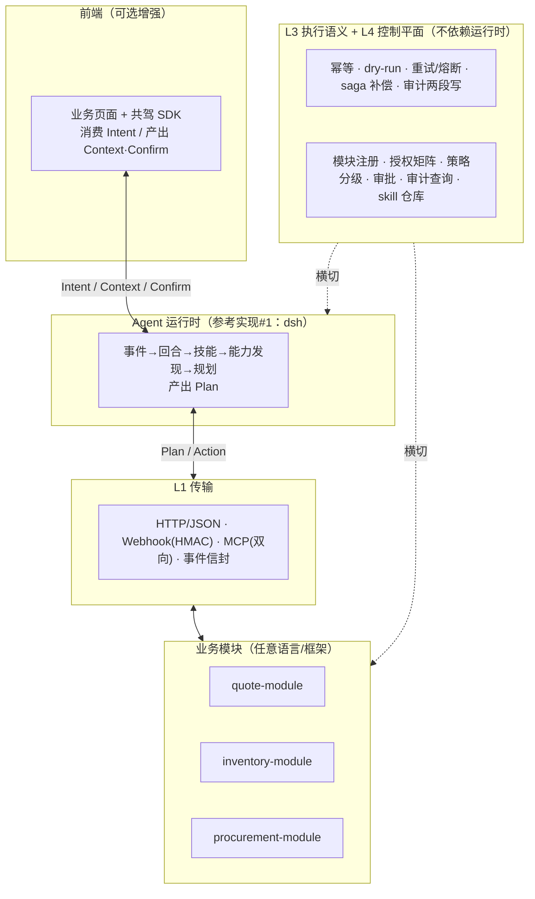
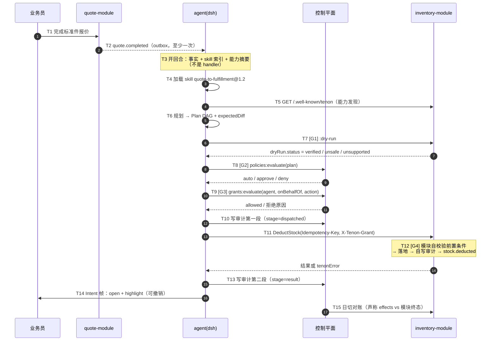
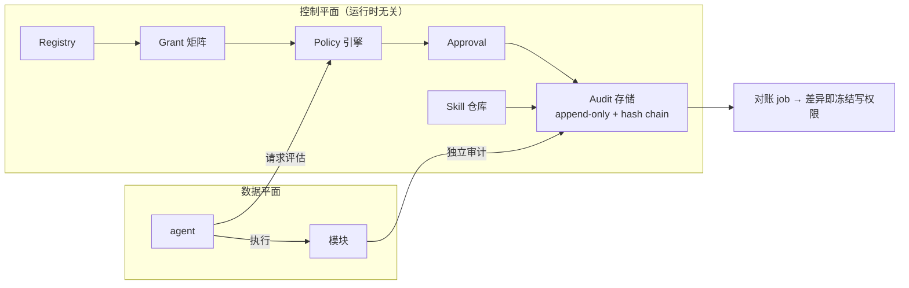

# Tenon Protocol（榫卯）设计文档

> 榫卯：不用胶水，靠结构本身严丝合缝。本项目的第一条铁律就是**禁止胶水代码**。

- 状态：**v0.2 待评审**（v0.1 → v0.2 依据独立评审修订，变更见 §16）
- 日期：2026-10-27
- 定位：基于 dsh（万物即插件）的开源项目，主产物是**可被机械验证的协议规范 + 参考实现**
- 包命名空间：`@tenon/*`；npm 包名 `tenon-protocol`（消歧用）
- 许可：Apache-2.0

---

## 0. 结论摘要

**技术可行性：可行。** dsh 生态已提供本项目所需的大部分基础原语：

| 自研（3 类工作、6 个包） | 对应 dsh 现成原语（不自研） |
|---|---|
| ① 协议契约（9 类 schema）+ 语义 | `dsh-skill`（技能）、`dsh-jobs-local`（任务队列） |
| ② 治理控制平面 | `dsh-authorization`、`dsh-permission-presets`、`dsh-user-approval`、`dsh-session-persistence-jsonl`、`dsh-otel` |
| ③ 一致性测试套件（可执行规范） | `dsh-mcp-client`（MCP 挂载）、`dsh-api-gateway`、`dsh-client-ui-*`（前端插件） |

**最大风险不是技术，而是产品性退化**：整套系统可能被接入方用 `on 事件 → 调 action` 的胶水代码写成规则引擎。本设计把这一点作为**规范级反模式判据**，并用**差异测试 + AST lint** 两层机械检查守住（§10.2）。

**规模估算**：M0–M2 约 **5.5 人周**（M0 2 + M1 1.5 + M2 2），含 20% 缓冲约 **6.6 人周**。

---

## 1. 目标与非目标

### 1.1 目标

1. **AI 驱动而非程序驱动**：模块插入后 agent 自动"学会"使用它，无需为每个业务流程写事件处理器。
2. **模块可插拔**：任意语言、任意框架的业务系统，按协议实现即可接入；符合 dsh"万物即插件"。
3. **协议可机械验证**：规范每一条都有可执行的一致性测试，第三方实现跑测即可自证合规。
4. **写操作可控**：风险分级、审批、幂等、补偿、审计、对账构成闭环。
5. **前端可选共驾**：agent 能让人看到它在做什么、让人一键批准/撤销，但前端不接入也不影响正确性。

### 1.2 非目标（v1 不做）

| 不做 | 原因 |
|---|---|
| UI/DOM 自动化（点页面） | 脆弱、慢、贵、难审计；与 Tool-first 冲突。遗留系统请写适配器 |
| 自研 LLM / 向量库 / 消息中间件 | 协议层不绑定任何基础设施 |
| 自研前端框架或低代码平台 | 前端只认三帧，任何框架都能接 |
| 通用工作流引擎 / BPMN | 会让"AI 驱动"退回"流程编排" |
| agent 内部规划算法 | 属实现细节，协议只规定输入输出与闸门 |

### 1.3 v2 Roadmap（明确不在 v1）

- **A2A 适配层**：Agent Card → Module Manifest 映射，agent 间委派。
- **语音/意图助手适配**（小艺类）：语音 → 业务意图帧。
- 用量与成本看板（字段已在审计契约预留，见 §4.8）。

---

## 2. 协议边界

### 2.1 协议内 vs 协议外

**协议内（必须写死，可被机械测试）**
- JSON 线格式与 JSON Schema（**唯一真源** = `spec/0.1/schemas/*.json`，Markdown 只写语义）
- **状态机**：Plan / Execution / Approval 的状态枚举与合法迁移（§5.1）
- **执行语义**：幂等、dry-run、重试、超时、熔断参数、saga 补偿（§5.2）
- **审计**：两段写（dispatched/result）、字段最小集、哈希链
- 版本协商与错误分类

**协议外（永远不规定）**
数据库、消息中间件、**鉴权实现**（令牌格式、SSO 协议）、前端框架、部署形态、LLM 供应商、agent 内部规划算法、UI 布局。

> 澄清：「鉴权实现在协议外」指**怎么认证**（OIDC/OAuth/证书）不规定；**授权决策的输入输出**（Grant 评估报文）在协议内，因为它是可测试的。

> **判据**：任何一条规范如果无法写出一致性测试用例，就不该进协议。

### 2.2 反模式判据（规范级）

> **接入方为了跑通业务流程，必须写「某事件/某错误 → 调某 action」的映射代码 —— 此时系统已退化为程序驱动，Tenon 在该接入点失效。**

三个支撑"AI 驱动"的机制，缺一即退化：

1. **能力发现**（`/.well-known/tenon`）：模块插进来，agent 通过发现获得新能力，不改代码。
2. **技能即知识**（skill 文件）：业务流程写成可审阅、可版本化的知识，教 agent 新流程只改 skill。
3. **治理闸门**（policy/approval/audit）：正因为不确定性是固有的，才用闸门而非硬编码控制风险。

**允许的绑定**：agent 可以声明订阅领域事件（`quote.*`）来决定"是否开启一个回合"。
**禁止的绑定**：事件类型或错误码到 action 的映射。

> **订阅决定"是否思考"，不决定"做什么"。**

这条用两层机械检查守住（§10.2）：**D1 差异测试**（主）+ **C10 AST lint**（辅）。

---

## 3. 架构总览

### 3.1 分层



| 层 | 承诺 | 不承诺 |
|---|---|---|
| 前端 | 消费 Intent、产出 Context/Confirm | 页面长什么样 |
| Agent 运行时 | 事件→回合→技能→规划→过闸门 | 怎么"想" |
| 业务模块 | 暴露 actions/events，**自己校验前置条件** | 内部实现 |
| L1 传输 | 语言无关、不绑 broker | 用哪个 broker |
| L3+L4 横切 | 幂等/补偿/审计语义 + 治理 | 用什么数据库 |

### 3.2 三个关键设计决定

1. **前端通道是可选增强**：无共驾 SDK 时 `Intent` 帧直接丢弃，业务结果不变。
2. **前置条件由模块自校验，agent 不可绕过**：agent 只能*请求*；"库存够不够"永远由模块判定。
3. **审计双写 + 两段**：agent 侧与模块侧各一份（对账用）；agent 侧分 `dispatched`/`result` 两段（崩溃恢复用）。

---

## 4. 契约（9 类）

> 计数说明：Manifest / Action / Event / Plan / Intent-Context-Confirm / Grant / Policy / Audit / Error = **9 类**。

### 4.0 通用：实体寻址与关联标识

所有跨契约的实体引用统一为：

```json
{ "module": "inventory", "type": "SKU", "id": "STD-1001" }
```

字符串简写形式：`inventory:SKU/STD-1001`。

`Event.subject`、`Plan.expectedDiff[].entity`、`Intent.target`、`Audit.effects.entities` 这四处都接受**两种形式**（类型记为 `EntityRefLike = EntityRef | EntityRefString`）。本文档示例里 `Event.subject`/`Intent.target` 用对象形式、`expectedDiff`/`effects.entities` 用字符串形式，二者都合法。

**但对账前必须先规范化**：比较两侧前统一转成对象形式（`module`/`type`/`id` 三段），否则字符串里的转义差异会导致假不一致。

- `causationId`：指向上一跳的 `eventId` 或 `auditId`；无上一跳时为 `null`。（**协议不定义 Command 契约**，不存在 `cmd_*`。）
- `correlationId`：`cor:<业务键>`，如 `cor:quote/Q-2026-0417`。

### 4.1 Module Manifest（发现）

`GET /.well-known/tenon` —— **摘要级**，不含 inputSchema（按需拉取，控上下文成本）。

```json
{
  "tenon": "0.1",
  "module": { "id": "inventory", "version": "1.4.0", "title": "库存" },
  "actions": [
    {
      "id": "inventory.DeductStock", "version": "1.0.0", "title": "扣减库存",
      "kind": "write",
      "risk": { "level": "medium", "reversible": true },
      "dryRun": { "supported": true }
    }
  ],
  "events": [ { "type": "stock.deducted", "version": "1.0.0" } ],
  "transports": ["http", "mcp"],
  "capabilities": ["dry-run", "event-replay"]
}
```

### 4.2 Action

```json
{
  "id": "inventory.DeductStock",
  "version": "1.0.0",
  "title": "扣减库存",
  "kind": "write",
  "inputSchema": {
    "type": "object",
    "required": ["sku", "qty", "referenceNo"],
    "properties": {
      "sku": { "type": "string" },
      "qty": { "type": "integer", "minimum": 1 },
      "referenceNo": { "type": "string" }
    }
  },
  "outputSchema": { "type": "object", "properties": { "onHand": { "type": "integer" } } },
  "risk": { "level": "medium", "reversible": true, "moneyAffecting": false },
  "idempotency": {
    "keyFields": ["sku", "referenceNo"],
    "scope": "module",
    "duplicateBehavior": "return_first_result"
  },
  "preconditions": ["stock.onHand >= qty"],
  "compensation": {
    "action": "inventory.ReleaseStock",
    "argMap": { "sku": "$in.sku", "qty": "$in.qty", "referenceNo": "$in.referenceNo" }
  },
  "timeoutMs": 5000,
  "dryRun": { "supported": true },
  "quotaUnit": "quantity"
}
```

硬约束（可机械校验）：
- `kind ∈ {read, write}`，**必填**。
- `kind == write` → `idempotency` **必填**；`kind == read` → 不得声明 `idempotency`。
- **`idempotency.keyFields` 必须是 `inputSchema.required` 的子集**（否则幂等键可能缺失 → 重复副作用）。
- `idempotency.scope ∈ {module, system}`；`duplicateBehavior` 取值域当前只有 `return_first_result`（未来可扩展）。
- `risk.reversible == false` 的 action **不允许出现在多步 Plan 的非末位**（无法回滚）。
- `risk.reversible == false` 且无 `compensation` → **强制审批**（策略层自动生效，不可绕过）。
- `preconditions` 是**模块自校验**的说明性字段，不是给 agent 执行的条件，agent 不得据此短路。
- `quotaUnit ∈ {calls, quantity}`，用于 Grant 配额计量（`quantity` 表示按 `args` 里的业务量计，字段名由 `quotaField` 指定）。

### 4.3 Domain Event

```json
{
  "eventId": "evt_01JB...",
  "type": "quote.completed",
  "version": "1.0.0",
  "subject": { "module": "quote", "type": "Quote", "id": "Q-2026-0417" },
  "occurredAt": "2026-10-27T09:12:03.412Z",
  "causationId": null,
  "correlationId": "cor:quote/Q-2026-0417",
  "payload": { "customerId": "C-88", "lines": [ { "sku": "STD-1001", "qty": 12 } ] }
}
```

语义：至少一次投递、可重放（`GET /tenon/events?since=cursor`）、消费侧按 `eventId` 去重。

### 4.4 Plan

```json
{
  "planId": "pln_01JB...",
  "supersedes": null,
  "trigger": { "eventId": "evt_01JB...", "correlationId": "cor:quote/Q-2026-0417" },
  "steps": [
    {
      "stepId": "s1", "action": "inventory.GetStock",
      "args": { "sku": "STD-1001" },
      "dependsOn": [], "kind": "read"
    },
    {
      "stepId": "s2", "action": "inventory.DeductStock",
      "args": { "sku": "STD-1001", "qty": 12, "referenceNo": "Q-2026-0417" },
      "dependsOn": ["s1"], "kind": "write",
      "idempotencyKey": "tenon:pln_01JB.../s2",
      "compensation": "inventory.ReleaseStock"
    }
  ],
  "expectedDiff": [
    { "entity": "inventory:SKU/STD-1001", "field": "onHand", "from": 120, "to": 108 }
  ],
  "dryRun": { "status": "verified", "diff": [ { "entity": "inventory:SKU/STD-1001", "field": "onHand", "from": 120, "to": 108 } ] },
  "estimatedRisk": "low",
  "rationale": null
}
```

硬约束：
- Plan 必须**人能读懂**、可被策略评估、可回放重建。
- `dryRun.status ∈ {verified, unsafe, unsupported, pending}` —— **三态+1**，不再是布尔（承载降级矩阵的"unverified → 强制审批"）。
- `rationale` 为**可选**字符串（v0.1 不强制；若实现方提供，审计可展示。理由见 §14 #1）。
- `amend` 产生**新 `planId`** 并置 `supersedes`；已执行步骤不得重放（靠幂等键吸收），仅未执行步骤可改。

### 4.5 Intent / Context / Confirm（人机共驾三帧）

**帧一：Intent（agent → 前端）**

```json
{
  "type": "tenon.intent",
  "intentId": "int_01J...",
  "planId": "pln_01JB...",
  "actions": [
    { "kind": "open", "target": { "module": "quote", "type": "Quote", "id": "Q-2026-0417" } },
    { "kind": "highlight",
      "target": { "module": "inventory", "type": "SKU", "id": "STD-1001" },
      "badge": "-12 已扣减", "undoable": true, "undoPlanId": "pln_01JB..." }
  ]
}
```

**帧二：Context（前端 → agent）**

```json
{
  "type": "tenon.context",
  "view": { "module": "quote", "type": "Quote", "id": "Q-2026-0417" },
  "edits": [ { "field": "qty", "from": 10, "to": 12 } ],
  "at": "2026-10-27T09:15:00.000Z"
}
```

**帧三：Confirm（前端 → agent）**

```json
{
  "type": "tenon.confirm",
  "confirmId": "cfm_01J...",
  "planId": "pln_01JB...",
  "decision": "approve",
  "patch": null,
  "by": "user:alice",
  "at": "2026-10-27T09:16:00.000Z"
}
```

- `decision` 枚举：`approve` | `reject` | `amend`。取 `amend` 时 `patch` 为 JSON Patch（RFC 6902），作用于 Plan 的未执行步骤。
- **帧内不含 DOM 选择器、不含坐标**。只表达"界面应进入什么状态"。

### 4.6 Grant（授权）

```json
{
  "grantId": "gr-01J...",
  "agent": "ag_fulfillment",
  "allow": [
    {
      "module": "inventory",
      "actions": ["inventory.GetStock", "inventory.DeductStock"],
      "constraints": { "maxQtyPerCall": 20, "window": "P1D", "maxUnitsPerWindow": 100 }
    }
  ],
  "expiresAt": "2027-01-01T00:00:00Z"
}
```

**权限取交集（D5）**：`effective = agent 被授予 ∩ onBehalfOf 用户权限`。agent 不会因业务员有财务权限而多出财务权限。

评估报文（宿主侧）：

```
POST /tenon/grants:evaluate
{ "agent": "ag_fulfillment", "onBehalfOf": "user:alice",
  "action": "inventory.DeductStock", "args": {...} }
→ 200 { "allowed": true, "matchedGrantId": "gr-01J...",
        "quota": { "remaining": 88, "unit": "quantity" } }
→ 200 { "allowed": false, "reason": "NOT_IN_GRANT" | "EXPIRED" | "QUOTA_EXCEEDED" | "SUBJECT_NOT_PERMITTED" }
```

- 配额窗口用 ISO-8601 duration；`quotaUnit` 由 action 声明。
- **模块侧必须再拒一次**（纵深防御）：模块校验 `X-Tenon-Grant: <grantId>` 与实际调用是否匹配。

**Webhook 签名**：`HMAC-SHA256(secret, timestamp + "." + rawBody)`，头 `X-Tenon-Signature: t=<unix>,v1=<hex>`；**时钟容差 ±300s**，超时即拒（防重放）。

### 4.7 Policy（风险分级）

```json
{
  "policyId": "pol-stock-deduct",
  "priority": 100,
  "match": { "module": "inventory", "actions": ["inventory.DeductStock"] },
  "when": { "all": [ { "arg.qty": { ">": 10 } } ] },
  "outcome": "approve",
  "approvers": ["role:warehouse_manager"]
}
```

- **算子集合（v0.1 封闭）**：`eq, ne, >, >=, <, <=, in, notIn, matches`。
- **组合**：`all` / `any` / `not`（可嵌套）。
- **合并规则（确定性）**：多策略命中时 **deny > approve > auto**；同 outcome 取 `priority` 最高者，记录其 `policyId`。
- **无命中 = deny**（fail-closed，与降级矩阵一致）。
- 自动升审批：`risk.reversible == false`、`dryRun.status != verified`、`idempotency` 缺失。

评估报文（宿主侧）：

```
POST /tenon/policies:evaluate
{ "plan": { ... } }
→ 200 { "outcome": "deny", "decidedBy": [], "reasons": ["NO_POLICY_MATCH_DEFAULT_DENY"] }
→ 200 { "outcome": "approve", "decidedBy": ["pol-stock-deduct"], "approvers": ["role:warehouse_manager"] }
```

- `outcome` 枚举：`auto` | `approve` | `deny`。
- 策略**不可被 agent 读取或改写**，只能请求评估。

### 4.8 Audit Event（不可变，两段写）

```json
{
  "auditId": "aud_01J...",
  "stage": "dispatched",
  "at": "2026-10-27T09:12:04.100Z",
  "actor": { "type": "agent", "id": "ag_fulfillment", "onBehalfOf": "user:alice" },
  "trigger": { "eventId": "evt_01JB...", "correlationId": "cor:quote/Q-2026-0417" },
  "planId": "pln_01JB...", "stepId": "s2", "action": "inventory.DeductStock",
  "inputHash": "sha256:...", "idempotencyKey": "tenon:pln_01JB.../s2",
  "decision": { "outcome": "auto", "policyId": null, "grantId": "gr-01J...", "approvedBy": null },
  "result": { "status": "unknown", "outputHash": null, "errorClass": null },
  "effects": { "entities": ["inventory:SKU/STD-1001"], "documentCount": 1, "quantity": 12 },
  "tokenUsage": { "in": 812, "out": 233 },
  "prevHash": "sha256:..."
}
```

字段约束：
- `stage ∈ {dispatched, result}`。**`dispatched` 必须先写成功，才允许执行**；写失败 → 拒绝执行。
- 同一次调用产生两条记录（`auditId` 相同、`stage` 不同），`prevHash` 串联成链。**链首记录的 `prevHash` 为 `null`**。
- `result.status ∈ {ok, error, partially_failed, unknown}`。`unknown` 表示崩溃恢复后结果未定，需按 `idempotencyKey` 向模块回查。
- `decision.outcome ∈ {auto, approve, deny}`；**`decision.policyId` 存是哪条策略批的**（与 outcome 分离，不撞名）。
- `effects` 承载业务单据量，v2 用量看板的聚合来源。**看板仍需新增聚合查询，但不需要改 schema**。
- 大对象只存 hash，原文入对象存储。

### 4.9 Error

```json
{
  "tenonError": {
    "class": "business_rejection",
    "code": "STOCK_INSUFFICIENT",
    "message": "可用 3，需求 12",
    "details": { "available": 3 },
    "retryable": false
  }
}
```

| class | 例子 | agent 行为 | 可重试 |
|---|---|---|---|
| `retryable` | 网络/限流/超时 | 退避重试，幂等键不变 | 是 |
| `business_rejection` | 库存不足/单据已变 | **重新规划**（改预留/拆单/发起采购），拿不准就问人 | 否 |
| `policy_denied` | 超授权/超阈值 | 终止转人工，**不得换路绕过** | 否 |
| `contract_violation` | schema 不符/未知 action | 死信 + 告警（协议或接入方 bug） | 否 |

### 4.10 接入面

**模块侧（任意语言实现这 6 个）**

```
GET  /.well-known/tenon            → manifest
GET  /tenon/actions/{id}           → 完整 Action（含 inputSchema）
POST /tenon/actions/{id}           → 执行（头：Idempotency-Key, X-Tenon-Grant）
POST /tenon/actions/{id}:dry-run   → 预演（可选，缺失则降级强制审批）
POST /tenon/events                 → 系统→模块：投递事件（Webhook，HMAC）
GET  /tenon/events?since=cursor    → 系统←模块：补课/重放
```

**宿主侧（控制平面实现这 4 个；模块不必实现）**

```
GET  /tenon/audit?planId=&since=   → 审计查询（支撑一致性用例 C4）
POST /tenon/grants:evaluate        → 授权评估
POST /tenon/policies:evaluate      → 策略评估
WS   /tenon/intents                → 三帧通道（REST 降级：GET /tenon/intents/poll + POST /tenon/intents/ack）
```

**版本协商**：`Tenon-Version: 0.1` / `Tenon-Min-Version`；语义化版本；**只增不删字段，未知字段必须忽略**。

**MCP 映射（D7）**：模块以 MCP server 暴露时，tool 名固定为 `tenon_<module>_<action>`（下划线，避免点号在部分客户端被截断）。

---

## 5. 状态机与执行语义

### 5.1 状态机（v0.1 写死）

**Plan**
```
draft → evaluating → auto_approved | approved | rejected
                          ↓            ↓
                      executing → completed | partially_failed | failed | aborted
```
`amended` 不是状态，而是**产生新 Plan**（`supersedes` 指旧 planId）。

**Approval**：`pending → approved | rejected | amended | expired`（`expiresAt` 到期自动 `expired`，等价 reject）。

**Execution Step**：`pending → dispatched → succeeded | failed | compensated | unknown`
- 进入 `dispatched` 前置条件：该 step 的 `dispatched` 审计已写成功。
- `unknown` 只能通过 `idempotencyKey` 回查收敛为 `succeeded` 或 `failed`。

### 5.2 执行语义参数（协议默认值，接入方可覆盖但必须声明）

| 项 | 默认值 | 说明 |
|---|---|---|
| `action.timeoutMs` | 30000 | 单步超时；超时视为 `retryable` |
| 重试 | `maxRetries=3`, `baseMs=200`, `factor=2`, `jitter=0.2` | 仅对 `retryable` |
| 熔断 | `failureThreshold=5`, `cooldownMs=60000`, `halfOpenProbes=1` | 熔断期该 action 在能力清单标 `unavailable` |
| 补偿 | 逆序执行已成功步骤的 `compensation` | 失败步骤本身不补偿（可能未生效） |

**不可逆约束**：`risk.reversible=false` 的步骤若不是 Plan 末位 → 宿主**拒绝该 Plan**（`contract_violation`）。

---

## 6. 纵切面：报价完成 → 扣库存

### 6.1 demo 业务系统（3 模块，`demo/mini-erp`）

| 模块 | actions | events | 用途 |
|---|---|---|---|
| quote | `CreateStandardPartQuote`、`GetQuote` | `quote.completed` | 触发器 |
| inventory | `GetStock`、`DeductStock`、`ReleaseStock` | `stock.deducted`、`stock.insufficient` | 主路径 + 补偿 |
| procurement | `CreatePurchaseRequest` | `purchase.requested` | **分支路径**：库存不足时 agent 自行选择 |

> 为什么必须 3 个模块：只有存在两条可能路径，才能用差异测试（§10.2 D1）证明 agent 在**推理**而不是跑流水线。

**规范不规定 `stock.insufficient` 对应哪个 action。** 演示中"改走采购"由 skill 引导 agent 自行决定，不由代码映射——这是 D1 差异测试能通过的前提。

### 6.2 时序（15 步 · 4 个闸门）

四个闸门枚举：**G1 dry-run**（T7）、**G2 策略**（T8）、**G3 授权**（T9）、**G4 模块前置条件**（T12）。



### 6.3 分支：库存不足（AI 驱动价值所在）

`DeductStock` 返回 `business_rejection / STOCK_INSUFFICIENT` → agent **不报错**，而是：
1. 重新读能力清单，发现 `procurement.CreatePurchaseRequest`
2. 产出替代 Plan（部分履约 + 采购申请），`supersedes` 旧 Plan，标 `estimatedRisk`
3. 若新 Plan 命中"高风险"策略 → `approve` 转人工；否则执行
4. Intent 帧告诉业务员："已扣 3 件，缺口 9 件已发起采购申请 PR-..."，可撤销

**差异测试 D1 就测这个分支**：摘掉 procurement 模块后，同一输入的 Plan 必须不同（例如改走"预留 + 转人工"），且不抛错。

### 6.4 技能（Skill）格式

复用 dsh skill（`SKILL.md` + frontmatter），增加业务元数据：

```yaml
---
name: quote-to-fulfillment
version: 1.2.0
tenon:
  subscribes: ["quote.completed"]        # 决定「是否思考」，不决定「做什么」
  expectedModules: ["inventory", "procurement"]
  outcome: "标准件报价完成后核对库存并履约"
---
# 步骤（给 agent 读的知识，不是可执行流程）
1. 若报价单含物理件，必须核对库存……
```

**硬约束**：skill 只能声明"我关心哪些事实"；**正文中不得出现 `模块.action` 形式的动作标识符**（C10 lint 会扫），只能描述业务语义。

**发布治理（D8）**：单人可发布，但每次发布进审计、可一键回滚到上一版本。

---

## 7. 治理控制平面

### 7.1 v1 范围

| 模块 | 内容 |
|---|---|
| **Agent 注册 + 能力授权矩阵** | agent 身份与凭证、可调用的 `模块×action` 白名单、配额（交集规则见 §4.6） |
| **审计 + 可回放** | 结构化审计两段、从审计回放到 dsh 会话轨迹、日切对账 |
| **技能 / 业务流程知识管理** | skill 仓库、版本化、单人发布 + 审计留痕 + 回滚 |

### 7.2 平面与数据平面



---

## 8. 健壮性：8 道闸 + fail-closed

| # | 机制 | 硬约束 |
|---|---|---|
| 1 | 幂等 | `kind=write` 必声明 keyFields 且 ⊆ required；`Idempotency-Key` 重复必须返回首次结果 |
| 2 | saga 补偿 | `reversible=false` 不许出现在非末位；失败则逆序补偿已成功步骤 |
| 3 | 超时 + 熔断 | 参数见 §5.2；熔断期从能力清单摘掉 |
| 4 | 对账 | 日切比对 `Audit.effects` vs 模块终态；差异即**冻结该 agent 写权限**再告警 |
| 5 | 审计不可变 | append-only + `prevHash` 哈希链；两段写（先 `dispatched` 后 `result`） |
| 6 | 双层授权 | 控制平面 + 模块侧各拒一次；webhook HMAC + 300s 容差 |
| 7 | 版本演进 | 只增不删、未知字段忽略、一致性测试进 CI |
| 8 | 降级 | 见下表，**全部 fail-closed** |

### 降级矩阵（fail-closed）

| 缺失/失败 | 行为 |
|---|---|
| 无前端 SDK | 丢 Intent 帧，业务正确 |
| 无 dry-run（`unsupported`）或 `unsafe` | Plan 标 `unsupported`/`unsafe` → **强制审批** |
| 策略服务不可用 | 默认 **deny**（不是 auto） |
| 授权服务不可用 | 默认 **deny** |
| 无 LLM | 事件积压可重放，不丢 |
| 模块超时/熔断 | 从能力清单摘掉 |
| 事件重复投递 | `eventId` 去重 |
| 审计 `dispatched` 写失败 | **拒绝执行** |

---

## 9. 兼容性

| 对象 | 怎么接 | 降级 |
|---|---|---|
| 任意语言后端 | HTTP/JSON + JSON Schema，模块侧 6 端点 | 无 SDK 手写端点 |
| 已有 MCP 服务 | 包装成模块：tool → action，名 `tenon_<module>_<action>` | 缺 risk/幂等注解 → 视为高风险 + 强制审批 |
| 无 API 老系统 | 写适配器（**不做 UI 自动化**） | 写操作退回人工 |
| 任意前端 | WS 三帧；REST 轮询可降级 | 纯对话 + IM 通知 |
| 消息中间件 | 事件信封与 broker 解耦（Kafka/NATS/Redis 适配器） | HTTP webhook 轮询 |
| A2A | v2：Agent Card → Module Manifest 映射 | v1 不承诺 |
| 语音/意图助手（小艺类） | v2：语音 → 业务意图帧 | v1 不承诺 |
| dsh 版本 | peerDeps 范围 + dsh 已有豁免机制 | 协议层不 import dsh |

**与 MCP 的关系**：MCP 是**传输与工具暴露**协议，Tenon 是**业务治理与执行语义**协议。互补，不替代。

---

## 10. 一致性测试套件（可执行规范）

```
tenon conformance run --target http://localhost:8080 --report out.json
```

### 10.1 用例

| # | 用例 | 断言 | 阶段 |
|---|---|---|---|
| C1 | manifest 合法性 | 符合 schema；每个 action 有 `kind`、`risk`；`kind=write` 有 `idempotency` | M0 |
| C2 | 幂等 | 同 Idempotency-Key 提交两次 → 副作用一次，返回首次结果 | M0 |
| C3 | 未知字段 | 注入未知字段 → 忽略而非报错 | M0 |
| C4 | 审计可查 | 写调用后审计可查，`dispatched` 与 `result` 两段齐备，`prevHash` 链连续 | M0 |
| C5 | fail-closed | 策略/授权评估端点不可达时，写操作被拒 | M0（桩）/ M1（真引擎） |
| C6 | 事件重放 | `since=cursor` 补齐丢失事件，消费侧不重复生效 | M1 |
| C7 | 补偿 | 多步 Plan 中途失败 → 已成功步骤被补偿，审计标 `partially_failed` | M1 |
| C8 | 可选能力容忍 | 未实现 dry-run → 用例 pass，但运行时强制审批 | M0 |
| C9 | 错误分类 | 四类错误码与 `retryable` 标志正确 | M0 |
| C10 | 反模式 lint | 见 §10.2 三条扫描规则 | M0 |
| D1 | **差异测试** | 见 §10.2：摘掉模块后 Plan 必须改变且不抛错 | M0 |

### 10.2 反模式的两层检查（核心）

**D1 差异测试（主判据，M0 交付）**

1. 冻结输入：同一事件 + 同一数据快照 + 固定 skill 版本。
2. 跑 A：三模块全在 → 记录 Plan A（含 chosen actions 序列）。
3. 跑 B：摘掉 `procurement` 模块 → 记录 Plan B。
4. 断言：**Plan A 的 action 序列 ≠ Plan B 的 action 序列**（结构差异，不比字符串），且 B 达成可接受结果（预留 / 转人工），**不抛错**。

为什么这样能证明：如果实现是硬编码映射，摘掉 procurement 后行为要么不变（说明它没在用）、要么崩溃（说明映射写死了）。**只有真正在按能力清单推理，行为才会自适应地改变。**

**C10 AST lint（辅助，覆盖静态痕迹）**

1. 事件订阅回调体内出现具体 action 字面量（`actions.<id>`、`invoke("<module>.<action>")`）
2. 错误码 → action 的映射（`case STOCK_INSUFFICIENT: call(...)`）
3. skill 正文里出现 `模块.action` 标识符

任一命中 → 失败。可对任意接入方仓库运行（`@tenon/lint`）。

通过者获 badge：`tenon-conformant-0.1`。

---

## 11. 仓库结构

```
tenon/
├── spec/0.1/
│   ├── schemas/*.json          # 唯一真源：manifest/action/event/plan/intent/grant/policy/audit/error
│   ├── manifest.md action.md event.md plan.md intent.md
│   ├── grant.md policy.md audit.md errors.md
│   ├── state-machines.md       # §5.1 的状态枚举与迁移
│   ├── semantics.md            # §5.2 的执行参数
│   └── CHANGELOG.md
├── scripts/build-spec.mts      # 由 schema 生成 md 字段表（md 不手写字段定义）
├── conformance/
│   ├── cases/*.yaml            # C1–C10 + D1
│   └── src/runner.ts
├── packages/
│   ├── tenon-core/             # 类型 + schema 校验 + 幂等/哈希/寻址工具（不依赖 dsh）
│   ├── tenon-lint/             # C10 AST lint
│   ├── dsh-plugin-module-host/ # 参考实现#1：cordis 插件，把模块挂进 dsh
│   ├── dsh-plugin-governance/  # 控制平面（registry/grant/policy/audit）
│   ├── dsh-plugin-intent-ui/   # 共驾三帧服务 + 前端 UI 插件
│   ├── dsh-plugin-skill-biz/   # 业务流程 skill 仓库（复用 dsh-skill）
│   └── sidecar-http/           # 参考实现#2：任意语言接入的 HTTP 侧车
├── demo/mini-erp/              # quote + inventory + procurement + 前端页面
├── docs/                       # 架构图、接入指南
└── .gitignore                  # 含 .superpowers/
```

---

## 12. 里程碑

| 阶段 | 内容 | 出口判据 | 估算 |
|---|---|---|---|
| **M0 骨架** | `spec/0.1` schema + conformance C1–C5/C8/C9/C10 + D1 + `tenon-lint` + mini-erp 三模块 + `dsh-plugin-module-host` + 「报价→扣库存」端到端 | 一条命令起 demo；**D1 与 C10 全绿**；注入 `dispatched` 写失败必须拒绝执行（可测） | 2 人周 |
| **M1 治理** | grant 矩阵 + policy 引擎 + 审批 UI + 审计查询/回放 + 对账 job + C6/C7 | 高风险路径必须人工；对账能发现人为篡改 | 1.5 人周 |
| **M2 兼容** | HTTP sidecar SDK + MCP 双向 + Python 示例 + 一致性 badge | 非 TS 模块接入跑通全套用例 | 2 人周 |
| **M3 知识** | skill 仓库 + 轨迹蒸馏半自动 + 发布审计/回滚 | 新业务流程只改 skill 即可上线 | 1.5 人周 |

> A2A 与语音适配属 v2（§1.3），不计入 M0–M3。

**范围切分（给实施计划用）**：本设计覆盖 M0–M3，是**四个可独立交付的子系统**。
下一份计划只针对 **M0**。M1/M2/M3 各自另起计划，前置条件是上一阶段出口判据达成。

---

## 13. 风险登记

| 风险 | 影响 | 缓解 |
|---|---|---|
| **R1 退化成规则引擎** | 高 | 反模式判据 + **D1 差异测试** + C10 lint |
| **R2 协议过抽象变空泛标准** | 高 | 只服务一个纵切面；无测试用例的条款直接删除；schema 为唯一真源 |
| R3 真实系统无补偿接口 | 中 | `risk.reversible` + 不可逆强制审批 + dry-run 必读 |
| R4 审计不可信（agent 自证） | 中 | 模块侧独立记录 + 日切对账 + 哈希链 |
| R5 共驾帧落地成本高 | 中 | 先只做 demo 页 + SDK hook；未接入降级纯对话 |
| R6 绑定 dsh 版本 | 低 | 协议层不 import dsh，仅 adapter 包依赖 |
| R7 D1 受 LLM 非确定性影响 | 中 | D1 只比对 **action 序列的结构差异**，不比对参数文本；同 skill 版本 + temperature=0 + 重试 2 次取多数 |

---

## 14. 决策记录

| # | 决策 | 结论 | 理由 |
|---|---|---|---|
| D1 | 项目主产物 | 双轨：规范 = 可执行测试 | 兼容性与健壮性都要可机械验证 |
| D2 | 首个纵切面 | 虚构 mini-erp | 公开可复现、无内部依赖 |
| D3 | 后端通道 | Tool/API-first，不做 UI 自动化 | 抗幻觉、可审计、可回滚 |
| D4 | 自主性边界 | 分风险分级 | 效率与可控的平衡 |
| D5 | 身份代理 | **权限取交集**（agent ∩ 操作人） | 最小惊讶；审计能追责但不放大权限 |
| D6 | 前端协议 | 共驾三帧（Intent/Context/Confirm） | 不做 DOM 自动化仍让人看得见、拦得住 |
| D7 | MCP 映射 | tool 名 `tenon_<module>_<action>` | 下划线兼容所有客户端 |
| D8 | skill 发布 | **单人可发 + 强审计 + 可回滚** | 知识需快迭代，用审计与回滚而非审批卡住 |
| D9 | 实现栈 | TS + cordis 插件；跨语言走侧车 | 与 dsh 同构，零胶水 |
| D10 | 管理台 v1 | 注册/授权 + 审计/回放 + 技能管理 | 用量看板延后（审计已预留 effects/tokenUsage） |
| D11 | 架构选型 | 协议内核 + 多运行时 | 协议不被运行时绑死，dsh 是第一个宿主 |
| D12 | demo 模块数 | 3 个（+procurement） | 有分支才能做差异测试 |
| D13 | AI 驱动的判据 | **差异测试（主）+ AST lint（辅）** | 唯一不依赖自觉的机械判据 |
| D14 | 事件订阅粒度 | 声明订阅 + M1 补漏判检测 | 全面订阅成本不可控 |
| D15 | 上下文成本 | 摘要优先 + 按需拉完整 schema | manifest 摘要层已现成 |
| D16 | 命名 | Tenon（榫卯） | ASIP 与同领域 3 个项目撞名 |

---

## 15. 未决问题

1. **`rationale` 是否升级为必填**：v0.1 选可选（避免 Plan schema 变重）。若 M1 审计回放发现"看不懂 agent 为何这么选"，再升级为必填。
2. **多租户隔离**：控制平面是否需要租户级策略与审计分区（v1 单租户）。
3. **配额单位扩展**：`quotaUnit` 目前只有 `calls` / `quantity`，是否需要 `money`。
4. **策略 DSL 表达力边界**：`all/any/not` + 9 个算子是否够；何时需要引入表达式语言（会牺牲可测试性）。
5. **skill 正文里允许的动作标识符例外**：例如"禁止调用 X"这类否定描述是否要放行。

---

## 16. v0.1 → v0.2 变更（依据评审）

| 评审问题 | 修法 |
|---|---|
| 幂等键含可选字段 | `DeductStock.referenceNo` 改为 required；新增硬约束 `keyFields ⊆ required` |
| 读写分类无字段 | Action 新增 `kind: read\|write`；C1 断言按 kind 分支 |
| dry-run 无报文 | §4.10 增端点；Plan 的 `dryRunVerified: boolean` 改为 `dryRun.status` 四态 |
| 6 端点不足 | 拆成「模块侧 6 + 宿主侧 4」两表（审计/授权/策略/WS 属宿主） |
| 审计 4 个未定字段 | 加 `stage`；`result.status` 四态枚举；加 `effects`；`decision.outcome` 与 `policyId` 分离 |
| Grant/Policy 只到概念 | 补 JSON、评估报文、算子集合、组合规则、合并规则、配额窗口、HMAC 参数 |
| 协议内清单没落成规范 | 新增 §5 状态机 + 执行参数（N/退避/超时/amend 语义） |
| 时序图 T9 重复、步数不符 | 重排为 T1–T15，显式枚举 G1–G4，标题改「15 步 · 4 闸门」 |
| C10 有漏洞、与 §2.2 不一致 | 新增 **D1 差异测试**为主判据；C10 扩到错误码映射与 skill 正文；§2.2 措辞对齐 |
| 实体寻址未定义 | 新增 §4.0 统一 `EntityRef`；`causationId` 不再引用不存在的 Command |
| 契约计数不一致 | 统一为 **9 类**；`spec/0.1/` 补齐 manifest/errors/grant/policy/state-machines |
| M3 与 v1 范围冲突 | A2A/语音移入 §1.3 v2；C5/C6/C7 归属到 M0 桩/M1 |
| 缓冲算术 | 改「5.5 人周，含 20% 缓冲 6.6」 |
| 真源不明 | schema 为唯一真源，md 由 `build-spec.mts` 生成字段表 |

---

## 附录 A：设计期可视化

- [`docs/design-screens/architecture-approaches.html`](../design-screens/architecture-approaches.html)（三方案对比与选型理由）
- [`docs/design-screens/design-1-layers.html`](../design-screens/design-1-layers.html)（分层 + 契约 + 协议内外边界）
- [`docs/design-screens/design-2-slice.html`](../design-screens/design-2-slice.html)（纵切面时序 + 错误分类 + 接入面）
- [`docs/design-screens/design-3-robustness.html`](../design-screens/design-3-robustness.html)（8 闸 + 降级矩阵 + 兼容性 + 风险）

> 注意：这四份是 **v0.1 时期**的可视化快照（已同步改名为 Tenon），步数/端点数与 v0.2 有差异，以本文档为准。设计期本地画板 `.superpowers/` 不入库。
