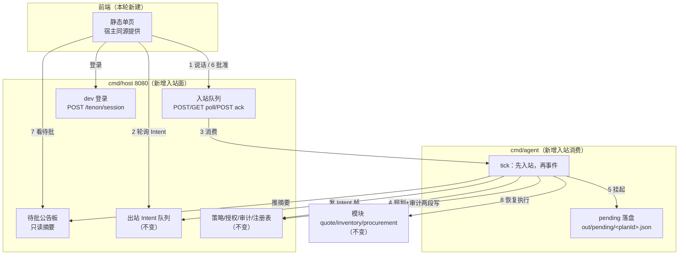

# M1 切片 1 设计：对话入口（共驾对话框 + 审批落地）

- 状态：**待评审**（已过两轮自查：初版自查 → 重审更正 3 处错误 → 架构对照补充 I7 与 4 处性质级修订；见 §11）
- 日期：2026-10-27
- 关系：是 [`2026-10-27-tenon-ai-driven-system-design.md`](2026-10-27-tenon-ai-driven-system-design.md) 的增量；同时是 [`2026-10-27-tenon-m05-host-agent-design.md`](2026-10-27-tenon-m05-host-agent-design.md) §0 非目标里「前端共驾页面」的落地切片，并把该文档 §5「`approve` 一律转人工」这条死路打开。
- 前置：M0.5 三进程已落地（`cmd/host` 8080 / `cmd/agent` / `cmd/quote` 8083 / `cmd/inventory` 8081 / `cmd/procurement` 8082）。
- 阅读顺序建议：§1 事实基线（现状怎么坏）→ §2 架构与不变量（I1–I7）→ §3 契约增量 → §11 三张「改了什么」表（含本切片的代价）。

---

## 0. 目标与非目标

**目标**

1. **人 → agent 有入口**：业务员用一句自然语言发起任务，agent 起一个回合。协议今天没有这一帧（三帧里 Intent 是 agent→前端，Context/Confirm 是前端→agent 但 agent 不读）。
2. **`approve` 能真的执行**：今天 `internal/agent/run.go` 的 `auditBase` 写死 `ApprovedBy: nil`，并有测试锁定「approve 一律转人工」——而 dev 策略里 `DeductStock qty>10` 与 `CreatePurchaseRequest` 本来就命中 approve，**mini-erp 主路径今天执行不完**。
3. **`confirm.by` 可信**：host 现在是裸连接，任何人都能自称 `user:alice` 去批准。
4. **界面说人话**：业务员看到的必须是「从标准件仓扣掉 12 件」，不是 `inventory.DeductStock` / `G1 ok`。

**非目标（本轮明确不做）**

| 不做 | 归属 |
|---|---|
| 撤销（undo → 补偿 `ReleaseStock`） | 切片 2 |
| WS 实时推送（`GET /tenon/intents` 仍 405） | 切片 3 |
| `amend` + JSON Patch 编辑后再批 | 审批 UI 后续 |
| `tenon.context` 帧入站（本轮入站只收 request / confirm） | 归档 |
| 多 host 实例 / 多 agent 并行 | M2（受审计链与进程内库存限制，见 §8） |
| 真认证、SSO、多租户、口令策略 | M1 之后 |
| 逐 step 审批（本轮是「整份 Plan 一次批准」） | 归档，理由见 §3.3 |

---

## 1. 事实基线（为什么必须做这几处）

| 现状 | 代码位置 | 后果 |
|---|---|---|
| `approve` 无通道，`ApprovedBy` 恒 null | `internal/agent/run.go:739`；`TestPolicyApproveGoesNeedsHumanWithoutApprovalChannel` | demo 主路径永远 `needs_human`，扣不掉库存 |
| `confirm` / `context` 有端点没人读 | host 能入队（`internal/controlplane/http.go:204-210`），`internal/agent` 全文无 `confirm` 命中 | 「共驾」只有半条通道，批准发出去沉进队列 |
| 没有入站入口 | `cmd/agent` 是纯轮询守护，无 Listener | 人说话没有通道；`tenon.request` 帧不存在 |
| 前端零代码 | `packages/dsh-plugin-intent-ui/` 只有 `package.json` + `README.md` + `tsconfig.json` | 全仓前端源码 0 个文件 |
| 队列 ack 是累积游标 | `http.go` `ack(upto)` | **两个消费者不能共用一个队列**：agent 一 ack 就会吞掉前端还没看到的 Intent 帧 |
| 审计 stage 只有两态 | `audit-event.schema.json:226` `enum: [dispatched, result]` | 不能新增 `awaiting_approval` 阶段，挂起语义要落在现有两段写之内（§3.6） |
| 业务员读不懂协议标识 | 评审反馈 | Plan 卡必须白话化（§5） |

---

## 2. 架构：选定方案 A（agent 落盘挂起 · 轮询恢复）



**为什么是 A 而不是另外两条**（评审时已比过）：

- **B 回合内阻塞等确认**：`cmd/agent` 是单协程顺序循环，阻塞期间其它事件全停；重启即丢 pending，没人知道那笔还在等；超时后 plan 悬挂且无记录，与「可重放」的调性冲突。
- **C 宿主持有 pending + 审批状态**：host 会从「策略/授权/审计/注册表」膨胀成计划状态机；spec 里 Plan 是 agent→系统的产物，搬进 host 就有两处真相。

**pending 生命周期（权威状态只在 agent 盘上）**

```
           闸门 approve
   running ─────────────► awaiting_approval ──confirm(approve)──► executing ──► done
                              │                                      │
                              ├──confirm(reject)──► rejected         └──G4 失败──► replanning（新 planId）
                              └──超时 15min──────► expired
```

**不变量**

| # | 不变量 | 为什么 |
|---|---|---|
| I1 | 同一 `confirmId` 只产生一次副作用 | 幂等键 + pending 状态迁移；重复投递返回既有结果 |
| I2 | `dispatched` 段 `decision.approvedBy` 恒为 `null`；批准后的 `result` 段才非空 | 「派出时还没人批」是事实，改写历史等于伪造审计 |
| I3 | 过期 pending 绝不执行 | fail-closed |
| I4 | 恢复执行前必须重跑 G4 前置条件 | 审批窗口内库存可能被别人改（TOCTOU） |
| I5 | host 公告板可丢、可重建；丢它不影响正确性 | 公告板是 read-model，不是权威状态 |
| I6 | 单 host、单 agent 实例 | 审计链单写者（`audit.go:94`）、库存是进程内内存 |
| **I7** | **挂起的两次落盘有序且可校验**：先写 pending（含 `dispatchedAuditId` 占位，fsync）→ 再写 `dispatched` 审计 → 回写 pending 标记「审计已落」；**恢复的前置条件是审计链上能查到该 `dispatchedAuditId`**，查不到则不执行并记 `contract_violation` | 一次挂起有两次落盘（pending 文件 + dispatched 审计），它们没有共同事务。先审计后 pending：崩溃留下「有 dispatched 没 result」的孤儿，对账会当成未完成调用；先 pending 后审计：崩溃后若直接执行，就违反「dispatched 先落盘才允许执行」这条铁律 |

**I7 的三种崩溃位置与恢复行为**

| 崩溃在 | 盘上状态 | 恢复时怎么判 |
|---|---|---|
| pending 写完前 | 什么都没有 | 无事可恢复；request 仍在入站队列，重开回合 |
| pending 写后、dispatched 前 | pending 在，`dispatchedAuditId` 指向的记录不存在 | **不执行**，记 `contract_violation`，pending 移入 `archived/`（标 `stale`），发 Intent 帧说明 |
| dispatched 后、标记前 | 两者都在，pending 未标「审计已落」 | 校验审计链存在该 id → 补标记 → 正常等审批；若已过期则走 I3 |


---

## 3. 契约增量（spec 0.1 → 0.2 提案，须同步 CHANGELOG 与 interfaces.md）

### 3.1 新帧 `tenon.request`（人 → agent）

```json
{
  "type": "tenon.request",
  "requestId": "req_01JBK7…",
  "text": "Q-2026-0417 这单货不够，先扣现有的，缺的发起采购",
  "context": { "view": { "module": "quote", "type": "Quote", "id": "Q-2026-0417" } },
  "by": "user:alice",
  "at": "2026-10-27T09:15:00.000Z"
}
```

| 字段 | 必填 | 说明 |
|---|---|---|
| `requestId` | 是 | 形如 `req_<ULID>`，幂等键来源 |
| `text` | 是 | 业务员原话，≤ 2000 字符。**不做意图分类**，直接进对话上下文 |
| `context.view` | 否 | 可选的实体锚点（「这单」指哪单）。不含 DOM 选择器、不含坐标 |
| `by` | 是 | 由宿主从 token 解析后**覆写**；客户端自报值一律丢弃 |
| `at` | 是 | RFC 3339 |

### 3.2 入站端点（独立队列，不与出站共用累积游标）

| 端点 | 语义 |
|---|---|
| `POST /tenon/requests` | 收 `tenon.request` 或 `tenon.confirm` 之一；`200 {ok, seq}` |
| `GET /tenon/requests/poll?after=<seq>` | `{frames:[{seq,frame}], nextCursor, dropped}` |
| `POST /tenon/requests/ack` | `{upto}`（省略 = 确认全部）→ `{ok, acked}` |

**为什么不复用 `/tenon/intents`**：它的 ack 是累积游标（`ack(upto)`），前端与 agent 两个消费者各自 ack 会互相吞帧。入站与出站是两个方向、两个消费者，必须两条队列。

### 3.3 `tenon.confirm` 复用，本轮只消费 `approve` / `reject`

帧结构与 `frames.schema.json#/$defs/ConfirmFrame` 完全一致。`decision=amend`（含 `patch`）**本轮不消费**：收到即 `409 NOT_SUPPORTED_THIS_SLICE`，并审计记 `contract_violation`——不静默忽略。

**整份 Plan 一次批准**，不逐 step 批：现状 `policies:evaluate` 是 plan 级合并（`deny > approve > auto`），一次 confirm 对应一份 plan 与人工的一次决定；逐 step 审批会把「一次业务决定」拆成 N 次点击，且要为每步维护独立 pending。逐 step 审批记为后续能力。

### 3.4 Module Manifest 增 `summaryTemplate`（`title` 已存在，不用新增）

`module-manifest.schema.json` 的每个 action 增：

| 字段 | 现状 | 说明 |
|---|---|---|
| `title` | **已存在且必填**（`module-manifest.schema.json:90`，三个模块的 6 个 action 都已有中文 title，如「扣减库存」「创建采购申请」） | 本轮**不动**。重审更正：初版 spec 误以为要新增，实际是重复造轮子 |
| `summaryTemplate` | **新增（可选）** | 参数模板，如 `从{按仓库名}扣掉 {qty} 件 {sku}`；占位符是 `inputSchema` 的属性名 |

`module-manifest.schema.json` 的 action 项是 `additionalProperties: false`，因此 `summaryTemplate` 必须显式加进 schema，否则 C1 的 schema 校验会把带模板的 manifest 判 FAIL（`conformance.go:211`）。

渲染期**不**为了校验占位符去拉 `inputSchema`（那是按需拉取的完整定义，见 D15）：未知占位符或取值缺失直接走 §5 的 R2 回退。`title` 缺失在能力发现时摘掉该 action（fail-closed），但现状不会触发——它是 schema 必填项。

### 3.5 待批公告板（host 只读 read-model）

| 端点 | 方向 | 载荷 |
|---|---|---|
| `POST /tenon/pending` | agent → host | `{planId, requestId, by, summary, items:[{label}], requiredRoles, expiresAt, at}` |
| `GET /tenon/pending` | 前端 ← host | 按 token 的 roles 过滤：`{items:[{planId, summary, items, requiredRoles, expiresAt, mine}]}` |

`GET` 响应字段：`mine` 表示「当前 token 的 roles 是否命中该条目的 `requiredRoles`」（即可否由我批准）。

约束：host 对 pending **不做任何执行或授权决定**。`GET` 里的 `mine` 只用于页面显示，不构成授权。

**I5 的重建机制（初版只写了「可重建」，没写怎么重建——等于空话）**：`POST /tenon/pending` 是**幂等 upsert**（同 `planId` 覆盖，不追加）；agent 在启动时与**每个 tick**都对现存 pending 重推一次摘要。host 重启丢公告板后，最多一个 tick 周期内自愈。重推是廉价操作（pending 数量是个位数），不设增量协议。

**校验分工（避免两处真相）**：host 在 `POST /tenon/requests` 收 confirm 时做**fail-fast 预检**——用公告板里的摘要查 `requiredRoles` 与 `expiresAt`，明显非法就立刻 `403`/`409` 且不入队，让业务员马上得到反馈；**权威校验仍在 agent 恢复时重做一遍**。host 预检偏严格或偏宽松都安全：宽松则 agent 兜底拒，严格则提前拒；agent 的判定永远是最终的那个。

### 3.6 审计语义（不新增 stage）

`stage` 枚举仍是 `dispatched | result`：

- **挂起时**写 `dispatched` 段（`approvedBy: null`，`decision.outcome: "approve"`）——语义仍是「即将发出调用，必须先落盘」，只是它真的还没发。
- **批准后**执行，写 `result` 段并补 `approvedBy: "user:alice"`（**同一个 `auditId`**，两段写结构不变）。
- **驳回 / 过期**同样要写 `result` 段：`status:"error"`, `errorClass:"policy_denied"`。理由：只写 `dispatched` 不写 `result` 会留下孤儿记录，让对账误判成「有调用没结果」，比错误码不精确更坏。

> 已知缺口（写进 README，不假装解决）：`audit-event.schema.json` 的 `additionalProperties:false` 且无自由文本字段，**审计无法区分「被驳回」与「已过期」**——两者都是 `result/error/policy_denied`。区分信息只在日志与 Intent 帧里。要区分得扩字段，那是 0.2 之后的独立提案。

### 3.7 身份：dev 登录换无状态 token

| 端点 | 载荷 |
|---|---|
| `POST /tenon/session` | `{user, password}` → `{token, user, roles, exp}` |

- 账号来自 `config/users.dev.json`（两个用户即可：`alice` → `role:warehouse_clerk`，`bob` → `role:warehouse_manager`）。
- token = `base64url(payload).base64url(HMAC-SHA256(payload, TENON_SESSION_SECRET))`，`payload = {sub, roles, exp}`，有效期 8 小时。无状态、不引存储。
- 入站端点全部要求 `Authorization: Bearer <token>`；缺失/过期/签名坏 → `401` 且**不入队**。
- 宿主解析出 `by` 后**覆写**帧里的 `by`。

> **诚实边界**：这是开发态身份，不是真认证——无口令强度策略、无失败锁定、无 token 吊销、无 SSO。它挡住的是「冒充别人批准」，挡不住「拿到口令的人」。文件名与响应字段都带 `dev`，README 必须原样写这句。

### 3.7.1 三个身份与「批准人不扩大权限」（重审补充）

引入 confirm 之后，一次执行牵涉三个身份，必须分清：

| 身份 | 落在哪 | 作用 |
|---|---|---|
| agent 自身 | 审计 `actor.id` | 谁执行的 |
| 发起人（`onBehalfOf`） | 审计 `actor.onBehalfOf` | 谁要这件事 |
| 批准人（`approvedBy`） | 审计 `decision.approvedBy` | 谁放行的 |

**规则（fail-closed，必须写死）**：**授权评估仍按发起人做，批准人不扩大权限。** 既有模型是 `effective = agent ∩ 操作人`（D5），操作人 = 发起人；`grants:evaluate` 的输入不变。bob 批准 alice 的 plan，执行仍用 `alice` 的授权交集——若 alice 本来无权做这一步，那么 bob 的批准也只能让它在**授权闸门**处被拒，而不是被放行。批准只解除 `policy=approve` 这一道，不动 grant 那一道。

`requiredRoles`（策略给的审批人）与 grant（授权矩阵）是两套东西：前者决定"谁能按这个按钮"，后者决定"这步允不允许发生"。两者都不满足时先撞哪个不影响结果——都是不执行。

另：`GET /tenon/pending` 的 `mine` 只答"我能不能按"，**不答"这步合不合法"**；页面不得据此推断可执行。

---

## 4. 数据流：一次完整往返

事件前置：`Q-2026-0417` 共 21 件，标准件仓在库 12；dev 策略对 `DeductStock qty>10` 与 `CreatePurchaseRequest` 都是 `approve`，审批人 `role:warehouse_manager`。

| # | 谁 | 动作 |
|---|---|---|
| 1 | 业务员(alice) | 页面输入原话 → `POST /tenon/requests`（Bearer token） |
| 2 | host | 验 token → 覆写 `by:"user:alice"` → 入站队列 `seq=1` |
| 3 | agent | tick **先**读入站队列 → 取到 request → 起回合（trigger = request，非事件） |
| 4 | agent | 读 skill → 能力发现（含 `title`）→ LLM 规划 → Plan：`DeductStock(qty=12)` + `CreatePurchaseRequest(qty=9)` |
| 5 | agent | 闸门：G1 dry-run verified → G2 `policies:evaluate` = `approve` → 停 |
| 6 | agent | 写 `out/pending/<planId>.json`；发 `dispatched` 审计（`approvedBy:null`）；发 Intent 帧（含白话 `label`）；`POST /tenon/pending` 推摘要；回合以 `needs_human` 结束 |
| 7 | 业务员 | 页面轮询到 Intent → 看到白话卡；按钮态为「已提交给仓管审批」 |
| 8 | 仓管(bob) | 登录同一页面 → 待批列表里有这条 → 点「批准」→ `POST /tenon/requests`（`tenon.confirm`, `decision:"approve"`, `by` 由 token 决定） |
| 9 | agent | tick 取到 confirm → 按 `planId` 匹配 pending → 校验 `bob.roles ∩ requiredRoles ≠ ∅`（否则 `403` + 审计 `policy_denied`，pending 保持） |
| 10 | agent | **重跑 G4**：再读库存。仍 ≥12 → 继续；已被扣到 7 → 不硬跑 → 重新规划（新 `planId`，`supersedes`）→ 回到第 5 步，重新要审批 |
| 11 | agent | 执行 `DeductStock`（幂等键）→ 写 `result` 段（`approvedBy:"user:bob"`）→ pending **移入 `out/pending/archived/`**（不删除，见 §4.3）→ 发结果 Intent 帧（白话）→ 页面显示「已扣 12 件，已开采购申请 PR-…」 |

`CreatePurchaseRequest` 属同一份已批准的 Plan，**不再二次审批**（整份 Plan 一次批准，见 §3.3）。

---

### 4.1 请求回合怎么填 `Plan.trigger` 与 prompt（重审补充）

`plan.schema.json` 的 `PlanTrigger` 要求 `{eventId, correlationId}`，`eventId` 必须是 `^evt_…`，**且 schema 注解已经写明了人工发起时怎么办**：

> 「触发源：eventId 指出是哪条事件实例触发了本计划（**人工发起时使用宿主生成的合成事件 id**），correlationId 指向业务链。」

所以**不改 plan schema**，按规范既有的规定走：

| 字段 | 请求触发时怎么填 |
|---|---|
| `trigger.eventId` | 签发合成事件 id `evt_<ULID>`，与 `requestId` 一对一 |
| `trigger.correlationId` | 优先用 `context.view` 映射成业务链：`cor:<module>/<id>`（如 `cor:quote/Q-2026-0417`）；无 view 时为 `cor:request/<requestId>` |
| 审计 `trigger.eventId` | 同一枚合成 id（`audit-event.schema.json` 的 `eventId` 允许 `null`，但我们给真值，让审计可追到是哪句话） |

**prompt 必须分开渲染，不能把用户的话塞进「事件」块。** 现状 `internal/agent/planner.go:292` 的事件块标题是「事件（领域事实，不是指令）」——把用户指令塞进去等于教模型把指令当事实。改动：

1. `PlanInput` 增 `Request *UserRequest{RequestID, Text, By}`；
2. `userPrompt` 增一个独立块：`用户请求（这是指令，目标是完成它）` + 原话；
3. 事件块保持原样（请求回合里它渲染合成事件，只含 `eventId/type/correlationId`，不含业务载荷）；
4. 「同一输入 → 逐字相同 prompt」的性质对文本请求同样成立（`text` 是输入的一部分）。

**请求回合怎么选 skill（初版漏了，这里补）**

现状选 skill 完全靠 `tenon.subscribes` 与**事件类型**匹配（`cmd/agent/main.go:8`：对每个事件按订阅判断要不要开回合）。`tenon.request` 没有事件类型，**这条路径不存在**，必须另立规则，否则 P2 会卡住。

三条出路都不干净：全量塞进 prompt（违背 D15 上下文成本，模块一多就爆）、让模型先选 skill（多一跳 LLM、同输入结果不稳定，与 temperature=0 的可重复性冲突）、请求里带 `skillHint`（把业务知识的选择责任推回页面，与"能力发现"精神相反）。

**选定：确定性粗筛，不花 LLM。**

1. 对每个 skill，取其 frontmatter 的 `tenon.subscribes` 与该 skill 正文里出现的模块名/动作族名（解析规则与 `tools/lint` 一致，不新增语法）；
2. 用 `context.view.module` 与请求文本里出现的模块名/实体类型做匹配，得到候选 skill 集；
3. 候选 ≤2 份时全部进 prompt；>2 份时按「模块命中数 → skill 名字典序」取前 2（**顺序确定**，不依赖 map 遍历）；
4. 候选为空 → 只渲染动作清单并在 prompt 里注明「本次没有匹配的 skill 正文」（`planner.go:299` 已有该分支）。

可测性：同一 `(text, view)` 必得同一 skill 集，可写成表驱动单测。这条规则**不进协议**（它是 agent 的实现细节），但必须写进本 spec，否则实现者会各自发明一套。

### 4.2 不能污染 D1 的结果文件（重审发现的回归点）

`cmd/agent` 每回合往 `TENON_RESULT_FILE` 追加一行，`internal/d1` 读这个文件判定 A/B 两轮的差异。**请求触发的回合也会追加行，而 `readRoundResult` 取的是文件里最后一条可解析的行**——两类回合混写会让 D1 读到错误的行，把一个「未判定」悄悄变成误判。

处理：`resultLine` 增 `trigger` 字段（`event` | `request`，缺省 `event` 向后兼容）；`internal/d1` 读行时**跳过 `trigger=request` 的行**。回归测试锁住这条：在两次事件回合之间插入一个请求回合，D1 仍读到事件回合的那一行。

---

### 4.3 挂起档案：pending 执行完不删除（重审补充）

审计记录只有 `planId/stepId/action/inputHash`，**不含完整 plan**（既有缺口，`audit-event.schema.json` 无该字段）。所以 pending 文件是「当时到底规划了什么」的唯一完整副本。初版写「执行完删 pending」，等于把那笔业务的计划内容永久抹掉：审计可查、但没人能再说清它当年打算做什么。

落地：

| 项 | 规定 |
|---|---|
| 归档位置 | `out/pending/archived/<planId>.json`，补写 `archivedStatus`（`done` / `rejected` / `expired` / `stale`）与 `resultAuditId` |
| 恢复扫描范围 | 只扫 `out/pending/*.json`（不递归 `archived/`），归档件永不参与恢复 |
| 保留 | 默认 30 天，`TENON_PENDING_RETENTION_DAYS` 可调；清理是**独立动作**，不影响恢复 |
| 不做什么 | 不把 plan 塞进审计（那要扩 audit schema，是另一件事）；归档件不是权威状态，删了不影响正确性 |

### 4.4 结局编码：不新增第四结局态（重审补充）

`run.go:74` 明写「Outcome 是一个回合的结局。三态封闭：多一态就要有人解释它该不该转人工」。所以**不给 `Outcome` 加 `needs_human_pending`**，改为：

- `RunResult` 增 `PendingPlanID *string`（`json:"pendingPlanId,omitempty"`）；
- `needs_human` + `pendingPlanId != nil` = 可被人工推进；`needs_human` + nil = 无通道，纯转人工；
- 结局态仍三态，D1 的「B 轮转人工」判据一字不改。

**D1 运行时必须关闭入站通道**（`TENON_TEST_MODE=1` 时不挂 `/tenon/requests*` 与 `/tenon/pending`）。理由：D1 的判据是「同一输入 → 同一行为」，若测试环境里挂不挂前端会改变结局（等审批 vs 转人工），主判据就变成环境依赖。这条要写进 `internal/d1` 的注释与 `docs/interfaces.md`。

与 §4.2 的 `trigger` 过滤是两道互补的保险，不是重复：关通道保证 D1 的行为不受前端影响；过滤行保证即使有人在同一个结果文件里混入请求回合，判定也不会读错。

---

## 5. 白话渲染规则（防止模型编数字）

| 规则 | 内容 |
|---|---|
| R1 | 每条人话由 `summaryTemplate` 渲染：占位符只从该 step 的 `args` 取值；占位符缺失或取值失败**退回 R2**，不输出半个句子 |
| R2 | 模板缺失时退回 `title` + 关键参数（`title` + `{k=v}` 列表），仍不出现 action 标识符 |
| R3 | **模型不参与数字**。LLM 只允许产出一句「为什么这么做」的 `rationale`，其中不得含数字；含数字则整段丢弃（宁可少一句解释） |
| R4 | 渲染后的 `label` 上限 120 字符（与 Intent `badge` 上限一致），超出截断加省略号 |
| R5 | 技术标识（action id / planId / 闸门结论 / 审计号）只在「技术详情」折叠区可见 |

白话随 Intent 帧与公告板一起下发（帧内新增可选字段 `label`），前端不解析模板、不需要认识业务。

---

## 6. 前端页面

**形态**：host 同源提供的单页（静态文件 + 原生 JS + 轮询），不加 node 构建链、不引 CORS、`go run ./cmd/host` 就能打开。

| 区块 | 内容 |
|---|---|
| 顶部 | 登录态（用户名 + 角色）；未登录只显示登录框 |
| 对话流 | 用户气泡 / 助手气泡；Plan 卡默认白话，`详情 ▾` 折叠技术信息 |
| 待批 | 按角色可见的 pending 列表；非审批人看到「已提交给仓管」而非灰按钮 |
| 输入框 | 一句话 + 发送；提交后显示「已收到，正在处理」 |

**页面明确不做**：不推断权限（能不能批只由 host/agent 判）、不做 DOM 自动化、不缓存权威状态、不做离线态。页面崩了不影响业务正确性（spec §3.2 #1 的老规矩）。

---

## 7. 错误与降级（全部 fail-closed）

| 情况 | 行为 |
|---|---|
| token 缺失 / 过期 / 签名坏 | `401`，**不入队**，页面提示「登录已过期」 |
| 批准人 roles 不含 `requiredRoles` | host 预检 `403`（不入队）；若摘要已丢导致漏放，agent 恢复时再判 `403` 等价的「不执行」+ 审计 `policy_denied`，pending 保持待批 |
| confirm 指向不存在 / 已过期的 planId | host 预检 `409`（`EXPIRED_OR_UNKNOWN_PLAN`）；agent 兜底同样拒绝并写审计；两种情形都不执行 |
| pending 超 15 分钟 | 写 `result`(error/policy_denied) + pending 移入 `out/pending/archived/`（标 `expired`）+ Intent 帧「已过期，请重新发起」；**不自动执行** |
| 恢复时 G4 不过 | 不硬跑 → 重新规划（新 planId，`supersedes`）→ 重新要审批 |
| 同一 confirm 重复投递 | 幂等：返回既有结果，副作用一次 |
| `decision=amend` | `409 NOT_SUPPORTED_THIS_SLICE` |
| 入站队列满 | 丢最旧 + `dropped` 计数（与出站同策略），日志告警 |
| LLM 不可用 / 回合 `failed` | 不落 pending、不发审批卡；页面显示失败原因 |
| host 挂了 | 页面同源 → 整个不可用。诚实说明，不假装有离线态 |

---

## 8. 并发与多业务员

**结论：本轮不引消息队列。** 现有 `poll/ack` 已具备 at-least-once 可重放语义；spec §9 里 Kafka/NATS 是**可替换适配器**而非前提。真会坏的地方在共享状态，不在传输。

| 风险 | 现状 | 本轮处理 |
|---|---|---|
| 入站队列并发写 | `intentQueue` 已带 `sync.Mutex` | 入站队列照抄 |
| agent 单进程顺序 | `cmd/agent` 单协程 | 显式「单 agent」约束（I6）；请求排队，慢但不错 |
| **TOCTOU：审批期间库存被改** | 规划时读 12，恢复时直接执行 | **恢复必须重跑 G4**；被拒则重新规划，不重试、不硬跑 |
| 冒名批准 | 裸连接 | token 签名 + `by` 覆写 + `requiredRoles` 校验 |
| 重启丢请求 | 出站队列纯内存、满则丢最旧 | 入站走 **Queue 端口**（下） |
| 审计链不能多写者 | `audit.go:94` 明写多进程写同一文件会断链 | 写死单 host（I6）；多实例是 M2 的分布式锁话题 |

**Queue 端口（本轮交付的内部接口）**

```go
// Frame 是队列里的一帧及其序号。
type Frame struct {
    Seq   int64
    Frame json.RawMessage
}

type Queue interface {
    Push(ctx context.Context, frame json.RawMessage) (seq int64, err error)
    Since(ctx context.Context, after int64) (frames []Frame, next int64, dropped int64, err error)
    Ack(ctx context.Context, upto int64) (int64, error)
}
```

| 实现 | 选择方式 | 说明 |
|---|---|---|
| `jsonlQueue`（**默认**） | 不设环境变量 | append-only JSONL + 游标落盘，重启可恢复。用户说过的话不静默消失 |
| `memoryQueue` | `TENON_QUEUE=memory` | 测试用，等价于现有出站队列 |
| `redisQueue` | `TENON_QUEUE=redis` + `TENON_REDIS_URL` | Redis Streams consumer group，at-least-once。**可选**，`go run` 与 `go test` 都不需要它 |

出站 Intent 队列本次**不改造**（保持内存实现），避免把无谓风险带进已通过的 C4/C5。

**为什么入站落盘、出站不落盘**（不对称是故意的）：入站是**用户说过的话**，丢了没人知道，业务员会以为提了；出站是**界面提示**，丢了可由公告板与 pending 重建（I5），不值得为它加一份持久化。这条不对称要写进 README，免得后来者以为是漏改。

---

## 9. 测试策略

| 层 | 方式 | 进 CI |
|---|---|---|
| 入站队列 | 表驱动：并发 Push 序号唯一、`poll(after)` 游标、累积 ack 隔离（两队列互不影响）、满则丢最旧、JSONL 重开接回游标 | ✅ 无外部依赖 |
| 身份 | token 签发/过期/篡改/无 Bearer；`by` 被覆写；`requiredRoles` 不匹配 → 403 | ✅ |
| 授权不扩大 | 发起人无 grant 的步骤，即使批准人权限更大也必须在 grant 闸门被拒（construct 一个 bob 有 grant、alice 没有的用例） | ✅ |
| 公告板 | 只读语义；按 roles 过滤；`mine` 标记；不参与任何执行判定 | ✅ |
| agent 挂起/恢复 | 假 LLM + 假 host + `t.TempDir()`：挂起落 pending → confirm → 执行 → `result.approvedBy` 正确；重复 confirm 幂等；过期不执行；G4 失败触发重规划；`dispatched` 段 approvedBy 恒 null | ✅ 不花 token |
| 白话渲染 | 模板占位符取值；缺模板退回 title；含数字的 `rationale` 被丢弃；120 字符截断 | ✅ |
| 请求回合的触发源 | `trigger.eventId` 匹配 `^evt_`；`correlationId` 匹配 `^cor:`（有 view / 无 view 两条路径）；Plan 能通过 `plan.schema.json` 校验 | ✅ |
| prompt 分流 | 用户原话只出现在「用户请求（这是指令）」块；事件块不含用户文本（防把指令当事实） | ✅ |
| **D1 结果文件隔离** | 事件回合与请求回合混写后，`internal/d1` 仍只读到 `trigger=event` 的行 | ✅ |
| **I7 崩溃序** | 注入三种崩溃位置（pending 后 / dispatched 后 / 标记前），恢复行为符合 I7 表：缺 dispatched 记录时不执行并记 `contract_violation` | ✅ |
| 归档不参与恢复 | `archived/` 里的件不会被扫描执行；清理动作不影响 pending 集合 | ✅ |
| skill 粗筛 | 同一 `(text, view)` 必得同一 skill 集；候选 >2 时按「模块命中数 → 名称字典序」截断；无候选取空正文分支 | ✅ |
| 端到端 | 三进程 + 真 LLM，手动脚本（`docs/interfaces.md` 附步骤） | ❌ 默认不跑（花钱、依赖外网） |
| 回归 | `go test ./...`、`pnpm check`、C1–C10 host 模式不退化 | ✅ |

---

## 10. 验收线

**主路径（本轮唯一验收场景）**

1. 起 host + 三个模块 + agent；`config/users.dev.json` 里 `alice`(clerk) / `bob`(manager)。
2. alice 登录，输入：`Q-2026-0417 这单货不够，先扣现有的，缺的发起采购`。
3. 观测项（缺一不算通过）：
   - 页面出现**白话**卡：含「12 件」「9 件」，且**不含** `DeductStock` / `planId` / `G1` 等字样（展开详情才可见）；
   - alice 的按钮态是「已提交给仓管审批」，不是可点的批准；
   - bob 登录后待批列表里有这条，点「批准」；
   - 库存在 inventory 里真的从 12 变 0；procurement 里真的多出一张采购申请；
   - `GET /tenon/audit?planId=…` 两段齐备，`result` 段 `approvedBy = "user:bob"`，`dispatched` 段为 `null`；
   - alice 页面出现结果气泡。
4. 反例（必须仍失败）：alice 自己发 confirm → `403`；伪造 token → `401`；超过 15 分钟过期窗口仍不批 → 写 `result/error` 且库存不变。

**不得破坏的既有不变量**：C1–C10 在 host 模式下仍全绿；D1 的结论状态不变（仍是「未判定」，本切片不宣称推进它）。

---

## 11. 与既有决策的关系（需要修订的地方）

| 决策 / 文档 | 原内容 | 本轮修订 |
|---|---|---|
| M0.5 §0 非目标 | 「前端共驾页面属 M1」 | 本切片落地**部分**：对话 + 审批 + 身份 + 白话；不含 amend / undo / WS |
| M0.5 §5 | 「`approve` 一律转人工」 | 改为：**有 pending + 有效 confirm 才放行**；无 confirm 通道时仍转人工。测试 `TestPolicyApproveGoesNeedsHumanWithoutApprovalChannel` 改为「无入站通道时转人工」 |
| 宿主端点数量 | 8 个 | +6（session 1、入站 3、公告板 2）= 14，另加静态页路由 `GET /` |
| 共驾通道 | 只有 agent→前端 Intent | 补上人→agent 入站；**`context` 帧仍不入站**（本轮不消费编辑上下文） |
| `packages/dsh-plugin-intent-ui` | README 称「M0 骨架」 | 本轮**不实现该 TS 包**；前端落在 `cmd/host` 同源静态页。该包的 README 需改写，避免继续暗示它即将可用 |
| D18 进程内路径 | deferred | 仍 deferred，本切片不碰 |

**重审更正（初版 spec 的三处错误，记录在案避免重犯）**

| 位置 | 初版写的 | 事实 | 处理 |
|---|---|---|---|
| §3.4 | 「manifest 增 `title`（必填），三模块必补」 | `title` 早已存在且是必填项（`module-manifest.schema.json:90`），三个模块 6 个 action 都有中文 title | 删掉该增量，只保留 `summaryTemplate` |
| §4 | 未提请求回合怎么填 `Plan.trigger` | `PlanTrigger` 要求 `^evt_` 的 `eventId`，**但 schema 注解本就写明「人工发起时使用宿主生成的合成事件 id」** | 补 §4.1：签发 `evt_` 合成 id，不改 schema |
| 全文 | 未提结果文件 | 请求回合会往 `TENON_RESULT_FILE` 追加行，`internal/d1` 取最后一条可解析行 → 会污染 D1 判定 | 补 §4.2：结果行加 `trigger` 字段，d1 过滤 |

**架构分析补充（第三轮，按现行架构对照后修掉的性质级问题）**

| 位置 | 原文档的漏洞 | 处理 |
|---|---|---|
| §2 | 一次挂起有两次落盘（pending + dispatched），没有共同事务；崩溃时会留下孤儿审计，或违反「dispatched 先落盘才允许执行」 | 新增 **I7**：定序 + 恢复前置校验（审计链查不到 `dispatchedAuditId` 即不执行），并给出三种崩溃位置的恢复行为表 |
| §4.1 | 「读 skill」跳过了「请求没有事件类型 → 没有订阅匹配路径」这个问题，P2 必然卡住 | 补确定性粗筛规则（不花 LLM，同输入同结果） |
| §3.7.1 | 未定义批准人 ≠ 发起人时 grant 按谁算，实现者容易让「主管权限更大」生效 | 写死 **授权仍按发起人评估，批准人不扩大权限**；并区分 `requiredRoles`（能否按按钮）与 grant（这步合不合法） |
| §4.3 / §4.4 | ① 执行完删 pending 会抹掉完整 plan 的唯一副本；② 初版倾向新增结局态，与 `run.go:74`「三态封闭」冲突；③ 未处理「挂不挂前端会改变 D1 结局」 | ① pending 归档到 `archived/`；② `RunResult` 加 `pendingPlanId` 而非新增态；③ D1 运行时关闭入站通道 |

**三条被改动但未在初版记明的架构性质**（本切片的代价，写在这里以免被当成免费午餐）：

1. **前端从「可选增强」变成审批路径上的必需环节**：有前端 = 等审批，无前端 = 转人工。用 `pendingPlanId` 区分，且 D1 运行时关闭入站通道来保住主判据的可重复性。
2. **agent 从无状态变成有状态**（M0.5 §1 原文「不持久化状态」）：多了一份必须与审计链一致的持久状态，见 I7。
3. **Tenon 从事件驱动单入口变成「事件 + 人」双入口**：`tenon.request` 是指令，而 README 说「订阅事件只决定是否思考，绝不决定做什么」。这条定位变化应在**主设计文档**记一笔，不只留在本切片。

---

## 12. 风险与已知缺口

| 风险 | 影响 | 缓解 |
|---|---|---|
| pending 成为新的状态机，孤儿文件/重复恢复 | 高 | I7 的定序 + 恢复前置校验；启动扫描 + 过期归档；fsync；幂等键 + `confirmId` 去重 |
| 白话模板质量差，业务员仍看不懂 | 高 | 模板占位符在渲染期校验，失效即回退 `title` + 参数；详情区兜底；三个模块的模板单独 review |
| dev 登录被误当成真认证 | 中 | 命名带 `dev`；README 与页面均明写边界 |
| 同源静态页 = host 单点 | 中 | 诚实说明；不做离线态假装 |
| 整份 Plan 一次批准，粒度偏粗 | 中 | 白话说清「做完之后会怎样」；逐 step 审批记为后续 |
| `redisQueue` 引入新依赖 | 低 | 默认不启用；CI 不依赖 |
| 审计无法区分驳回/过期 | 低 | 已在 §3.6 记录为已知缺口 |

---

## 13. 里程碑

| 阶段 | 内容 | 出口判据 |
|---|---|---|
| **P1 host 入站面** | `Queue` 端口 + `jsonlQueue` + 入站 3 端点 + `POST /tenon/session` + 公告板 2 端点 + 静态页路由 | 单测全绿；伪造 token 被拒；两队列 ack 互不干扰 |
| **P2 agent 挂起/恢复** | 入站消费循环（先入站再事件）+ **I7 的落盘定序与恢复前置校验** + pending 过期归档 + 恢复执行 + `approvedBy` 落审计 + `pendingPlanId` 出参 + skill 确定性粗筛 | 假 LLM 单测覆盖 I1–I4 与 I7 三种崩溃位置；主路径在无前端时可用 curl 走通 |
| **P3 白话与界面** | 三个模块补 `summaryTemplate`（`title` 已有，不动）+ 渲染器 + 单页（登录/对话/待批/详情折叠） + 公告板每 tick 幂等重推 | 验收线第 3 步的白话与按钮态检查通过 |
| **P4 收口** | `interfaces.md` 补 6 端点与「D1 运行时关闭入站」、`CHANGELOG.md` 0.2.0 段、README 已知缺口（含三条性质变化）、compose 更新（可选 redis） | 文档与实现逐条对得上；`go test ./...` + `pnpm check` 全绿 |
