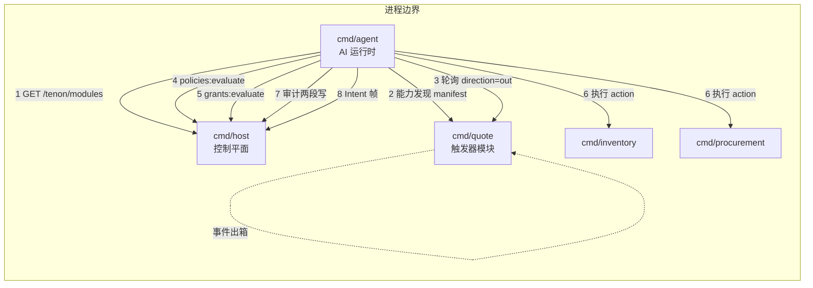

# M0.5 设计增量：宿主与 agent 运行时

- 状态：**待评审**
- 日期：2026-10-27
- 关系：是 [`2026-10-27-tenon-ai-driven-system-design.md`](2026-10-27-tenon-ai-driven-system-design.md) 的增量，不重复其九类契约与治理模型；只定义「谁实现宿主、谁扮演 agent」以及为此必须补的协议扩展。
- 前置实现：M0 内核已落地（spec 10 份 schema、`internal/spec`、`internal/protocol`、`tools/lint`、`internal/module`、`cmd/inventory`、`cmd/procurement`、`conformance`、`cmd/tenon`）。

---

## 0. 目标与非目标

**目标**

1. 让一致性用例 **C4（审计两段写 + 哈希链）** 与 **C5（fail-closed）** 从 SKIP 变为 PASS。
2. 让 **D1 差异测试** 能真跑：用 LLM 规划器证明「摘掉模块后 agent 行为自适应改变」。
3. 保持 **agent 与治理解耦**：agent 是可替换进程，换模型/换实现不改 host。

**非目标（本轮不做）**

- 前端共驾页面（只做到「帧能发、能回放」；页面属 M1）。
- dsh/cordis 原生宿主（D18 的「进程内路径」deferred，见 §7）。
- 多租户、真实凭证签发、MCP 双向。
- C6（事件重放）与 C7（补偿）的完整断言（M1）。

---

## 1. 架构：三进程



**为什么 agent 是独立进程**：D11 说「协议内核 + 多运行时」。把大脑塞进 host，等于换 agent 就得换宿主；独立进程后，D1 只改注册表，不动 agent 一行代码。

| 进程 | 端口 | 职责 | 不含 |
|---|---|---|---|
| `cmd/host` | 8080 | 策略、授权、审计链、注册表、共驾帧 | 任何 LLM 调用 |
| `cmd/agent` | 无（纯客户端） | 事件→技能→发现→规划→闸门→执行→审计 | 不开端口、不持久化状态 |
| `cmd/quote` | 8083 | 触发器模块，产出 `quote.completed` | 业务推理 |
| `cmd/inventory` / `cmd/procurement` | 8081 / 8082 | 已有 | — |

---

## 2. 契约增量（对 0.1 的扩展，必须在 CHANGELOG 与 interfaces.md 标明）

### 2.1 宿主侧端点从 4 个扩到 5 个 + 测试面

| 端点 | 状态 | 说明 |
|---|---|---|
| `POST /tenon/policies:evaluate` | 0.1 已有 | 实现落地 |
| `POST /tenon/grants:evaluate` | 0.1 已有 | 实现落地 |
| `POST /tenon/audit` | **新增** | 写审计（两段写）。0.1 只定义了 `GET`，没定义谁写、怎么写。agent 必须能写，否则 C4 无法成立 |
| `GET /tenon/audit?planId=&since=` | 0.1 已有 | 实现落地 |
| `GET /tenon/modules` | **新增** | 注册表读取：`[{id, baseURL, enabled}]`。agent 靠它知道去哪儿能力发现 |
| `WS /tenon/intents`（+ REST 降级） | 0.1 已有 | 实现最小版：能发帧、能通过 `GET /tenon/intents/poll` 回放 |
| `POST /tenon/admin/modules` | **测试专用** | 注册/摘除模块。仅 `TENON_TEST_MODE=1` 时挂载 |

> `POST /tenon/audit` 不是可选装饰：0.1 把「审计两段写」写成硬约束，却没给写入口，是一处规范缺口。本轮补上并把字段冻结为 `AuditEvent` schema 的子集（`stage`/`planId`/`stepId`/`decision`/`result`/`effects`/`prevHash`）。

### 2.2 模块发件箱（0.1 缺口 #6 的解决）

0.1 定义了 `GET /tenon/events?since=` 为「系统←模块：补课/重放」，但 `internal/module` 此前只把它读成「宿主投进来的事件」。模块自己产生的业务事件（`quote.completed`）**没有出口**。

扩展：

```
GET /tenon/events?since=<cursor>&direction=out|in&limit=<n>
```

- `direction=in`（**缺省**）：宿主投递进来的事件（保持 0.1 语义，向后兼容）。
- `direction=out`：模块自己产生的事件，供 agent 轮询。
- 响应形状不变：`{events, nextCursor}`。

### 2.3 测试态重置

```
POST /tenon/admin/reset        # 仅 TENON_TEST_MODE=1
```

恢复内存种子（库存、幂等表、事件表、游标）。**目的**：D1 两轮 A/B 的输入必须完全相同，否则「同一输入」的前提不成立。

---

## 3. 数据流（D1 的 A 轮，库存不足场景）

事件：`quote.completed`，`lines: [{sku: STD-1002, qty: 12}]`；在库 3。

1. 业务员调 `POST /tenon/actions/quote.CreateStandardPartQuote`（真实业务动作，非 mock）→ quote 写发件箱 `quote.completed`。
2. agent 轮询 `GET /tenon/events?direction=out` → 取到事件，按 `correlationId` 开回合。
3. agent 读 skill `quote-to-fulfillment`（`tenon.subscribes: ["quote.completed"]`）→ 决定「要思考」。
4. agent 拉每个模块的 `/.well-known/tenon` 摘要（**只拿 id/title/kind/risk/dryRun**）。
5. LLM 产出 Plan（JSON，按 `plan.schema.json` 校验）。需要细节时按 id 拉完整 Action。
6. 闸门顺序：`policies:evaluate` → `grants:evaluate` → 对每个 write 尝试 `:dry-run`。
7. 审计第一段 `POST /tenon/audit stage=dispatched`（失败即终止）。
8. 执行（带 `Idempotency-Key`），失败按 §5 分类处理。
9. 审计第二段 `stage=result`。
10. Intent 帧：`open(quote#…)` + `highlight(SKU 缺口 9)`。
11. 结局 `completed`。

**B 轮**：`POST /tenon/admin/modules` 摘除 procurement → 同一事件 → LLM 只能看到 quote/inventory，产出「扣 3 + 无力补足」→ 结局 `needs_human`，**不报错**。

---

## 4. LLM 规划器的接口

`internal/llm`：OpenAI 兼容 `/chat/completions`。

| 环境变量 | 说明 |
|---|---|
| `TENON_LLM_BASE_URL` | 缺省 `https://api.deepseek.com` |
| `TENON_LLM_API_KEY` / `TENON_LLM_API_KEY_FILE` | 二选一；文件优先 |
| `TENON_LLM_MODEL` | 缺省 `deepseek-flash` |
| `TENON_LLM_TIMEOUT` | 缺省 60s |

约束：
- **temperature=0**（D1 的可重复性，R7）。
- 输出必须是**单个 JSON 对象**，用 `response_format: {"type":"json_object"}`；仍失败则由 schema 校验兜底并重试 1 次。
- prompt 里**只能**出现从 manifest 动态获得的 action id；agent 代码中不得出现任何业务 action 字面量。

---

## 5. 错误与降级

| 情况 | agent 行为 | 是否可测 |
|---|---|---|
| Plan 不合 schema | 附校验错误重试 1 次 → 仍失败 `failed` | 单测（假 LLM 返回坏 JSON） |
| `retryable` | 指数退避最多 3 次，幂等键不变 | 单测 |
| `business_rejection` | 重新规划，上限 2 轮 → 再失败 `needs_human` | 单测 + D1 |
| `policy_denied` | 立即 `needs_human`，**不得换路绕过** | 单测 |
| `dispatched` 审计写失败 | **拒绝执行** | 单测（注入 500） |
| host 不可达 | fail-closed：不做任何写 | 单测 |
| 无可达 Plan（能力不足） | `needs_human`，Intent 帧说明缺口 | D1 B 轮 |
| 无 LLM key | agent 启动即失败，不静默降级 | 单测 |

---

## 6. 测试策略

| 层 | 方式 | 是否进 CI |
|---|---|---|
| `internal/controlplane` | 表驱动单测（policy 算子/合并/默认 deny、grant 交集/配额、审计链、两段写注入失败） | ✅ 无外部依赖 |
| `internal/module` 扩展 | 单测（outbox 方向、reset 幂等、TEST_MODE 关闭时端点不存在） | ✅ |
| `internal/llm` | `httptest` 假服务（正常 JSON、坏 JSON、超时、429） | ✅ |
| `internal/agent` | **假 LLM**（脚本化返回固定 Plan）→ 断言闸门顺序、审计两段、错误分类、重规划上限 | ✅ 不花 token |
| D1 端到端 | 真三进程 + 真 DeepSeek，`go test -tags e2e` 或 `tenon d1 run` | ❌ 默认不在 CI（花钱、依赖外部网络）；`tenon d1 run` 供手动/夜间跑 |
| conformance C4/C5 | 指向真 host | ✅（CI 里用进程内 host 的 httptest 变体） |

---

## 7. 与既有决策的关系（需要修订的地方）

| 决策 | 原内容 | 本轮修订 |
|---|---|---|
| D18 | demo 用 1 TS 插件 + 2 Go 侧车，测「进程内 + 跨进程」两条路径 | **本轮只覆盖跨进程**：host 选了 Go（决策 A），没有 TS 宿主，`quote` 也只能是 Go 侧车。「进程内路径」记为 deferred，等 dsh 集成时补。**不假装已覆盖。** |
| 宿主侧端点 | 4 个 | 5 个（+`POST /tenon/audit`、`GET /tenon/modules`），另加测试面 2 个 |
| 事件方向 | 设计文档时序图画成 push | 明确为 **agent 轮询模块 outbox**；push 通道留 v0.2 |
| D17 | 工具链 Go | 不变，且 host/agent 沿用同一模块与风格 |

---

## 8. 风险

| 风险 | 影响 | 缓解 |
|---|---|---|
| LLM 输出不稳定导致 D1 抖动 | 高 | temperature=0；只比 action 序列结构不比参数；失败重试 2 次取多数（R7） |
| D1 结论依赖「模型够聪明」 | 高 | B 轮只要求「不去调不存在的模块 + 转人工」，不要求它想出巧妙替代方案。**降低判据强度，换取判据可靠** |
| agent 无意中硬编码 action 名 | 高 | 代码 review + 后续给 Go 加 AST 检查（C10 目前只覆盖 TS/JS）；D1 是最终兜底 |
| 测试态端点泄漏到生产 | 中 | 仅 `TENON_TEST_MODE=1` 挂载；host 启动时打警告；文档标注 |
| DeepSeek 外部依赖 | 中 | `internal/llm` 走 OpenAI 兼容，可换任何兼容端点 |

---

## 9. 里程碑

| 阶段 | 内容 | 出口判据 |
|---|---|---|
| **P1 host** | controlplane（policy/grant/audit/registry）+ `cmd/host` | C4、C5 由 SKIP 变 PASS；单测覆盖默认 deny、两段写注入失败 |
| **P2 框架缺口 + quote** | outbox、TEST_MODE reset、`cmd/quote` | 模块能产出事件且 agent 能轮询到；reset 使两轮输入完全一致 |
| **P3 agent** | `internal/llm` + `internal/agent` + `cmd/agent` | 假 LLM 单测全绿；真 LLM 能跑通 A 轮（含审计两段） |
| **P4 D1 + 收口** | `tenon d1 run`、文档/容器、compose.m0 | A≠B 且 B 为 `needs_human`；报告可归档 |

---

## 10. 执行期调整（记录在案，避免文档与事实脱节）

| 调整 | 原计划 | 实际 | 理由 |
|---|---|---|---|
| **共驾通道** | `WS /tenon/intents` | **本轮只做 REST 三端点**：`POST /tenon/intents`、`GET …/poll`、`POST …/ack`；WS 升级留 M1 | Go 标准库没有 WebSocket 服务端；为 M0.5 引入一个 WS 依赖不值得。REST 三端点语义等价（能发帧、能回放、能确认），只是少了实时推送 |
| **并发验证** | 所有并发用例跑 `-race` | **本机不跑 `-race`**（`CGO_ENABLED=0` 且无 gcc/clang）；并发用例保留，靠 Mutex 临界区 + 端到端不变量论证；`registry` 已在容器内（`golang:1.26-alpine` + gcc）补跑 `-count=3 -race` 全绿 | 环境限制。**这是验证强度的真实缺口**：内存模型层面的竞争无法在本机机械排除，需在有 gcc 的 CI 补跑 |
| **controlplane 目录结构** | `internal/controlplane/{policy,grant,audit,registry}.go` 同包 | 拆成四个子包 `internal/controlplane/{policy,grant,audit,registry}/` | 四个部分并行实现时同包会互相打断编译；拆开后职责边界也更干净 |
| **审计记录字段** | 计划的字段清单不含 `trigger`/`inputHash`/`idempotencyKey`/`tokenUsage` | 已补齐 | 这四个是 `audit-event.schema.json` 的必填项；缺了会让落库记录不是 schema 完整事件，且**静默丢字段**比报错更难发现 |
