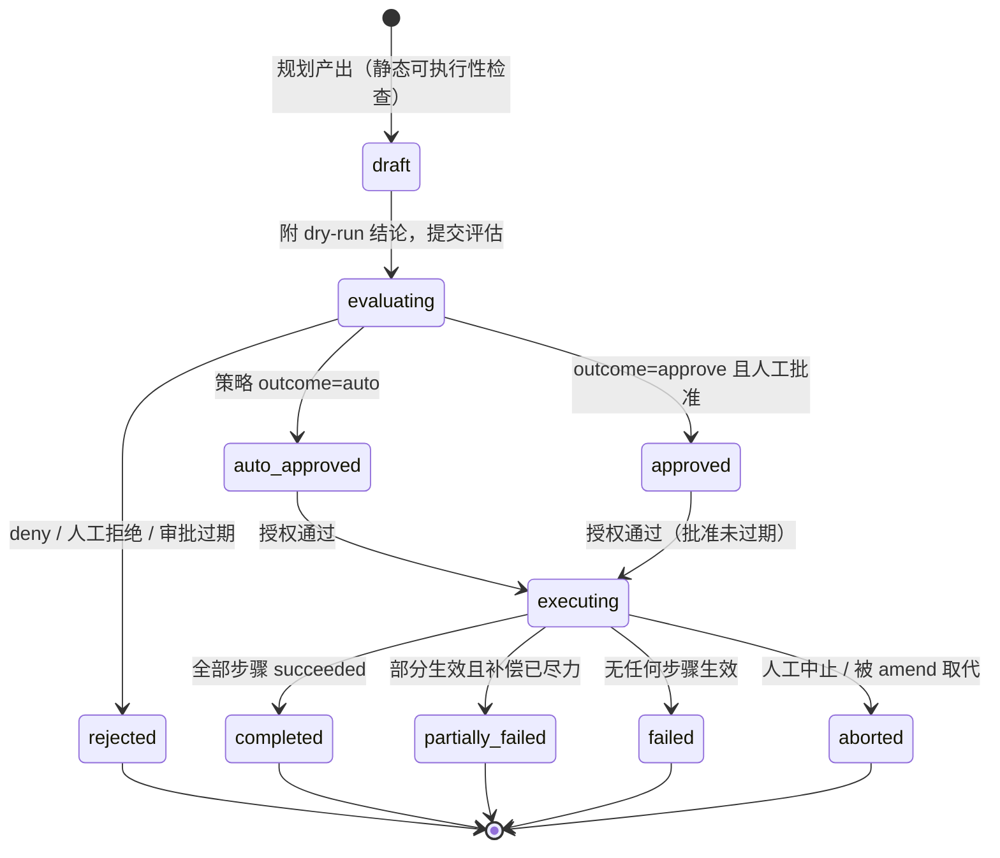
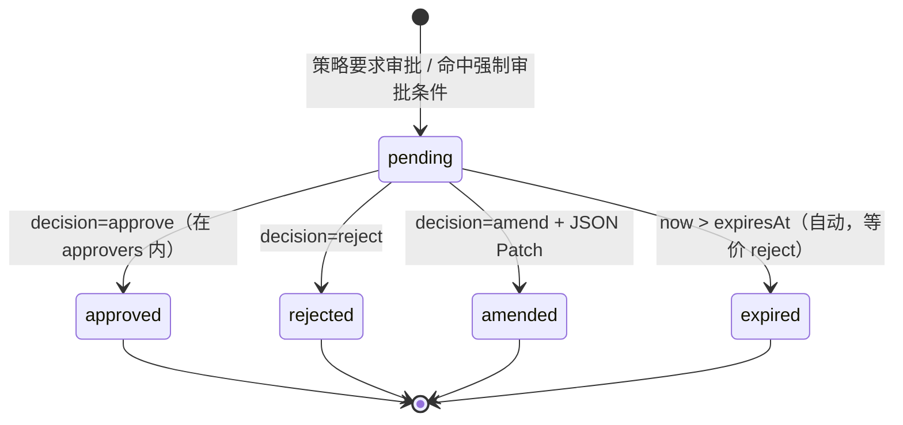
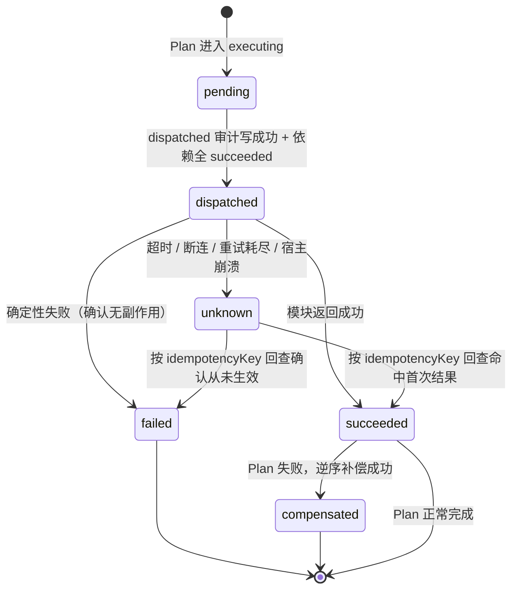
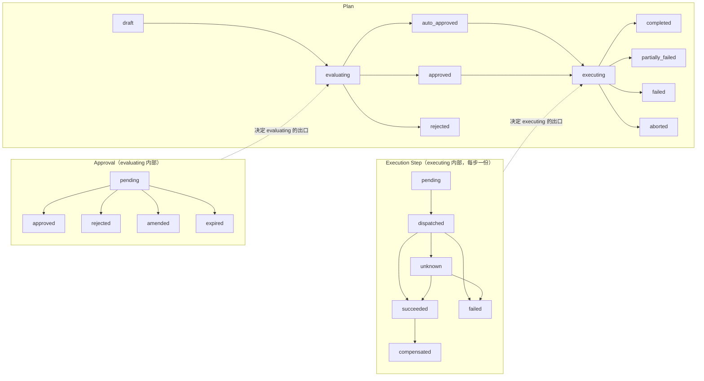

# 状态机（§5.1）

0.1 把三个状态机写死：**Plan**、**Approval**、**Execution Step**。它们是协议内条款，可被一致性用例断言，实现方不得自行增删状态或改迁移边。

---

## 0. 总则

1. **状态不进线格式。** Plan / Audit / Grant 报文里没有 `state` 字段：报文承载的是「计划的内容」「发生了什么」，状态是宿主与模块运行时持有的进度。同一个 Plan 可以被回放重建，但不会被重新执行。
2. **迁移必须先过闸门。** 状态推进不是计数器自增，每条边都绑定前置条件（见各表「前置条件」列）。闸门未过即停在原位。
3. **枚举的唯一副本**是 [`common.schema.json`](schemas/common.schema.json) 的 `PlanState` / `ApprovalState` / `ExecutionStepState`，一致性用例与实现共用它。
4. **`amended` 不是 Plan 状态。** amend 产生**新 Plan**（新 `planId`），新 Plan 的 `supersedes` 指回旧 `planId`（§4.4）。Plan 侧没有「被修改」这种状态，只有「被取代」（`aborted`）。
5. **非法迁移 = 实现 bug。** 统一按 [`errors.md`](errors.md) 的 `contract_violation` 处理：拒绝迁移、保持原状态、写审计、告警；不得静默纠正，也不得「就近取一个合法状态」。

---

## 1. Plan 状态机

### 1.1 状态

| 状态 | 含义 | 终态 |
|---|---|---|
| `draft` | 规划产出、尚未提交评估；此阶段做静态可执行性检查 | 否 |
| `evaluating` | 正在过闸门：dry-run 结论已附，策略评估与授权预检在此进行；若策略要求审批，本状态内部运行 Approval 子状态机 | 否 |
| `auto_approved` | 策略判定 `auto`，无需人工批准 | 否 |
| `approved` | 策略判定 `approve`，且已获人工批准 | 否 |
| `rejected` | 被策略拒绝、被人工拒绝，或审批过期 | 是 |
| `executing` | 正在逐步调度执行；各步状态见 §3 | 否 |
| `completed` | 全部步骤 `succeeded` | 是 |
| `partially_failed` | 部分步骤已生效、计划未完成；补偿已尽力执行，可能未完全回滚，需人工介入 | 是 |
| `failed` | 没有任何步骤产生生效结果，计划失败 | 是 |
| `aborted` | 被人工中止、被 amend 取代，或崩溃恢复后人工判定放弃 | 是 |

`failed` 与 `partially_failed` 的界线是「有没有留下已生效的副作用」，不是「错了几步」：前者可安全重来，后者必须人工核对。

### 1.2 合法迁移

| # | 从 | 到 | 触发 | 前置条件 |
|---|---|---|---|---|
| P1 | （起始） | `draft` | agent 产出 Plan | 通过 schema 校验；步骤依赖无环、`dependsOn` 引用存在；`risk.reversible=false` 的步骤都在末位 |
| P2 | `draft` | `evaluating` | 提交评估 | `dryRun.status` 已由 G1 填入（四态之一，不得缺失）；计划静态可执行（否则在 `draft` 直接拒，见 1.3） |
| P3 | `evaluating` | `auto_approved` | 策略 `outcome=auto` | `dryRun.status=verified`；未命中任何强制审批条件（不可逆、`dryRun≠verified`、幂等缺失等） |
| P4 | `evaluating` | `approved` | 策略 `outcome=approve` 且 `tenon.confirm` 的 `decision=approve` | 审批未过期；决定者在 `approvers` 范围内；`approvedBy` 可解析到具体主体 |
| P5 | `evaluating` | `rejected` | 策略 `outcome=deny`，或 `decision=reject`，或审批到期转 `expired` | — |
| P6 | `auto_approved` | `executing` | 开始调度 | 授权评估 `allowed=true`；目标动作未在 `unavailableActions` 中；`dispatched` 审计可写 |
| P7 | `approved` | `executing` | 开始调度 | 同 P6，且批准未过期 |
| P8 | `executing` | `completed` | 所有步骤 `succeeded` | 每一步都有成对的 `dispatched`/`result` 审计 |
| P9 | `executing` | `partially_failed` | 某步失败，逆序补偿已尽力执行 | 至少一步已生效，或补偿本身未成功 |
| P10 | `executing` | `failed` | 首步失败且无任何生效结果 | 已按 §3 判定为确定性失败 |
| P11 | `executing` | `aborted` | 人工中止、被 amend 取代、崩溃恢复后判定放弃 | 已生效步骤按逆序补偿（若其声明了补偿），未执行步骤保持 `pending` |

### 1.3 非法迁移

| 从 | 到 | 为什么非法 | 处理 |
|---|---|---|---|
| `draft` | `executing` | 跳过四道闸门，等于没有治理 | 拒绝迁移，`contract_violation` |
| `draft` | `auto_approved` | 跳过策略评估 | 拒绝迁移，`contract_violation` |
| `evaluating` | `executing` | 跳过批准与授权闸门 | 拒绝迁移，`contract_violation` |
| `auto_approved` | `completed` | 跳过执行，审计无法成对 | 拒绝迁移，`contract_violation` |
| `executing` | `evaluating` | 状态回退，且评估结论对已变更的计划已失效 | 拒绝迁移；如需改计划，走 amend 产生新 Plan |
| 任意终态 | 任意 | 终态不可迁出（`rejected`/`completed`/`partially_failed`/`failed`/`aborted`） | 拒绝迁移；后续动作只能由**新 Plan** 承载 |

**静态不可执行的 Plan 不进状态机。** 若步骤依赖成环、`dependsOn` 指向不存在的 `stepId`、`risk.reversible=false` 的步骤不在末位（§5.2 不可逆约束），宿主在 `draft` 阶段就拒绝并返回 `contract_violation`，该 Plan 不产生任何状态迁移——它从未可执行，不该留下「失败」的历史。

### 1.4 图

---

## 2. Approval 状态机

Approval 是 `evaluating` 内部的子状态机，由控制平面持有。它的终局决定 Plan 的出口（P4/P5/P11）。

### 2.1 状态

| 状态 | 含义 | 终态 |
|---|---|---|
| `pending` | 已发起审批，等待人工决定；`expiresAt` 已设定 | 否 |
| `approved` | 人工批准（`decision=approve`） | 是 |
| `rejected` | 人工拒绝（`decision=reject`） | 是 |
| `amended` | 人工改写（`decision=amend`），旧 Plan 作废、新 Plan 另起 | 是 |
| `expired` | 超过 `expiresAt` 自动过期，**语义等价 reject** | 是 |

### 2.2 合法迁移

| # | 从 | 到 | 触发 | 前置条件 |
|---|---|---|---|---|
| A1 | （起始） | `pending` | 策略 `outcome=approve`，或命中强制审批条件 | 已确定 `approvers` 非空且设定了 `expiresAt` |
| A2 | `pending` | `approved` | `tenon.confirm` 的 `decision=approve` | 未过期；`by` 命中 `approvers`；`patch=null` |
| A3 | `pending` | `rejected` | `decision=reject` | 未过期；`patch=null`；`by` 可解析到具体主体 |
| A4 | `pending` | `amended` | `decision=amend` | `patch` 为合法 JSON Patch；旧 Plan 的已执行步骤不受影响，未执行步骤被新 Plan 继承改动 |
| A5 | `pending` | `expired` | `now > expiresAt` | 自动触发，无需人来操作 |

### 2.3 非法迁移

| 从 | 到 | 为什么非法 | 处理 |
|---|---|---|---|
| `expired` | `approved` / `rejected` | 过期即等价拒绝，不得事后追认 | 拒绝；需要批准就重新评估并生成新 Plan（新的 `expiresAt`） |
| `approved` | `rejected` | 已生效的批准不可撤回；撤销要执行补偿，而不是改历史状态 | 拒绝；走补偿流程 |
| `rejected` / `amended` | `pending` | 不得重开同一份审批 | 拒绝；新 Plan 新审批 |
| `pending` | `approved` 但 `by` 不在 `approvers` 内 | 越权批准 | 拒绝，`policy_denied` |
| `pending` | `amended` 但 `patch=null` | amend 无内容 | 拒绝，`contract_violation`（schema 已禁止，此处为运行时兜底） |

### 2.4 图

---

## 3. Execution Step 状态机

### 3.1 状态

| 状态 | 含义 | 终态 |
|---|---|---|
| `pending` | 未调度：依赖未满足，或 Plan 已终止 | 否（Plan 终止后长期停留于此） |
| `dispatched` | 已发出调用（其 `dispatched` 审计已落盘），尚未拿到确定性结果；重试发生在本状态内部 | 否 |
| `succeeded` | 模块确认成功 | 否（Plan 回滚时可转为 `compensated`） |
| `failed` | 模块给出确定性失败，确认未产生副作用 | 是 |
| `compensated` | 曾成功，后因 Plan 失败被补偿成功 | 是 |
| `unknown` | 结果未定：超时、断连、重试耗尽或宿主崩溃 | 否（只能回查收敛） |

### 3.2 合法迁移

| # | 从 | 到 | 触发 | 前置条件 |
|---|---|---|---|---|
| S1 | （起始） | `pending` | Plan 进入 `executing` | 步骤在 DAG 中 | 
| S2 | `pending` | `dispatched` | 调度该步 | **该步的 `dispatched` 审计已写成功**（§5.1 硬前置）；依赖步骤全部 `succeeded` |
| S3 | `dispatched` | `succeeded` | 模块返回成功 | 有对应的 `result` 审计，`status=ok` |
| S4 | `dispatched` | `failed` | 模块返回确定性失败 | 错误属 `business_rejection` / `policy_denied` / `contract_violation` 且可确认未产生副作用 |
| S5 | `dispatched` | `unknown` | 超时、连接中断、重试耗尽、宿主崩溃 | 无法取得模块的确定性回答 |
| S6 | `unknown` | `succeeded` | 按 `idempotencyKey` 回查，模块返回首次结果 | 回查请求与首次调用使用同一幂等键 |
| S7 | `unknown` | `failed` | 按 `idempotencyKey` 回查，模块确认该键无记录（从未生效） | 同上 |
| S8 | `succeeded` | `compensated` | Plan 后续失败，逆序执行本步的 `compensation` | 补偿调用成功；补偿按「后成先进」的逆序进行 |

### 3.3 关于重试与 `unknown` 的三条判断

1. **重试不产生状态迁移。** 可重试错误（网络/限流/超时）在 `dispatched` 状态内部重试：每次尝试写一对 `dispatched`/`result` 审计，`auditId` 不同、`idempotencyKey` **不变**（§4.9 明确要求「幂等键不变」）。状态机因此不需要 `failed → dispatched` 这条回退边。
2. **重试耗尽后是 `unknown`，不是 `failed`。** 「可重试」不等于「未生效」：超时的写入可能已经落库。在拿到模块的确定性回答前只能记 `unknown`，否则对账会把已生效的写入当成未发生（§8 #4 的差异就是这样产生的）。
3. **只有确定性失败才是 `failed`。** `business_rejection`（如库存不足）由模块在副作用之前拒绝，因此可以断言未生效；`policy_denied` 与 `contract_violation` 同理。

### 3.4 非法迁移

| 从 | 到 | 为什么非法 | 处理 |
|---|---|---|---|
| `pending` | `succeeded` | 跳过 `dispatched`，等于没有执行前审计（§5.1 硬前置） | 拒绝迁移，`contract_violation`；该步不得被记为成功 |
| `pending` | `unknown` | 从未发出调用，不存在「结果未定」 | 拒绝迁移 |
| `dispatched` | `compensated` | 未确认成功的步骤不补偿：可能补偿了一个从未发生的写入（§5.2「失败步骤本身不补偿」） | 拒绝迁移 |
| `dispatched` | `pending` | 状态回退，会让同一步被重复调度 | 拒绝迁移 |
| `unknown` | `dispatched` | 未回查就重投，等于赌「上次没生效」 | 拒绝迁移；必须先按 S6/S7 收敛 |
| `unknown` | `compensated` | 结果未定，无从判断是否需要补偿 | 拒绝迁移 |
| `succeeded` | `dispatched` / `failed` | 已生效的结果不得重放、不得改写 | 拒绝迁移；需要撤销就走 S8 补偿 |
| `failed` | `compensated` | 失败步骤不补偿（§5.2） | 拒绝迁移 |
| `compensated` | 任意 | 终态 | 拒绝迁移 |

### 3.5 图

> 图中只有 `succeeded → compensated` 一条进入 `compensated` 的边。§5.1 的 ASCII 草图把 `compensated` 画在 `dispatched` 的分支上，那是「终态集合」的简写；按 §5.2「失败步骤本身不补偿」，真正能进入 `compensated` 的只有已成功步骤。

---

## 4. 三个状态机的关系

- **嵌套而非并列**：Approval 只在 `evaluating` 内存在，Step 只在 `executing` 内存在。
- **出口规则**：Approval 得 `approved` → Plan 走 P4 到 `approved`；得 `rejected`/`expired` → Plan 走 P5 到 `rejected`；得 `amended` → 旧 Plan 终止于 `aborted`，新 Plan 从 `draft` 重新开始。
- **Step 出口规则**：全部 `succeeded` → `completed`；存在 `failed` 且无生效副作用 → `failed`；存在已生效步骤无法完成 → `partially_failed`；存在 `unknown` 且回查不可用 → 停在 `executing` 并告警，不得直接判成功或失败。
- **`pending` 在 Plan 终止后的含义**：从未执行、无副作用，因此保持 `pending`，不引入 `skipped` 状态。状态集只减不增是 0.1 的取舍：多一个状态就多一条迁移边，就多一处实现分歧。
